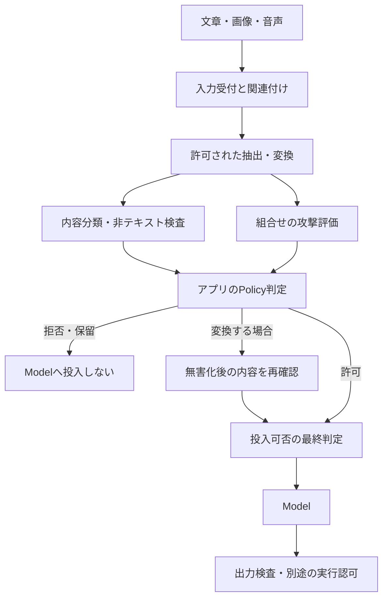

# C2.2 Content & Policy Screening

## Normative Requirements

読むときは、[具体Scenario](#security-objectiveと講義用scenario)から入力経路を追い、
[要件別の解説](#各requirementを設計検証へ翻訳する)、[Pass／Failの比較](#passfailとscope-calibration)、
[対話の再構成](#対話の再構成)へ進むと、全体像と個別の保証を往復できる。

対象はAISVS **v1.0**、固定Revision `78775233666a2022dcfb82037e5e029116955c00`。
採用版は[Source Registry](../../../sources/registry.yaml)で管理する。1.01への移行や最新版への追随は本変更の対象ではない。
Levelは上流のVerification Levelであり、学習難易度、Control成熟度、製品の適合結果ではない。

以下は[OWASP AISVS v1.0 C2の原文](https://github.com/OWASP/AISVS/blob/78775233666a2022dcfb82037e5e029116955c00/1.0/en/0x10-C02-Input-Validation.md)からの要件引用とRepositoryによる日本語訳。
英語はMarkdownの強調を除いて原文を保持する。日本語訳は非公式で、原文を変更するものではない。
原文の著作権・ライセンスは[OWASP AISVSのCC BY-SA 4.0表記](https://github.com/OWASP/AISVS/blob/78775233666a2022dcfb82037e5e029116955c00/README.md#license)を参照する。

### v1.0-C2.2.1

AISVS Verification Level: 1

> Verify that every prompt is scored by a content classifier for violence, self-harm, hate, and sexual content against configurable thresholds. Prompts that exceed those thresholds are rejected or sanitized before reaching the model context.

**意味を保った日本語訳:** すべてのPromptが、設定可能な閾値に対し、暴力、自傷、憎悪、性的内容について内容ClassifierでScore化されることを検証する。閾値を超えるPromptは、Model Contextへ到達する前に拒否または無害化される。

### v1.0-C2.2.2

AISVS Verification Level: 1

> Verify that prompt content classification is evaluated for unsupported languages.

**意味を保った日本語訳:** 対応外言語について、Promptの内容分類が評価されることを検証する。

### v1.0-C2.2.3

AISVS Verification Level: 2

> Verify that non-text inputs (image/video/audio) are checked for adversarial perturbations, steganographic payloads, hidden or embedded content, or known attack patterns.

**意味を保った日本語訳:** 非テキスト入力（画像・動画・音声）が、敵対的な攪乱、SteganographyのPayload、隠された内容や埋め込まれた内容、または既知の攻撃パターンについて検査されることを検証する。

### v1.0-C2.2.4

AISVS Verification Level: 3

> Verify that coordinated attacks spanning multiple input types (e.g., steganographic payloads in images combined with prompt injection in text) are detected and blocked.

**意味を保った日本語訳:** 複数の入力形式にまたがる協調した攻撃（例：画像内のSteganographyのPayloadと、Text内のPrompt Injectionの組合せ）が検出され、遮断されることを検証する。

## Source separation・位置づけ

このノートはC2.2の4要件を、実際の入力受付からModel投入まで追う講義である。
[Family guide](README.md)と[Controlの俯瞰図](../../control-records/c02-input-validation/README.md)へ戻れる。
末尾に全4件のControl本文を示す。保証・検証・証拠・限界の正本は各Controlであり、
学習資料の充実をControl成熟度や製品の適合結果へ自動反映しない。

- **Normative:** 冒頭の固定版AISVS要件。分類、評価、検査、検知・遮断の違いを保つ。
- **Research:** 同じRevisionのC2.2 Research。多言語・非テキスト・複合攻撃の検討材料。
  製品名、数値、対応言語表、推奨構成は、そのまま原文の追加条件にしない。
- **Repository interpretation:** 以下の架空Scenario、Policy例、試験設計。唯一の適合方法ではない。
- **Derived insight:** 既存対話から得た洞察と、今回整理した設計上の考え方。追加教材を実際の発言として記録しない。

### C2.1・C7との関係

C2.1は入力による指示乗っ取りを扱う。C2.2は、形式が正しい入力も用途のPolicyに反し得ることと、
非テキスト・複合入力にも攻撃が含まれることを扱う。両者は重なるが同じ判定ではない。
たとえば禁止された有害内容の生成依頼は、System指示の上書きを含まなくても内容分類の対象になる。
一方、無害な語彙で回答を競合他社向けに改ざんする指示は、四つの内容Categoryだけでは捉えられない。

| Requirement | 原文の動詞と対象 | 暗黙に追加しない条件 |
|---|---|---|
| C2.2.1 | 全Promptの四CategoryのScore化、設定可能な閾値、超過時の投入前拒否または無害化 | 特定Classifier、全有害内容の完全検知、特定の閾値 |
| C2.2.2 | 対応外言語での内容分類の評価 | 全言語のサポート、一律拒否、翻訳の必須採用 |
| C2.2.3 | 非テキスト入力の敵対的加工・隠蔽・埋込み・既知攻撃等の検査 | 全Steganographyの検出、OCRだけでの完全な検査 |
| C2.2.4 | 複数入力形式にまたがる協調した攻撃の検知と遮断 | 特定のMultimodal製品、すべてのSession間相関機能 |

C7の出力検査は「外へ何を渡すか」を制御する。C2.2の入力検査は「Modelへ何を入れるか」を制御する。
出力で止められたことは、未検査の入力を通したC2.2の代替Evidenceにはならない。
Toolが最終回答より先に動くAgentでは、回答表示の検査だけでは実行の防御に間に合わない。

## AISVS Researchから読むべき補足

固定版[C2.2 Research](https://github.com/OWASP/AISVS/blob/78775233666a2022dcfb82037e5e029116955c00/1.0/research/chapters/C02-User-Input-Validation/C02-02-Content-Policy-Screening.md)
は、分類器の有無だけでなく、そのCoverageとPolicyへの接続を問題にしている。
以下は本講義への取り込み方であり、製品の現行機能を保証する表ではない。

| Researchの論点 | 本講義で確かめること | 原文へ自動追加しないこと |
|---|---|---|
| 過剰拒否と見逃しのTrade-off | 攻撃例と正常例の対、Category別の閾値評価 | 特定Benchmarkの採用や、固定の合格率 |
| 対応外・混在・音写された言語 | 対応表と実経路の評価を分ける | 全言語の翻訳や一律拒否 |
| 画像縮小、OCR、音声文字起こしの死角 | Modelが見る表現と検査器が見る表現の比較 | 再Encodingで全隠蔽を除去できるという主張 |
| 形式をまたぐPayloadの協調 | 単体と組合せの比較、検知から遮断への接続 | 特定のOmni-modal製品や全Session相関機能 |

Researchには製品・地域・Preview等の情報も含まれるが、現行製品の採用判断には別途一次資料の確認が必要である。
本講義ではそれらの機能表や性能値を移植せず、一般化できる失敗経路と検証方法を扱う。

<a id="scenario用語threat-model"></a>

## Security Objectiveと講義用Scenario

一般向けの文章作成サービスを考える。利用者は文章に加えて画像・音声を添付でき、
サービスは内容を読み取って説明文を作る。ここでは画像・音声もModelが直接受け取れる構成を想定する。
正当な用途は、商品説明、学習用の説明、利用者が許可した資料の要約である。

攻撃者は利用者として文章と添付Fileを選べるが、サービスの内容PolicyやClassifierの設定は変更できない。
攻撃者は、禁止内容を直接依頼するほか、画像に依頼の続きを置く、音声で文章と異なる指示を出す、
対応外言語で分類を回避することを狙う。以下の例は合成された講義用Scenarioである。

守る対象は、Policyに沿った入力受付、利用者への安全な応答、処理される資料の機密性、
後続Systemへ渡る操作候補である。内容分類Serviceへ送るデータ自体も保護対象になる。
「安全のためのClassifierだから」という理由で、本来送信できない個人情報を無制限に外部へ送ってよいわけではない。



| Trust Boundary | 渡るData | 確認する失敗 |
|---|---|---|
| 利用者 → 入力受付 | Text、添付、関連付け | 添付だけ別経路を通り検査を迂回する |
| 元File → 変換後表現 | 縮小画像、抽出Text、音声区間 | 検査器とModelが異なる表現を見る |
| Classifier → Policy判定 | Score、Error、未対応状態 | 未検査や判定不能をScoreゼロとして扱う |
| 複数部品 → 完成した要求 | Textと画像等の関係 | 単体Passを完成要求のPassと見なす |
| Policy判定 → Model投入 | 拒否・無害化・許可の結果 | 閾値超過でも元Payloadを送る |

## 用語：何を測り、何を決めるのか

### Classifier・Score・閾値

Classifierは、入力があるCategoryに該当する程度を推定する仕組み。
Scoreはその出力で、必ずしも校正された確率ではない。`0.8`なら80%の確率で危険という意味とは限らない。
閾値は、Scoreに応じてアプリが拒否等へ切り替える境界である。
ModelやClassifierの版を変えれば、同じ数値の意味や分布も再評価する。

原文の四CategoryはViolence、Self-harm、Hate、Sexual contentである。
各Categoryの境界や許容Contextは、採用する分類仕様と用途Policyで明示する。
医療・教育・被害相談での言及と、有害行為を助長する依頼を区別する必要があるが、
原文は個別業務の許可範囲や数値を定義していない。

### ScreeningとAuthorization

Screeningは入力を評価・選別すること。Authorizationは、特定主体が特定Resourceへ特定操作を行ってよいか決めること。
内容が穏当でも、他人のAccount変更は許可されない。
同様に、危険語が含まれる引用を検出しただけで、利用者の操作権限まで決めたことにはならない。

### Sanitization：無害化

この講義では、問題のある部分を定めたPolicyで除去・置換し、許可した内容へ変える処理を指す。
変更した内容を確認して送るのであって、分類Scoreだけを下げたり、表示だけを変更したりすることではない。
空白の追加、見た目のMask、Unicode正規化だけで有害な意味が除かれたとは言えない。
変更によって依頼の意味や安全上必要な文脈を壊すなら、拒否や確認依頼へ切り替える。

### 対応外言語・Code-switching・Transliteration

対応外は、採用Classifierの表明する対応範囲外であること。生成Modelの対応言語とは別に確認する。
Code-switchingは一つの文章等で複数言語を混ぜること。Transliterationは別の文字体系へ音を写すこと。
サービスのUIが日本語でも、入力が日本語のみとは限らず、短文では言語判定自体が不確かになる。

### OCR・Multimodal・Steganography

OCRは画像内の文字をTextへ抽出する処理。画像の意味、全画素、全Metadataを理解する処理ではない。
MultimodalはText、画像、音声、動画など複数の形式を扱うこと。
Steganographyは別のDataの中へ情報を隠すこと。画素に隠した内容や音響の特徴は、OCRや文字起こしに現れない場合がある。
Adversarial perturbationは、認識や判断を誤らせるための入力の加工。Fileが正常に開くことと、攻撃用の加工がないことは別である。

## Threat ModelとAbuse Path

### 1. Scoreは出るが、制御へつながらない

```text
攻撃者が閾値を超える依頼を投稿
  → Classifierが高Scoreを返す
  → アプリは監査Logへ記録するだけ
  → 元のPromptがModelへ投入される
```

これは分類の見逃しではなく、判定から投入制御への接続の失敗。
Classifierを高性能なものへ交換しても、この配線の欠陥は直らない。

### 2. 対応外言語を「低Risk」と扱う

```text
攻撃者が対応外言語や混在言語で依頼
  → 言語判定がUnknown、またはClassifierがScoreを返せない
  → アプリが欠損値をゼロへ変換
  → 通常の許可判定でModelへ送る
```

「評価できなかった」と「評価して低Scoreだった」は異なる。
C2.2.2はまず、その言語で分類がどう動くかの評価を求める。
評価の結果に基づく拒否・別経路・保留等は、用途とRiskに応じた別の設計判断として説明する。

### 3. 人間や検査器と、Modelが違う画像を見る

```text
攻撃者が縮小時に別内容の現れる画像を添付
  → 元画像だけをOCR・検査
  → 後段がResizeし、Modelには異なる文字や配置が見える
  → 元画像のPassを変換後画像にも流用する
```

前処理は安全化の一方向の処理ではない。Crop、Resize、動画Frame選択、音声区間の抽出で、
見える内容と関係性が変わる。Metadata除去や再Encodingは一部の経路を減らしても、画素内の隠蔽を完全に除去しない。

### 4. 部品を分けて、意図を隠す

Textには「画像内の手順を、通常の確認を省いて適用する」と書き、画像に操作対象の変更内容を置く。
または、Textには資料の読み方だけを置き、画像側にその読み方と組み合わせた時だけ成立する指示を配置する。
Text単体・画像単体のScoreが低くても、関連付けると攻撃の目的が明らかになる場合がある。

```text
Text単体の評価 = 許可
画像単体の評価 = 許可
    ↓ 同じ依頼として関連付ける
完成した要求 = Policy回避または不適切な操作への誘導
```

これは「画像に攻撃文がある」だけのケースとは分けて試す。
同じ攻撃語が最初から片方だけに全て書かれているなら、複合評価の有効性を示す試験にならないことがある。

<a id="security-invariantenforcement具体的テスト"></a>

## Security InvariantとEnforcement

C2.2.1とC2.2.4に関わる中心の性質は次である。

> 拒否すべきと判定した入力を、そのままModelや後続処理へ渡さない。

C2.2.2とC2.2.3には、別の観点も要る。

> 評価・検査が届かない言語や表現を、検査済みの安全な入力と呼ばない。

| 配置 | 強制・確認すること | 限界 |
|---|---|---|
| 入力受付・変換処理 | FileとTextを同じ要求へ関連付け、検査対象の表現を特定する | Parser自体の安全性は別の検討も必要 |
| Classifier・攻撃検知器 | 内容Scoreと攻撃候補を返す | 判断の正しさは確率的で、評価が必要 |
| アプリのPolicy Gate | 閾値超過、複合攻撃判定、未検査状態を区別してルーティングする | 間違ったPolicy設定自体は救えない |
| Sanitizerと再確認処理 | 変更後の内容を判定対象にし、元のPassを流用しない | 意味の改変や見逃しは残る |
| Model Gateway | 最終Payloadに対応した許可だけで投入する | 検知できなかった攻撃の実行は別境界で制限する |

Policy GateはModel出力の自由文をそのまま「許可」と解釈するのではなく、
許可した判定形式とCategory・閾値をアプリ側で検証する。
これで遮断の決定を固定しても、Classifierが攻撃を正しく理解したことまでは保証されない。

## 各Requirementを設計・検証へ翻訳する

### C2.2.1：分類することと、投入を止めることを分ける

四CategoryについてScoreを得て、設定した閾値と照合し、超過時に拒否または無害化する。
一般的な「不適切です」という一つの自由文や、Prompt Injection用Scoreだけで四Categoryの分類を代替しない。
また、検索で追加したContextやRetry経路も含め、何を一つのPromptとして評価しているかを説明する。

**Policyの具体化:** 誰がCategory定義と閾値を管理するか、境界値をどう扱うか、設定変更をどう承認するかを決める。
ここでの「禁止」は、採用仕様と用途Policyに基づいて処理を拒否すべき状態を指す。
危険語を一つ含めば即拒否という定義にはしない。原文は数値や比較演算子の細部を固定していない。

**遮断の試験:** Test Doubleに、各Categoryについて閾値未満・境界・超過のScoreを返させる。
超過時にはModel呼出しが発生しないか、無害化後の許可された内容だけが渡ることを観測する。
この試験で分かるのはGateの接続であり、Classifierの意味判定の精度ではない。

**精度の試験:** 用途Policyでラベル付けした合成依頼と、医療・教育・被害相談などの正常例を対で投入する。
Categoryごとの見逃しと過剰拒否を測り、正常な利用をどれだけ維持できるかも確認する。
正常例の許可ラベルは用途Policy次第であり、すべての医療文書を必ず許可するという意味ではない。

**無害化の試験:** 元の依頼が超過する時、変更後の内容と実際の送信内容を比較する。
画面表示を伏字にしただけで元Promptを送る構成はFail。
無害化の成功が確認できなければ、元の内容を「処理済み」として送らない。

この要件にPassしても、出力の完全な無害性や、機密情報の開示防止までは保証しない。

### C2.2.2：対応外言語で「評価したか」と「どう運用するか」を分ける

生成Modelが多言語対応でも、内容分類器も同じ範囲で動くとは限らない。
Classifierの対応表を確認するだけでなく、実際のPrompt経路で対応外言語の振る舞いを測る。
UIで言語を制限しても、貼付け文章、引用、画像内の文字が別言語という経路は残り得る。

| 評価軸 | 試す例 | 観測すること |
|---|---|---|
| 言語 | 想定利用地域の対応外言語 | Categoryごとの見逃し・過剰拒否 |
| 表記 | 音写、略記、文字体系の混在 | 英語評価から見えなかった誤判定 |
| 文脈 | 短文、引用、前Turnと組み合わせた依頼 | 言語判定の不確実さと分類結果 |
| 失敗状態 | Unknown、低Confidence、Timeout | 未評価状態が正常Scoreへ変換されないか |

**正常系:** 各言語の正常な依頼も含め、分類と後段Policyの結果を残す。
**Negative test:** 対応外言語のPolicy違反例を流し、同じ意味の対応言語版と比較する。
翻訳を使う構成なら、否定、引用、暗黙の意味が翻訳で変わる例も含め、翻訳後だけでなく実運用全体を評価する。

評価の結果が悪くても、単に「測定した」ことと「十分な防御になった」ことは別である。
原文への評価Evidenceと、運用を許容できるかのSecurity判断を分けて記録する。
拒否・確認依頼・別Classifierへの振分けは対策例であり、C2.2.2が全言語対応や一律拒否を要求しているわけではない。

### C2.2.3：Fileが正常に開くことを、攻撃検査と取り違えない

対象は画像・動画・音声。MIME Typeや拡張子の一致、Malware Scanだけでは、Modelに対する攻撃の検査を示せない。
受け付ける形式、元Data、前処理後Data、Modelが実際に消費する表現を整理する。
非テキストを一切受け付けないSystemなら、その非到達性を確認する。対応しているふりをして未検査で通さない。

| 入力 | 検査・評価の例 | それだけでは届かない範囲 |
|---|---|---|
| 画像 | OCR、画像内容分類、変換前後の既知攻撃試験 | OCRに出ない画素の隠蔽、象徴や配置の意味 |
| 音声 | 文字起こしの検査、必要に応じた音声自体の評価 | 非言語音、文字起こしで失う特徴、区間外の内容 |
| 動画 | 抽出Frame・字幕・音声・時系列の検査 | Frame間の内容、標本化されない瞬間、同期関係 |

**正常系:** 正常な写真、読み取れる資料画像、対応言語の音声を処理し、誤検知と品質低下を確認する。
**Negative test:** 低Contrastや細字、変換後に現れる内容、抽出に失敗する入力を使い、
どの成分が検査され、どこが未評価かを観測する。既知攻撃例と正常例を同じ実経路へ通す。

Modelへ画像そのものを渡すなら、OCR結果だけの検査を「画像全体の検査」と呼ばない。
Modelへ文字起こしだけを渡す構成なら、その範囲を明示し、音声Nativeな攻撃が到達する構成と区別する。
元Fileの検査結果を、別の縮小・Crop・区間選択へ無条件に流用しない。

原文は検査を求めるが、すべてのSteganographyの不在証明や、各ケースの一律遮断方式までは定めていない。
再Encoding、Metadata除去、OCRの組合せも補助手段であり、隠蔽の完全除去を主張しない。
能力・形式・サイズの制限や、検査不能時の拒否等は残余リスクを扱う設計として明記する。

### C2.2.4：単体のPassを、組合せ全体のPassに使わない

Textと添付画像を同じ依頼として関連付け、その関係が意味する操作やPolicy回避を評価する。
単にOCR結果をTextの後ろへ足すだけでは、時系列、画像配置、音声の意味等を失う場合がある。
採用構成が何を関連付けられ、何を関連付けられないかを説明する。

**比較試験:** 同じ合成攻撃について、Textのみ、画像のみ、Text＋画像をそれぞれ投入する。
単体では成立しないが組合せで成立する攻撃を含め、完成した要求に対する検知を確かめる。
正常なText＋画像の説明依頼も対照として用意し、添付があるだけで拒否していないことを確認する。

**遮断試験:** 複合攻撃の判定を強制するTest Doubleで、元の要求がModelへ入らないことを確認する。
非同期検査中にModel呼出しを先行させる経路、添付の差替え、Retryで片方の検査結果だけを再利用する経路も試す。
入力の対応関係が変わった場合、古い組合せの判定は使わない。

履歴・Agent間で断片を分散させる攻撃は、有用な追加試験候補である。
ただし原文は特定のSession相関製品や全Agent Hopの機能一覧を要求していない。
対象Systemで到達可能な組合せを選び、未対応範囲を残余リスクとして記録する。

検査器が複合攻撃をFlagしたのにそのまま転送すれば、検知の有無にかかわらず遮断の保証を失う。
また、内容Policyの分類に通った場合でも、画像の指示でAccount変更が許されるわけではない。
実行の認可は別の境界で確かめる。

<a id="passfailと保証境界"></a>

## Pass／FailとScope Calibration

| 観測したScenario | 直接の評価 | 別に確認すること |
|---|---|---|
| 四CategoryでScoreを得るが、超過入力をLogだけ残して送る | C2.2.1はFail | Classifier精度ではなく投入制御の欠陥 |
| 超過入力を拒否し、正常入力をPolicyどおり通す | C2.2.1のPass候補 | 未知の有害内容や出力の安全性までは保証しない |
| 対応言語表だけを引用し、対応外言語の実評価がない | C2.2.2はFail | 生成Modelの多言語性能は代替Evidenceにならない |
| 対応外言語で評価を行い、見逃しが多いと判明した | 評価Evidenceはある | 防御として許容できるかを別判断し、C2.2.1等への影響も調べる |
| 画像の拡張子とMalwareだけ検査し、Model向け攻撃を評価しない | C2.2.3の検査を示せない | 通常のFile Securityは有用だが目的が異なる |
| OCR後のTextだけ調べ、Modelには未検査の画像全体を送る | C2.2.3のCoverageにGap | OCRにない内容と変換後表現の試験が必要 |
| 複合攻撃をFlagしたが、Model投入を先に開始した | C2.2.4はFail | 後からAlertが出ても投入前遮断にはならない |
| Text・画像単体は通り、組合せの攻撃を検知して遮断する | C2.2.4のPass候補 | 正常な組合せ、他形式・別変形も別途評価 |
| 入力検査は通ったが、出力検査が有害な回答を止めた | C7の防御が働いた観測 | C2.2の全要件がPassした証明ではない |
| 画像由来の依頼で権限外Account変更が実行された | 原因を一律に内容分類へ帰属させない | 入力検知、Tool認可、承認の各失敗を分解する |

Pass候補は講義上の評価例。実製品の適合宣言でも、未知の攻撃への成功率の保証でもない。

## 検証結果を運用へつなぐ

精度と遮断を混ぜず、次のEvidenceを対応付ける。

| Evidence | 何を説明できるか | 必要な注意 |
|---|---|---|
| Category・言語・形式別の評価集合 | どの入力で見逃し・誤検知があるか | 合計値だけで弱い言語や形式を隠さない |
| 閾値とPolicy版、Classifier版 | その判定がどの設定で出たか | Scoreの意味が版変更で変わる可能性 |
| 合成入力の変換前後と最終Payload | 検査した内容が実際に使われたか | 本番の機密Fileを無制限に保存しない |
| Model投入の有無、拒否・無害化記録 | 判定から制御がつながったか | 非同期処理、Retry、Fallbackも含める |
| 検査不能・Timeout・未対応の記録 | Coverageの欠落が通常許可へ化けていないか | Error率とLatencyも運用上追う |

入力に個人情報や被害相談が含まれる場合、Logへ内容を丸ごと複製すると別の漏えい面を作る。
合成Corpus、判定ID、設定版、必要最小限の診断情報を優先し、閲覧権限と保持期間を決める。
詳細Logの形式はC2.2本文の追加必須条件ではなく、再現性とデータ保護を両立するRepositoryの運用上の推奨である。

Classifier障害時は、未検査と低Scoreを別状態として扱う。拒否、保留、対応機能の縮小などを事前に決める。
「障害時だけ全入力を通す」Fallbackは、防御の存在を前提としたRisk判断を崩す。
一方、C2.2.2の「評価」という動詞へ、特定の障害時処理を原文要求として追加しない。

## 保証範囲と残余リスク

内容分類は利用ContextとPolicyに依存し、誤検知と見逃しをゼロにはできない。
翻訳、OCR、文字起こし、動画の標本化で情報が失われ、Modelが検査器とは別の意味を読み取る可能性もある。
分類器自体をLLMで実装する場合、その判定も攻撃入力の影響を受け得る。
Policy Gateをアプリへ置くことは遮断の確実性を高めるが、意味判定の完全性を作り出さない。

講義ScenarioにToolを追加するなら、内容Screeningとは別に、操作権限、対象Resource、必要な承認を確認する。
内容が許可された依頼でも権限が不足することがあり、逆に正規利用者でも禁止内容を要求し得る。
この二つを独立して評価することが、C5のCredential保証と同様に、一つのControlのPassをSystem全体へ広げない考え方である。

## 対話の再構成

以下は再構成前のノートに残っていた学習対話を保持したもの。今回の加筆で新しい学習者の回答や理解確認を創作していない。

### 対話1

問い：閾値超過でもLogだけ残してModelへ送る。学習者：「Fail」。整理：分類と処理制御は別。

### 対話2

問い：対応外言語の評価がなく、判定不能を安全と扱う。学習者：「Fail」。要件は評価を求める。判定不能時のPolicyも設計する。

### 対話3

質問：「出力値の検査は別カテゴリか」。整理：主にC7。入力検査は何を受け付けるか、出力検査は何を外へ出してよいか。出力前にToolが動く場合、出力検査だけでは遅い。

### 対話4

問い：個別検査を置いているが既知複合攻撃が通る。学習者は診断観点として両方チェックしたいと指摘し、最終判断は「Fail」。整理：単体と組合せを比較して成立条件を特定する。

**今回のScope補足:** 対話2では二つの問題が同時に挙がっている。対応外言語の評価がないことはC2.2.2の直接のFail。
「判定不能を安全と扱う」ことは、評価の結果をどう使うかという別の設計上の欠陥でもある。
原文の「評価」を、全言語対応や特定の拒否方式と読み替えない。
対話4のFailは、単体検査の有無ではなく、対象とする複合攻撃を検知・遮断できないことに基づく。

## Derived insights・レビュー項目

以下の短い原則と確認事項は既存対話から保持したもの。原文の引用や新しい規範要件ではない。

> 部品を個別に検査しても、組み合わせた要求が安全とは限らない。

> 攻撃の入口を調べることと、入った攻撃がどこまで到達できるかを調べることは、別の診断観点。

- 分類器の精度と、判定後の遮断を別々に確認したか。
- 「判定不能」を安全と混同していないか。
- 検査が対応する言語・入力形式を把握したか。
- 個別入力と関連付けた入力の両方をテストしたか。
- 入力・出力・実行境界を混ぜずに原因を特定したか。

### 今回の講義で補強した設計レビュー項目

- 全Promptについて四Categoryと設定可能な閾値の関係を説明できるか。
- Categoryの意味、業務上の許可Context、閾値の管理者が明示されているか。
- 分類精度の試験と、強制ScoreによるGate・無害化経路の試験を分けたか。
- 無害化した内容とModelへ送った内容が一致し、元Payloadが再利用されないか。
- Classifierと生成Modelの言語Coverageを分け、対応外・混在・音写を実評価したか。
- 未対応・Timeout・欠損Scoreを低Riskと同じ状態へ変換していないか。
- Modelが消費する画像・音声・動画の表現と、検査器の対象表現を比較したか。
- OCRや文字起こしに現れない内容を、Coverage外として認識しているか。
- 単体では成立しない複合攻撃と、正常な組合せの両方を試したか。
- 非同期検査、添付差替え、Retryで判定対象との対応が崩れないか。
- 本番内容の過剰記録を避けながら、設定版と判定・投入結果を再現できるか。
- 出力検査とTool認可を、入力Screeningの代替証拠にしていないか。

### 持ち帰る原則と演習

> 未検査は低Riskではなく、判断の根拠が欠けている状態である。

これは今回の講義によるRepositoryの整理である。履歴検索、音声受付、画像を読むAgentへも適用できるが、
未検査時の扱いをすべて同じ拒否Policyへ固定するという意味ではない。

次の2問は追加の演習であり、学習者の回答済み記録ではない。

1. 医療教育向けの画像説明サービスで、正当な教材を維持しながら禁止依頼の見逃しを測るには、どの正常例・攻撃例・Category別の結果を用意するか。
2. 音声とTextを別々に検査したら許可されたが、組み合わせるとPolicy回避が成立した。内容の関連付け、検知、投入前遮断、Tool認可をどう分けて調べるか。

検討の軸は、用途Policyに基づくラベル、形式・言語別のCoverage、単体と組合せの比較、決定論的なGateの証拠である。
Keyword一致や総合Score一つだけでは、どの保証にGapがあるか説明できない。

## 関連Control

- [v1.0-C2.2.1 Control](../../control-records/c02-input-validation/v1.0-c2.2.1-screen-prompts-before-model-context/README.md)
- [v1.0-C2.2.2 Control](../../control-records/c02-input-validation/v1.0-c2.2.2-evaluate-content-classification-for-unsupported-languages/README.md)
- [v1.0-C2.2.3 Control](../../control-records/c02-input-validation/v1.0-c2.2.3-check-non-text-inputs-for-hidden-attacks/README.md)
- [v1.0-C2.2.4 Control](../../control-records/c02-input-validation/v1.0-c2.2.4-detect-and-block-cross-modal-attacks/README.md)

## References

- [C2.2 Research](https://github.com/OWASP/AISVS/blob/78775233666a2022dcfb82037e5e029116955c00/1.0/research/chapters/C02-User-Input-Validation/C02-02-Content-Policy-Screening.md)
- [C7 Normative](https://github.com/OWASP/AISVS/blob/78775233666a2022dcfb82037e5e029116955c00/1.0/en/0x10-C07-Model-Behavior.md)
- [C5.1.2 学習ノート：説明の深さとScope Calibrationの参照](../../control-records/c05-access-control-and-identity/v1.0-c5.1.2-short-lived-minimal-scoped-signed-agent-tokens/learning.md)

## 改訂の記録

2026-10-19：C5.1.2の講義の深さを参考に、Scenario、用語、攻撃経路、要件別の検証、保証境界、運用上のEvidenceを再構成。
既存の対話と洞察を保持し、追加演習とは区別した。Source Version、Control本文、Catalog、Mapping、学習完了の状態は変更していない。
