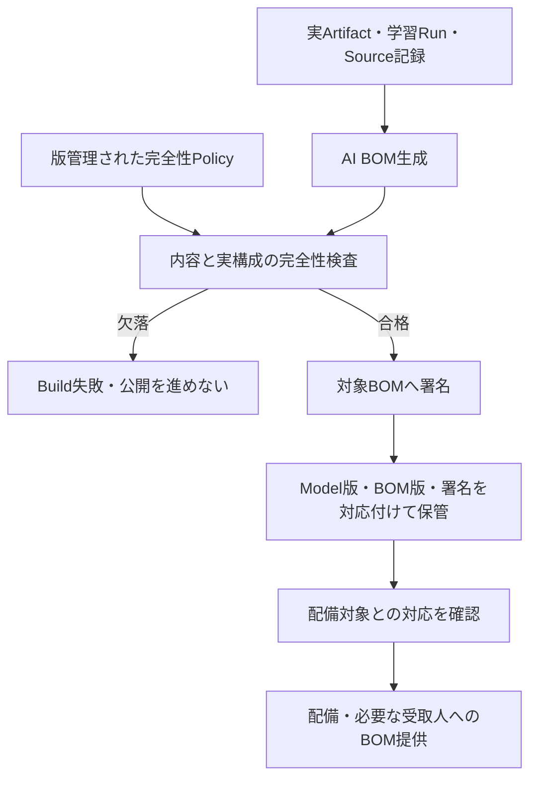

# C6.2 AI BOM & Supply Chain Monitoring

## Normative Requirements

対象はAISVS v1.0、固定Revision `78775233666a2022dcfb82037e5e029116955c00`。
採用状態は[Source Registry](../../../sources/registry.yaml)を参照する。1.01への移行は本教材の対象ではない。
Levelは上流のVerification Levelであり、学習難易度・Control成熟度・製品適合ではない。

以下は[固定版C6の要件原文](https://github.com/OWASP/AISVS/blob/78775233666a2022dcfb82037e5e029116955c00/1.0/en/0x10-C06-Supply-Chain.md)から、Markdownの強調だけを除いた引用と、Repositoryによる非公式日本語訳。
引用・翻訳元の帰属とLicenseは[OWASP AISVSのCC BY-SA 4.0表記](https://github.com/OWASP/AISVS/blob/78775233666a2022dcfb82037e5e029116955c00/README.md#license)を参照する。

### v1.0-C6.2.1

AISVS Verification Level: 1

> Verify that every model artifact publishes a version-controlled, machine-readable AI BOM listing datasets, weights, licenses, and data-origin statements.

**意味を保った日本語訳:** 各Model Artifactが、Dataset、重み、License、Data由来声明を列挙する、版管理された機械可読AI BOMを提供することを検証する。

### v1.0-C6.2.2

AISVS Verification Level: 2

> Verify that AI BOMs are cryptographically signed before deployment.

**意味を保った日本語訳:** AI BOMが配備前に暗号学的に署名されることを検証する。

### v1.0-C6.2.3

AISVS Verification Level: 2

> Verify that AI BOM completeness checks fail the build if any component metadata is missing.

**意味を保った日本語訳:** Component Metadataに欠落があれば、AI BOMの完全性検査がBuildを失敗させることを検証する。

## この文書の役割とSource separation

C6.2は、Modelの材料を追える文書を作り、その文書へ署名し、必要情報が欠けたBuildを止めるSectionである。
[Family学習ガイド](README.md)と[C6.1の講義](v1.0-c6.1-model-artifact-integrity.md)からも参照できる。
末尾の個別Controlが保証・検証・証拠・限界の正本である。

- **Normative:** 冒頭の固定版AISVS要件。BOMの提供、配備前署名、Metadata欠落時のBuild失敗を別々に扱う。
- **Research:** 同じRevisionのC6.2 Research。AI特有の構成情報、署名対象、Schema適合と完全性の違いを補足する。
- **Repository interpretation:** 以下の架空Release、Data構造、Gate、試験・Evidence候補。唯一のBOM形式や実装ではない。
- **Derived insight:** 比較から導いた設計上の整理。実際の学習対話に由来する結論とは区別する。

2026-10-22に学習対話を追記した。理解確認は継続中。試験の記述は期待結果であり、実製品での実施結果ではない。
学習資料が完成しても、Control成熟度、製品適合、Mapping、新版採用を変更しない。

## C6における位置づけ

C6.1は外部Model等の取得・検査・受入れを扱う。
C6.2は、どの材料でどのModelができたかを後から扱える構造化情報と、その保護・完全性のGateを扱う。
BOMがあるからC6.1のCode Scanや受入試験が済んだとは言えない。

| Requirement | 直接問うこと | それだけでは言えないこと |
|---|---|---|
| C6.2.1 | 各Model Artifactに版管理された機械可読BOMがあり、四つの情報区分を含む | 記載が真実である、BOMへ署名がある |
| C6.2.2 | 配備前にBOMの内容へ暗号署名がある | 記載が完全・正確である、Model自体にも署名がある |
| C6.2.3 | Component Metadata欠落を検出するとBuildが失敗する | Schemaに合うだけで情報が十分である、供給網が無害である |

Section名のSupply Chain Monitoringは、BOMから影響する版や構成を探せる運用へつながる。
ただし三つのRequirement本文から、特定の脆弱性Feed、監視頻度、応答時間、製品の導入義務は導かない。

## Security Objectiveと具体Scenario

会社はC6.1で受け入れた文書分類Modelを、自社の問い合わせDataで追加学習してRelease R1を作る。
R1は基盤重みW1、Adapter A1、Dataset D1、Tokenizer T1、設定C1を使う。
次のRelease R2ではDatasetをD2へ更新し、AdapterもA2へ変わる。

後日、基盤ModelやDatasetに供給網上の問題が見つかったとする。
運用者は、R1とR2のどちらが対象か、どのData由来・利用条件に関係するかを調べたい。
一方、攻撃者はBOMの保存先や生成入力の一部を変更し、問題のComponentを隠す、別ModelのBOMを添える、配備後に署名する等を狙う。
攻撃者が社内の信頼する署名鍵・完全性Policyまで自由に変えられるとは仮定しない。

守る資産は、Releaseと構成の対応、Data由来と権利条件、BOMの内容・署名、Build・配備の判定、調査の再現性である。
必要な社内担当者や受取人が対象版のBOMを取得できることも重要になる。
ここでのPublishは適切な利用者へ提供する意味であり、機密Dataや内部構成をInternetへ無制限公開する要求とは解釈しない。

これは一つの設計例。原文は署名の前後に全処理をこの順序で並べることまでは指定しない。
必要なのは、対象版のBOMがあり、配備前にその内容へ署名し、欠落があれば実Buildを失敗させることである。

## 用語：BOMが表すものと表さないもの

### BOM・AI BOM・Component

BOMはBill of Materials、材料・構成要素の一覧と関係を表す文書。
AI BOMではDataset、重み、License、Data-origin Statementなど、AIに関する材料と由来を機械処理可能にする。
Componentはその一覧に含める単位。Model名一つだけで、別AdapterやDatasetを使った版まで区別できるとは限らない。

### Version-controlledとMachine-readable

版管理は、過去と現在の内容、Modelとの対応を識別できること。
同じFile名へ上書きし、前版を失うこととは異なる。
機械可読は、合意した構造としてParserやPolicyが項目・関係を扱えること。
PDFに文字が入っているだけ、説明文を丸ごとJSONの一Fieldへ入れただけでは、必要な構成照合ができるとは限らない。

### Data-origin StatementとLicense

Data-origin Statementは、Dataがどこから来たかについての声明・記録。
Licenseは利用条件の根拠となる情報であり、取得URLやModelの人気とは別である。
Dataの供給者が述べた出所と、自組織が独立に確認した出所は区別する。
声明の存在は真実の証明でも、あらゆる用途への利用許諾でもない。

### Schema ValidityとCompleteness

Schema適合は選んだ文書形式の構造・型等へ合うこと。
Completenessは、実際に存在するComponentと、必要なMetadataが欠けていないこと。
形式上任意のFieldであっても、対象用途の完全性Policyでは必須にする場合がある。
反対に、実際に存在しない要素を埋めるため架空のDatasetを作らない。

### Signatureと署名対象

暗号署名は、署名対象の内容と署名者の結び付き・変更を検証する仕組み。
Model本体の署名とBOM文書の署名は、対象が違う。
署名済みBOMを正しく検証しても、最初から誤って書かれた由来や欠けた構成物を正しくすることはできない。

### Build・Deploy・Gate

BuildはRelease成果物を作成・検査する処理、Deployは利用環境へ配備する処理。
Gateは結果に従って先へ進めるかを強制する境界である。
検査Commandが非ゼロで終了しても、CIが失敗を無視して成功扱いで公開するなら、実効的なBuild失敗にはなっていない。

## Trust BoundaryとAbuse Path

| 境界 | 失敗する経路 | 確認すること |
|---|---|---|
| 実構成・Run記録 → BOM生成 | 生成器が重みだけ見てDatasetやAdapterを落とす | 生成器と独立した実構成からも照合する |
| 外部の由来情報 → 内部のBOM | 未確認の声明を確認済み事実と書く | 記載根拠と未確認を区別する |
| BOM → 署名者・Verifier | 別版・別内容の署名を添付する | 内容・対象・署名者・時点を対応付ける |
| 検査結果 → Build状態 | 欠落をWarningへ落として公開する | 実Buildが失敗し後続が進まないか追う |
| Release保管 → 調査者 | 古いBOMを上書きし、過去版が辿れない | Model版とBOM版の履歴を保持する |

攻撃者がいなくても、手作業の転記や生成器のCoverage不足で同じ失敗は起こる。
署名ServiceやBOM生成器も供給網の一部であり、名前だけで正しいと信頼しない。

## 小さなReleaseの対応表を作る

以下は構造を理解するための合成例。標準BOMのSchemaでも、適合済みの完成BOMでもない。
実際のField名や参照方法は採用形式へ合わせる。

| 対応させる情報 | R1の例 | R2の例 |
|---|---|---|
| Model Artifactの識別 | R1とその内容Digest | R2とその内容Digest |
| 基盤重み | W1の版と照合情報 | W1の同じ版と照合情報 |
| 追加構成物 | A1、T1、設定C1 | A2、T1、設定C2 |
| Datasetと由来声明 | D1、収集・提供元の記録への参照 | D2、変更された由来情報への参照 |
| License | 対応Componentごとの条件・参照 | 更新したComponentの条件・参照 |
| BOMの版 | B1 | B2 |
| BOMの署名 | B1の内容に対する署名 | B2の内容に対する署名 |

原文の四区分はDataset、Weights、Licenses、Data-origin Statements。
AdapterやTokenizer等の記載は実構成の漏れを避けるための具体化であり、全Systemへこの表の固定Field名を要求するものではない。
B1をR2へ流用すれば、文書は存在しても現在の構成を説明できない。

## Requirement別の設計・試験・Evidence

### C6.2.1：各Model版から、そのBOMを取得・解析できるか

生成Jobを一回実行するだけでは、各Artifactへ対応したBOMの提供を示せない。
対象一覧を定め、四情報区分を構造として記載し、Model更新後も過去版との対応を保つ。
機密性に応じた提供先の制限は可能だが、必要な受取人が対象版を参照できることを確認する。

**Security Invariant:** 全対象Model Artifactに、版を識別でき、必要情報を機械処理できるBOMが提供される。
Enforcement／確認地点はBOM生成・版管理Store・配布Metadata・利用者の取得経路である。

| 試験 | 観測すること |
|---|---|
| 正常系 | R1・R2それぞれのBOMを取得し、Parserで四情報区分とModel版への対応を辿る。 |
| Negative：記載 | Datasetまたは由来声明を省き、必要情報の欠落として発見する。 |
| Negative：対象 | R2を登録したのにBOMはR1しかない状態を作り、対象漏れを発見する。 |
| Negative：履歴・形式 | 前版を上書きする、自由文PDFだけを提供する等で、版対応や構造の不足を確認する。 |

**Evidence:** 対象Artifact一覧、ModelとBOMの版対応、構造化文書、受取人による取得・解析結果。
BOMをParserで読めることと、記載が真実であることは別に扱う。
ProviderのData由来が非開示なら、その部分は未立証であって、空欄を都合よく埋めた完成BOMにはしない。

### C6.2.2：署名は、配備前のそのBOM内容に付いているか

署名Fileが同じDirectoryにあるだけでは、BOMの内容に対応しているか分からない。
署名対象の内容、署名者・信頼根拠、BOMとModel版の対応、署名と配備の順序を追う。
署名時刻の自己申告だけに依存せず、Build・Release記録等との対応も確認する。

**Security Invariant:** 配備前に、配備対象へ対応するBOM内容に有効な暗号署名がある。
署名の生成はBuild／Signing処理、証拠の確認はVerifierとRelease記録が担う。
配備時Verifierを強制することは有用な運用設計だが、原文の署名事実と同じ動詞ではない。

| 試験 | 観測すること |
|---|---|
| 正常系 | R1のB1へ配備前に署名し、内容との一致・署名者・順序を検証する。 |
| Negative：内容 | 署名後にB1の由来Fieldを変更し、署名が変更後内容に対応しないと分かる。 |
| Negative：対象 | B1の署名をB2へ添付し、別内容の署名を流用していないかを確認する。 |
| Negative：時点 | 配備後に初めて署名した履歴を用意し、配備前の条件を満たさないと判定する。 |

**Evidence:** BOMの正確な版・内容、署名・検証情報、署名Identity、Release・配備との順序。
鍵やSigning Credential自体は教材・BOM・Logへ埋め込まない。
鍵更新後の旧BOMの検証、Signer侵害時の扱いも運用で設計する。

署名済みBOMに誤ったLicenseや未記載Componentがある場合、C6.2.1・C6.2.3等の別評価が必要になる。
Model本体の署名しかない場合、BOM署名を得たとは言えない。
透明性Log、特定の署名Envelope、特定製品の採用は、この原文から一律に必須化しない。

### C6.2.3：不足の発見を、実際のBuild失敗へ接続する

まず実構成と必要Metadataを定義する。Schema上任意、空文字、`unknown`、参照先が不存在という状態を、
用途上どこまで完成情報とみなせるかをPolicyで明示する。
`unknown`という文字があることは、不明を正直に表すことはできても、由来を立証したことにはならない。

**Security Invariant:** Component Metadataが欠けたBuildは成功しない。
Enforcement Pointは保護されたBuildの完全性検査と、結果を取り込むCI・公開制御。
生成器が見落としたComponentは文書内の必須Field検査だけで見つからないので、実構成からの照合も要る。

| 試験 | 観測すること |
|---|---|
| 正常系 | 必要情報を満たす合成BOMで実際のBuild検査が成功する。 |
| Negative：値 | 必須のData-origin FieldやLicense情報を消し、同じBuild経路が非成功となる。 |
| Negative：成分 | 実構成にはあるAdapterをBOMから丸ごと落とし、形式が正しくても不足を検出する。 |
| Negative：制御 | 検査失敗をWarning、`continue-on-error`等で無視する構成を試し、実Buildが成功・公開してしまわないか追う。 |
| 復旧確認 | 不足を正しく補い、同じPolicyで再Buildした場合に正常経路へ戻る。 |

**Evidence:** 実構成一覧、完全性Policy・生成器版、BOM版、欠落Fixture、検査結果、実Build状態・後続Jobの有無。
Test Doubleで失敗を強制する試験は、CI接続の確認にはなるが、実際のMetadata欠落検出の証拠にはならない。
逆に欠落を検出しただけでも、Buildが失敗しなければ原文の要求を満たさない。

署名済み・Schema適合のBOMでも、必要情報が不足する場合がある。
例外承認でBuildを通す運用があるなら、そのRisk受容と本要件のPassを読み替えない。
外部Providerの非開示は情報Gapとして扱い、検査を無効化することで完全性を作らない。

## Pass／FailとScope Calibration

| 観測 | 評価 |
|---|---|
| 機械可読・版管理されたBOMはあるが未署名 | C6.2.1にはPassし得る。C6.2.2の署名は別に必要。 |
| Model本体は署名したがBOMは署名しない | C6.2.2はFail。署名対象が違う。 |
| 配備前に正しく署名したが由来情報が欠落 | 署名の局所的な成立と、記載・完全性のGapを分ける。 |
| Schema Validationは成功したが、実構成のAdapterが丸ごと未記載 | Schema成功だけでC6.2.3をPassとしない。実構成と照合する。 |
| 欠落検査が非ゼロでもCIが成功扱いで成果物を公開 | C6.2.3はFail。検出とBuild失敗が接続していない。 |
| BOMを社内の許可利用者へ提供し、一般Internetには公開しない | それだけでC6.2.1をFailとしない。必要な受取人の取得可能性を見る。 |
| 署名した由来声明が後で虚偽と分かった | 署名は記載の真実を保証しない。内容の根拠と影響範囲を別に調査する。 |

## AISVS Researchの補足と採用範囲

ResearchはAIに関わる材料・由来、BOM生成、署名と対象の結合、欠落検査のCI接続を補足している。
この講義では、それを実構成・BOM・Releaseの対応と、上の正負試験へ翻訳した。

| Researchでの補足 | この講義での扱い |
|---|---|
| CycloneDX ML-BOM、SPDXのAI／Dataset情報 | 構造化の選択肢。原文は一つの規格・版を指定しない。 |
| 署名Envelope・透明性Log・配備時検証 | 信頼と運用を補強する選択肢。特定Toolの導入と署名の成立は分ける。 |
| 生成器・Schema・完全性Policy | 生成成功、形式適合、実構成の完全性を独立に試す。 |
| 供給網のIncident対応・規制説明 | 重要な文脈だが、原文の三要件へ共通の法的義務や特定のFeedを追加しない。 |

Research内の製品版、成熟度、CVE、法令適用日は、本ノートで個別に再検証した現行事実として採用しない。
実装時に規格・Toolを選ぶ場合は、その一次仕様と利用版を確認する。
この教材の独自対応表は、その確認を省略するための標準BOM見本ではない。

## 更新・障害・影響調査の設計

Model・Dataset・Adapterの変更をBOM生成へ反映し、変更後のBOMに署名を用意する。
Generator、完全性Policy、署名者、配布先が変わる場合も、同じ負例と正常例で経路を再確認する。
生成器の障害時に前版BOMを別Modelへ無通知で付ける、Signing障害時に配備を先行する等のFallbackを点検する。

供給網の問題が判明した時には、Componentから利用Model版へ逆に辿り、そのModelがどの環境へ配備されたかを調べる。
これはBOMの有用性を確かめる運用上の演習であり、三要件の成立だけで自動Incident対応が完成するとはしない。
実配備Inventoryや監査Logとの結合がなければ、BOMが正しくても現在の利用先は分からない。

BOMにDataset名・内部Path・機密の由来情報が含まれる場合、提供相手と閲覧権限を決める。
公開版をRedactする設計なら、どの情報を隠したか、必要な評価者へ完全版をどう提供するかを説明し、
情報を隠した文書を、欠落のない同一文書と呼ばない。
署名は正確な内容に対応するため、派生文書の改変を元の署名で証明しようとしない。

## 残余リスクと保証の境界

生成器の見落とし、供給者の虚偽声明、署名者の侵害、実構成と文書のずれ、後から追加されたRuntime依存が残る。
BOMの署名はこれらの真偽やModelの振る舞いを証明しない。
また、文書に列挙したComponentの脆弱性が全て検出されるわけでもない。

C6.1の取得・検査、C3の実構成管理、C12の来歴・変更記録と組み合わせ、何が立証され、何が未確認かを残す。
「知らないことを記録する」ことは透明性を高めるが、不明な出所を既知に変えるものではない。

## 理解確認のための想定問答

次の3問は著者が用意した教材であり、回答済みの記録ではない。実際の対話は次節に分けて記録する。

### 問い1：BOMの署名は正しいが、Datasetの由来が空欄だった

**考える軸:** C6.2.2の署名対象・時点・有効性と、C6.2.1の内容・C6.2.3の欠落時Build失敗を分ける。
署名を付け直すだけでは情報Gapは解決しない。根拠を得るか、未立証とRisk判断を明示する。

### 問い2：JSON Schemaに合うが、Modelが使うAdapterが記載されていない

**考える軸:** 形式は成功しても実構成の完全性は示せない。
BOM生成器と同じ不完全な一覧だけを期待値にせず、実Artifact・Run・配備構成から逆照合する。
その検査の結果がBuild失敗に接続するかまで追う。

### 問い3：R2へ更新した後、R1のBOMを上書きした

**考える軸:** 現在の文書が読めることと版管理・過去Modelとの対応は別である。
R1の材料が問題になった時に再構成できるかを確認する。Model名や最新Fileだけでは足りない。

## 実際の学習対話からの補足 — 2026-10-22

署名済みでもデータ由来が欠ければC6.2.1を満たさず、欠落の警告だけでBuild成功ならC6.2.3を満たさないと学習者が回答した。
BOMから構成要素自体が抜けた場合の照合元について「予め定義したホワイトリスト的な項目」と回答し、AI BOMの技術詳細と課題の説明を求めた。
講義では必須項目・実構成・許可を区別し、データ構造、生成・検証工程、署名の限界と運用課題を説明した。
学習者の保存依頼により、[独立ドキュメント](../../../docs/insights/ai-bom-inventory-evidence-and-trust.md)へ詳説と洞察を保存した。
この記録は追加説明の受領を示すもので、C6.2の学習完了とはしない。

## 持ち帰る原則と設計レビュー

> BOMの存在、署名の有効性、情報の完全性、記載の真実性は、四つの異なる問いである。

> Schema検査は文書の形を確かめる。完全性検査は、実際にあるものが抜けていないかも確かめる。

これらは本講義によるRepositoryの整理で、AISVSの追加要件や実際の対話由来の結論ではない。
SBOMやPluginのManifestにも類似した見方を適用できるが、それぞれの対象と必須情報は独立に定める。

- 各Model ArtifactからBOMの版・内容へ辿り、必要な受取人が取得できるか。
- Dataset、重み、License、Data由来声明を構造として扱えるか。
- Model更新後も旧BOMとの対応を保持できるか。
- BOMの内容・署名者・配備前という時点を証拠で結び付けられるか。
- Model本体の署名をBOM署名と取り違えていないか。
- 値の欠落だけでなく、Component全体の未記載を発見できるか。
- 欠落時に実Buildが失敗し、公開・配備経路が成功扱いで進まないか。
- 空欄・`unknown`・Provider非開示を完成情報として偽装していないか。
- 影響するComponentからModel版・配備先へ逆引きできるか。
- BOM自体の機密性、生成器・署名者の信頼、記載の真偽を別に評価したか。

## 関連Control

- [v1.0-C6.2.1 Control](../../control-records/c06-supply-chain-security-for-models/v1.0-c6.2.1-versioned-machine-readable-ai-bom-for-every-model/README.md)
- [v1.0-C6.2.2 Control](../../control-records/c06-supply-chain-security-for-models/v1.0-c6.2.2-cryptographically-signed-ai-bom-before-deployment/README.md)
- [v1.0-C6.2.3 Control](../../control-records/c06-supply-chain-security-for-models/v1.0-c6.2.3-fail-build-on-missing-ai-bom-component-metadata/README.md)

## References

- [C3.1 学習ノート：台帳と実配備構成](../c03-model-lifecycle-management-and-change-control/v1.0-c3.1-model-authorization-and-integrity.md)
- [C12.5 学習ノート：Data・Modelの来歴と監査](../c12-monitoring-logging-and-anomaly-detection/v1.0-c12.5-training-data-and-model-lifecycle-audit.md)
- [AISVS v1.0 C6 Normative（固定版）](https://github.com/OWASP/AISVS/blob/78775233666a2022dcfb82037e5e029116955c00/1.0/en/0x10-C06-Supply-Chain.md)
- [AISVS v1.0 C6.2 Research（固定版）](https://github.com/OWASP/AISVS/blob/78775233666a2022dcfb82037e5e029116955c00/1.0/research/chapters/C06-Supply-Chain/C06-02-AI-BOM-Supply-Chain-Monitoring.md)
- [C6 Control概要](../../control-records/c06-supply-chain-security-for-models/README.md)
- [共通学習方針](../README.md)
- [C5.1.2 学習ノート：説明の深さと保証範囲の参考](../../control-records/c05-access-control-and-identity/v1.0-c5.1.2-short-lived-minimal-scoped-signed-agent-tokens/learning.md)

## 改訂の記録

2026-10-19：初版。固定版Normative・Researchと既存Controlを参照し、講義・想定問答・設計レビュー項目を作成。
実際の学習対話・理解確認、実製品試験は未実施。

2026-10-22：実際の対話を追記し、AI BOMの技術解説と洞察の独立ドキュメントをリンク。理解確認は継続中。
