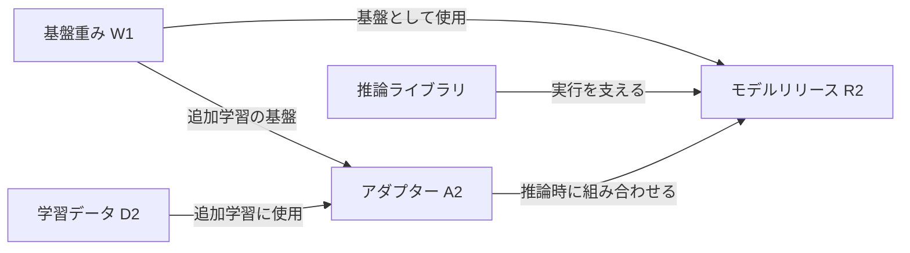

# AI BOMの技術構造と実構成を確かめるための証拠

## 中心となる洞察

AI BOMは、AIの構成要素と、それらの関係・由来を機械で扱えるように記録したものである。
BOMはBill of Materials、部品表を意味する。モデルの材料を追跡し、問題が判明した際に影響するリリースを調べる基盤になる。

> 記載の必須項目、実際に使った構成、使用を許可した構成は、別々の基準で確かめる。

BOMに載っている要素の情報がすべて埋まっていても、要素自体の記載漏れはあり得る。
署名の正しさも、記載の網羅性・真実性・モデルの安全性をまとめて保証するものではない。
この洞察はAI BOMに加え、SBOM、資産台帳、配備Manifestのレビューにも適用できる。

## 位置づけと出典の役割

- **一次資料の事実:** CycloneDXとSPDXが提供するAI・Datasetの表現は、後掲の仕様を参照する。
- **Repository interpretation:** 以下の構成例、生成工程、照合方法、検証観点は設計上の整理であり、唯一の実装ではない。
- **対話からの洞察:** C6.2学習での「予め定義したホワイトリスト的な項目」という回答を起点に、必須項目・実構成・許可の三つを区別した。

これはControl、Engineering Pattern、Mapping、製品適合の証拠ではない。
C6.2の学習を起点とするが、本文の全項目をAISVSの必須要求とするものではない。
仕様例の説明はRepositoryでの新しいSource採用決定を意味しない。

## AI BOMが記録するもの

例えば、問い合わせ分類モデルR2を、基盤重みW1、追加学習用アダプターA2、学習データD2から作る。

| 対象 | 情報の例 | 調査で使う目的 |
|---|---|---|
| モデルR2 | 識別子、版、成果物のハッシュ | 調査対象のモデルを特定する |
| 基盤重みW1 | 配布元、固定リビジョン、ハッシュ、ライセンス | どの重みを使ったか確認する |
| アダプターA2 | 版、ハッシュ、対応する基盤モデル | 追加学習による変更を追う |
| 学習データD2 | スナップショット、収集元、加工履歴、利用条件 | 学習材料の由来を追う |
| 推論用ライブラリ | パッケージ名、版、依存関係 | ソフトウェアの問題との関係を調べる |

材料の一覧だけでなく、関係を記録する。



D2は推論サーバーに配置されていなくても、A2を作った材料である。
配備ディレクトリの一覧だけでは、学習時の材料を復元できない。
R1でD1を、R2でD2を使ったなら、各リリースとBOMを対応付けて保持する。
BOMを最新版で上書きすると、過去のリリースへの影響を追えなくなる。

## 交換形式と技術構造

AI BOMは単一の専用ファイル形式の名称ではない。
[CycloneDXのAI/ML-BOM](https://www.cyclonedx.org/capabilities/mlbom/)はモデル、データセット、依存関係、来歴などを表現する。
CycloneDX 1.7は[ECMA-424第2版](https://ecma-international.org/publications-and-standards/standards/ecma-424/)として標準化され、機械可読JSON形式を定義している。

SPDX 3.0.1には、学習情報・ハイパーパラメータ・モデルの制約などを記述する
[AIPackage](https://spdx.github.io/spdx-spec/v3.0.1/model/AI/Classes/AIPackage/)と、収集・前処理・機密性などを記述する
[DatasetPackage](https://spdx.github.io/spdx-spec/v3.0.1/model/Dataset/Classes/DatasetPackage/)がある。
仕様が表現できる情報と、各項目が必須であることは別である。

以下は構造を理解するための疑似YAMLであり、標準準拠ファイルではない。

```yaml
subject:
  id: classifier-r2
  artifact_digest: "<リリース成果物のハッシュ>"
components:
  - id: weights-w1
    kind: model-weights
    revision: "<固定リビジョン>"
    digest: "<重みのハッシュ>"
    license_ref: "<利用条件の参照>"
  - id: adapter-a2
    kind: adapter
    digest: "<アダプターのハッシュ>"
    license_ref: "<利用条件の参照>"
  - id: dataset-d2
    kind: dataset
    snapshot: "<学習時の固定スナップショット>"
    origin_statement: "<収集元・収集方法の説明>"
    license_ref: "<利用条件の参照>"
relationships:
  - from: classifier-r2
    relation: uses
    to: weights-w1
  - from: classifier-r2
    relation: uses
    to: adapter-a2
  - from: adapter-a2
    relation: trained-on
    to: dataset-d2
```

名前・IDは参照のための識別子、版・スナップショットは対象時点を固定する情報、ハッシュはバイト列を照合する情報である。
同じモデル名でも中身が更新され得る。ハッシュだけでは、誰が作り、どんなデータで学習したかは分からない。
複数ファイルの成果物では、個々のハッシュやManifestのダイジェストが何を対象とするかも明確にする。

## 生成と検証を実行工程につなぐ

次は設計例である。

```text
学習工程
  固定したデータ、基盤モデル、学習コード、出力モデルを記録
    ↓
パッケージ作成工程
  実際に組み込んだ重み・アダプター・設定・依存物を収集
    ↓
BOM生成
  構成要素と学習・派生・依存関係を結合
    ↓
検査
  形式、構成の漏れ、必須情報、参照の整合性を確認
    ↓
リリース
  確定したBOMに署名し、対象モデルと対応付けて保存
    ↓
配備時
  対象モデルとの対応、署名、適用するポリシーを確認
```

外部モデルの説明ページから取得できるのは、基本的に公開・申告された情報である。
重みの解析だけで全学習データや収集時の利用条件が判明するわけではない。
自分たちが観測した事実、供給者の申告、不明な事項を区別する。

照合元には、学習ジョブの固定入力記録、ビルドの実取得記録、完成パッケージのファイルとハッシュ、配備設定を使う。
これらの記録の生成者・保存先も信頼境界になる。
BOMを書き換えられる攻撃者が、照合元や検査Policyまで自由に変更できるなら、照合の保証は崩れる。
生成器と検査器が同じ手書き一覧だけを見ていれば、同じ漏れを共有する。
実行工程からの記録と成果物を突き合わせ、照合の根拠を保護する。

## 必須項目と実構成と許可を分ける

| 比較 | 分かること | 検出できない例 |
|---|---|---|
| 記載内容と必須項目定義 | ライセンス等の情報欠落 | A2の項目自体がない |
| 実構成とBOM | 使用した要素の記載漏れ | 記載した要素が未承認である |
| 実構成と許可リスト | 未承認の要素の使用 | 承認済み要素のBOM記載漏れ |

W1とA2を使っているのにBOMへW1しか記載しない例では、W1の情報だけを検査してもA2の欠落を検出できない。
許可リストにW1とA2があっても、両方を毎回使うとは限らない。
対象リリースで実際に使った要素を特定する必要がある。

学習用、評価用、配備用では対象範囲が異なる。全ファイルとBOMを単純に一対一対応させる前に、
対象工程、要素の粒度、集約の規則を定義する。学習データが配備物にないことを欠落と誤判定しない。

## 検証の保証範囲

| 検証 | 確認すること | それだけでは分からないこと |
|---|---|---|
| 形式 | 構文と仕様への適合 | 実構成が全部記載されているか |
| 構成の網羅性 | 使用したA2も記載されている | 由来説明が真実か |
| 情報の充足 | 必須の由来・利用条件等がある | 記載内容が事実か |
| 成果物との対応 | BOMが対象R2を指している | R2の振る舞いが安全か |
| 署名 | 信頼する署名者の署名を検証できる | 署名者の記載に誤りがないか |

配備前の署名を確認する際も、BOM内の自己申告時刻だけでなく、署名・リリース・配備の記録を対応付ける。
正しく署名された不完全なBOMは成立し得る。検出後に警告だけを出してBuild成功とすれば、欠落は強制的に止まらない。
検査結果と工程の終了状態を別々に観測する。

## 実運用の課題と限界

| 課題 | 難しさ | 対応と残る限界 |
|---|---|---|
| 上流の情報不足 | 基盤モデルの学習データが不明・非公開 | 観測・申告・不明を分ける。不明の明記は情報充足と同義ではない |
| 真実性 | 正しい署名でも虚偽を記載できる | 学習記録や供給者の証拠と照合する。供給者への信頼は残る |
| 粒度 | Dataset、Shard、Recordのどこまで追うか | 調査目的に合う粒度を定義する。巨大な一覧だけでは運用できない |
| 変換・派生 | 量子化、追加学習、Adapter統合で成果物が変わる | 変換前後を識別して派生関係を残す |
| 配備後の変化 | Adapter差替え、外部APIの更新 | 配備記録との対応を維持する。外部サービス内部の不可視性は残る |
| 機密性 | 顧客名や内部Data所在を含み得る | 閲覧範囲を分け、詳細証拠をアクセス制御する |
| 相互運用性 | 同じ形式でも対応項目・Profileが違う | 必要情報が交換・変換後にも保持されるか確認する |
| 安全性 | 材料が判明してもBackdoor等を判定できない | コード検査、振る舞いの受入試験、実行時制御と組み合わせる |

SPDXのAI Profile対応はDatasetやBuild等への対応まで意味しない。
製品の「SPDX対応」という表示だけで、必要情報を交換できるとは判断しない。
[SPDX 3.0.1 Conformance](https://spdx.github.io/spdx-spec/v3.0.1/conformance/)の各Profileの範囲と、実際の受渡し結果を確認する。

## 設計レビューと検証例

- 対象リリース、学習入力、配備構成をどの不変IDで結ぶか。
- BOMに存在しない構成要素を、どの独立した記録から発見するか。
- 取得・変換・差替え後も、BOMと実行物の対応が維持されるか。
- 誰が生成・修正・署名でき、誰が検証鍵や必須情報Policyを変更できるか。
- 検査不能や上流情報不足を、成功へ変換していないか。

| 試験例 | 期待する観測 |
|---|---|
| 正常なR2、対応BOM、必要情報と有効な署名 | 設定した検査を通過し、対象版と判定根拠を記録 |
| A2をBOMから削除 | 実構成との照合で記載漏れを検出 |
| D2の由来情報を削除 | 必須情報検査でBuild失敗 |
| 署名後にBOMを書換え | 署名検証失敗 |
| 正しく署名したR1のBOMをR2へ添付 | 署名検証とは別に成果物との対応検査で拒否 |
| 欠落検出後もCIを成功扱いにする | 検出と強制の不一致を確認し、成功扱いの経路を修正 |

これらは検証設計例であり、実製品での試験結果ではない。

## 再利用する短い原則

- 形式が正しくても、構成要素は抜け落ちる。
- 使ってよいものと、実際に使ったものを区別する。
- 署名は記載内容を保護するが、その真実性を作り出さない。
- BOMの価値は、実構成・生成工程・配備対象との対応で決まる。

## 起点となった学習記録と関連資料

2026-10-22のC6.2学習対話で、AI BOMの意味、技術構造、課題を掘り下げた説明を独立保存した。

- [C6学習ガイド](../../controls/learning/c06-supply-chain-security-for-models/README.md)
- [C6.2学習ノート](../../controls/learning/c06-supply-chain-security-for-models/v1.0-c6.2-ai-bom-and-supply-chain-monitoring.md)：起点はv1.0-C6.2.1、C6.2.2、C6.2.3。
- [C6 Control概要](../../controls/control-records/c06-supply-chain-security-for-models/README.md)：個別要件の保証・検証へ進む。
- [Security Artifactの保証範囲](security-artifacts-have-bounded-claims.md)：署名やSchemaの一般的な保証境界。本書はBOM生成と実構成の照合へ具体化する。
- [実際に利用される内容の検査](validation-must-cover-effective-payload.md)：検査対象と実行対象の対応。

## 改訂の記録

2026-10-22：学習対話から初版作成。技術解説、構成と記載と許可の区別、生成・検証工程、運用上の課題を保存。
