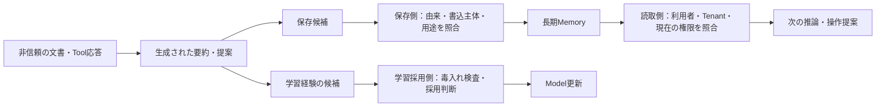

# ATLAS 2026.10：Engineeringへの影響

- 確認日：2026-10-29。状態：影響評価案。人のSecurity Review・製品試験は未実施。
- 対象：Content `2026.08`→`2026.10`、Format `6.0.0`→`6.1.0`。固定版と差分は[更新レビュー](../../sources/updates/2026-10-29-atlas-2026.10-review.md)に記録。
- [2026.08の発見記録](mitre-atlas-pattern-discovery-2026-08.md)を置換しない。以下はATLASの攻撃経路を既存の実装・候補と比較したRepositoryの判断であり、Framework coverageのMappingではない。

**変えるべきなのはPatternの数ではなく、開発者が確認する境界の精度。** 例えば「Memoryの漏洩」と「学習済み重みからの記憶内容の回収」は、同じ検索Filterでは止められない。どこに情報があり、何を根拠に読取・保存・操作を許すのかを分ける。

## 既存Patternで何を変えるか

| Pattern | 対象の変更 | 判断と強制点 |
|---|---|---|
| [P1：ツール実行](../domains/agents/secure-tool-execution/README.md) | `AML.T0053`が、Agent自身・利用者委任の権限の代理悪用を明示 | 主例・実装は維持。資格窃取なしでも、正規資格で業務外の操作は起き得る。Webセッション、保存Task、業務対象を実行側で比較する既存の境界が必要 |
| [P2：検索時認可](../domains/rag/secure-multi-tenant-retrieval/README.md) | `AML.T0085.000` RAGと`.002`会話・Memoryの取得を分ける | 主例は文書検索なので維持。会話履歴API・Memory Store・学習済み重みまでP2の検索認可で保護したと扱わない。読取許可とLLM送信許可も別のまま |
| [P3：MCPの構成と主体](../domains/mcp/audience-bound-downstream-delegation/README.md) | `AML.M0026`サービス主体と`AML.M0027`利用者委任の区別、`AML.T0053`の権限悪用 | 実装は維持。ローカル・本人Tokenでも、本人に許された操作の目的が正当とは限らない。主体・Tool範囲・固定接続先を限定する。新版はリモート方式やOPAを必須にしていない |
| [P4：返信材料と送信の境界](../domains/agents/untrusted-content-to-action-containment/README.md) | `AML.T0061`指示の自己複製と`AML.T0143`伝播を区別 | 要約・過去の下書きを再利用する経路の確認N13を追加。社内履歴を生成入力へ持ち込まず、業務APIから許可項目を取り直す既存実装を維持。長期Memory・学習経路の保護は範囲外 |

P1〜P4は`draft`のまま。ATLASのTechnique maturity、関係の追加、チェックシートの作成は、Patternの人のレビューや製品試験の代わりにならない。

## Agent Memory：保存の手前と、使い直す手前を分ける

これはRepositoryの境界図であり、ATLASが指定する標準構成ではない。

| 既存候補 | 今回確認した違い | 実装を具体化するときの確認 |
|---|---|---|
| P5 Authorized Memory Lifecycle | `AML.T0085.002`は保存履歴だけでなく現在Contextからの取得も含む | Memory不要なら保持をなくす。必要なら、保存元の認証済み主体・Tenant・Source ACL・有効期限を、保存／検索／削除で照合する。現在Contextへ入った後の開示は別の境界 |
| P6 Persistent Context Poisoning Containment | `AML.T0080.000`のMemory汚染と`AML.T0143`の伝播。認証済みAgentの要約も元の指示を運ぶ | 要約を新しい信頼済みSourceと扱わず、元Source・派生関係・保存判断を残す。元文書を消した後、要約・共有Memory・復元先にコピーが残るケースを検討 |
| P8 Training Data Pipelineとの接点 | `AML.T0145`はAgentの環境から学習経験が採用される経路を扱う。上流maturityは`Feasible` | 保存したMemoryを読み直す処理と、重み・Policyを更新する処理を分ける。正規Agentが生成したFeedbackであっても学習採用の根拠にはならない。学習しない構成へ無理に適用しない |

この影響評価時点ではP5/P6/P8は[Landscape](pattern-landscape.md)の候補だった。その後、各範囲提案への継続指示を受け、P5は[本人の型付き回答設定](../domains/memory/authorized-memory-lifecycle/README.md)、P6は[案件内の自由文メモ](../domains/memory/persistent-context-poisoning-containment/README.md)に限ってガイドを作成した。P8は候補のまま。上の表は候補全体の設計観点であり、P5/P6が全てを実装・検証したという主張ではない。

## AI Supply Chain：配布元の承認と、実行の安全性を分ける

`AML.T0010.002`／`.003`は、正常なRepository機能や攻撃者のPublisher名でも悪性Artifactを届けられると明確化した。`AML.M0023`のBOM範囲も、ModelだけでなくAgent設定や接続先まで広がっている。

既存候補P9〜P12を一つの「BOMで対策」へまとめない。

| 候補 | 何をもとに・何を・どこで確認するか | 残るもの |
|---|---|---|
| P9 Artifact Resolution and Promotion | 取得・昇格側で、管理されたPublisher／Repositoryの承認、固定版、信頼するDigest・署名等と、実際に解決したArtifactを照合する | 承認先の侵害、正当に署名された悪性Artifact |
| P10 Safe Artifact Loading | 読込み・変換前に、形式・Loaderの実行能力・必要な隔離範囲を判定する | Hash一致だけではコードやモデル挙動の無害性を証明できない |
| P11 Extension Admission | Tool／Skill／MCP拡張の登録時に、許す操作・資格・外部接続を管理Policyと照合する | 正しい配布元であっても過大な権限を与え得る |
| P12 Control-Plane Integrity | 指示・Tool定義・設定の変更時に、変更者・承認版・実稼働版を比較し、Agentからの書換えを制限する | 正規の変更者の誤り、許可された設定内の悪用 |

これらは候補の評価項目。今回のATLAS更新を理由に新しい製品・依存関係・実行サービスを追加しない。

## Threat Modeling：攻撃名の一覧から、経路と証拠へ戻す

Format 6.1.0はActor・Software・Case Studyを別objectとして記録する。分析では次の順に読む。

1. **誰が何へ到達できるか。** 資格の窃取、正規資格の代理悪用、利用者に許された操作の目的逸脱を分ける。
2. **どの境界を越えたか。** `AML.T0135`の収集、`AML.T0024`／`AML.T0136`の外への転送、`AML.T0005.001`の模倣を同じ一動作にしない。
3. **証拠は何か。** Case Study内の`step-id`と`leads-to`を辿る。同じTechniqueが二度出ても別stepなら残す。`reported-by`は報告者であり攻撃者の帰属ではない。
4. **何を観測できるか。** `AML.T0138`の証拠隠し、`AML.T0140`の分散、`AML.T0141`のMetadata除去を考慮する。Agentの自己報告だけで実行や停止を証明しない。

`AML.M0043`は追加の運用課題を示す。Agent停止・Token失効後も、既に作った外部アカウント、公開File、インフラは残り得る。外部資源を作る構成では、管理側の所有者・期限・台帳と実資源を照合して回収する必要がある。現在のP1〜P4の主例は汎用の資源Provisioningを提供しないため、今回その機能を加えず、P15のScope管理と候補選定で再評価する。

## 開発者への依頼例

> 現行版の構成で、非信頼文書から作った要約が次の会話・共有Memory・学習Dataへ入る経路を示してください。各経路で誰が何を照合して採用するのか、元Sourceの版、派生先、実際の生成入力が分かる試験記録をお願いします。保存がない構成なら、その経路がないことを示してください。

> Agentが正規の利用者Tokenを持つ状態で、保存Taskの対象外の注文を要求してください。拒否した箇所と業務APIの副作用を確認したいです。Token検証の成功やモデルの拒否しか示せない場合は、アプリ側の対象照合と実呼出し記録を追加してください。

> Modelの取得例について、承認されたPublisher・固定版・実ファイル・BOMの対応を示してください。Hashだけが一致する場合は、その期待値を誰のどの承認済み記録から得たか、読込み時のコード実行をどこで隔離するかを追加してください。

いずれも製品側で行う確認例。今回これらを実施・合格したとは扱わない。
