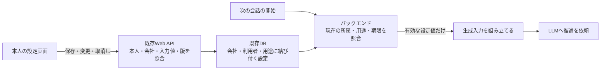
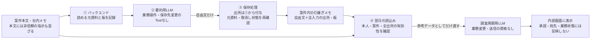

# Engineering Pattern Candidate Landscape

- Status: discovery
- Last updated: 2026-10-29
- Scope: Pattern候補の比較のみ

## 目的と境界

このLandscapeは、具体的なユースケースから反復するセキュリティ設計問題を抽出し、
Pattern化する前に候補の境界、重複、再利用可能性を比較するための作業記録である。

ここに記載された項目は候補の分析記録であり、Pattern本文とその成熟度はリンク先で管理する。
未選定候補の名前と配置先は暫定であり、ディレクトリやプレースホルダーは作成しない。
Control IDやFramework coverageを候補の発見根拠にせず、Controls／FrameworksへのMappingも
この段階では行わない。

P1を選定し、[安全なツール実行のPattern](../domains/agents/secure-tool-execution/README.md)を作成した。
続いてP2を選定し、[検索時認可のPattern](../domains/rag/secure-multi-tenant-retrieval/README.md)を`draft`として作成した。
P3とP4の比較後、利用者本人として下流APIを呼ぶ範囲でP3の開発着手が承認された。[MCPの構成・実行主体を選ぶPattern](../domains/mcp/audience-bound-downstream-delegation/README.md)を`draft`として作成した。
2026-10-27、ユーザーのP4実装指示を受け、顧客への情報開示に絞って選定し、[返信材料と送信先を制限するPattern](../domains/agents/untrusted-content-to-action-containment/README.md)を`draft`として作成した。既存Patternの本文レビュー完了を意味しない。
2026-10-29、P5/P6の比較・範囲提案への継続指示を受け、[本人の回答設定を保存・再利用するPattern](../domains/memory/authorized-memory-lifecycle/README.md)を`draft`として作成した。開発対象の選定と、本文の技術レビュー・製品試験は区別する。
続いて、P6の案件内メモへの範囲案にも継続指示を受け、[自由文要約の出所と再利用を扱うPattern](../domains/memory/persistent-context-poisoning-containment/README.md)を`draft`として作成した。P5の型付き設定とは別の適用範囲である。

## 入力ユースケース

1. Agentが社内APIを呼び出す。
2. RAGが複数テナントの文書を検索する。
3. MCP Serverが下流APIへアクセスする。
4. AgentがWebページを読んで操作を行う。
5. 長期memoryへユーザー入力を保存する。
6. Agent runtimeとAuthorization PDPが同じ管理IdentityまたはDeployment権限を
   共有し、Agent侵害からPDPを再配置・変更できる。

6番目の観察はAuthorization ControlのReview対話で発見したが、Control IDやRequirement
coverageではなく、共有管理Identityによって実際のTrust Boundaryが消失するSystem failureを
入力とする。Controlとの関係は候補の発見根拠にせず、両Endpointの開発後に別途評価する。

これに加え、MITRE ATLAS v2026.08の全Technique、Mitigation、Case Study、relationshipを
第二の発見入力としてscreeningした。Source snapshot、除外判断、各候補のATLAS evidenceは
[`mitre-atlas-pattern-discovery-2026-08.md`](mitre-atlas-pattern-discovery-2026-08.md)
に記録する。ATLAS IDは発見根拠であり、この段階ではMappingではない。

2026-10-29に[Content 2026.10の影響](mitre-atlas-impact-2026-10.md)を評価した。
P5/P6のMemory保存・再利用とP8の学習経験採用、P9〜P12の取得・実行・能力・設定の境界を
区別し、P15には停止後も残る外部資源の回収を検討事項として記録した。
上流の追加だけでは候補の選定・Pattern作成を行わず、旧版の発見根拠も保持する。

## 抽出方法

次の順序で、ユースケース名ではなく設計問題を比較する。

```text
実ユースケース
  -> Trust Boundary
  -> Abuse Case
  -> Security Invariant
  -> deterministic Enforcement Point
  -> Negative Test
  -> 複数コンテキストでの再利用可能性
  -> Pattern候補
```

同じ問題、Invariant、Enforcement Point、Negative Testを共有するユースケースは一つの候補へ
まとめる。新しいTrust Boundary、異なる失敗結果、独立したEnforcement Pointまたは固有の
Negative Testが必要なら、別候補として保持する。複数候補で使われる原則やprimitiveは、
それだけでPattern候補にしない。

## 候補一覧

| ID | 暫定候補 | 主な入力ユースケース | 既存の計画候補との関係 |
| --- | --- | --- | --- |
| P1 | Deterministically Authorized Tool Execution | Agentが社内APIを呼び出す | `agents/secure-tool-execution`を支持 |
| P2 | Authorization-aware Retrieval Isolation | RAGが複数テナントを検索する | `rag/secure-multi-tenant-retrieval`を支持 |
| P3 | MCP Access Configuration and Acting Identity（旧 Audience-bound Downstream Delegation） | MCP Serverが下流APIへアクセスする | `mcp/audience-bound-downstream-delegation`を選定・作成 |
| P4 | Untrusted Content-to-Action Containment（開発範囲：顧客への情報開示） | 社内調査から顧客への返信を作るAgent | `agents/untrusted-content-to-action-containment`を選定・作成。一般的な間接Prompt Injection全体には広げない |
| P5 | Authorized Memory Lifecycle（開発範囲：本人の型付き回答設定） | 利用者設定を次回の生成要求へ渡す | `memory/authorized-memory-lifecycle`を選定・作成。自由文の汚染はP6に残す |
| P6 | Persistent Context Poisoning Containment（開発範囲：案件内の引継ぎメモ） | 案件の自由文要約を後の会話で再利用する | `memory/persistent-context-poisoning-containment`を選定・作成。共有・多段要約は対象外 |
| P7 | Provenance-Bound RAG Ingestion | ATLASのRAG poisoning Case Studies | P2とはingestionとretrievalで分離 |
| P8 | Provenance-Bound Training Data Pipeline | ATLASのtraining data poisoning incidents／exercises | P7とはruntime contextとmodel trainingで分離 |
| P9 | Immutable AI Artifact Resolution and Promotion | ATLASのdependency confusion、rug pull、namespace reuse | 新規候補 |
| P10 | Safe AI Artifact Loading and Processing | ATLASのunsafe model、template、processing pipeline | P9とはidentity resolutionとactive processingで分離 |
| P11 | Capability-Bounded Agent Extension Admission | ATLASのpoisoned Tool／Skill／MCP cases | P9のartifact identityだけでは不足 |
| P12 | Agent Control-Plane Configuration Integrity | ATLASのrules、prompt construction、Tool definition cases | P11とはproject configurationとpackage lifecycleで分離 |
| P13 | Agent Runtime Host and Network Isolation | ATLASのagent RCE、host escape、secret access cases | P1のTool authorizationだけでは不足 |
| P14 | Mediated AI Credential Use | ATLASのcredential harvesting／exfiltration cases | P1、P3とはcredential exposure boundaryで分離 |
| P15 | Bounded Autonomous Objective and Resource Execution | ATLASのautonomous scope adaptation incidents | P1とはsingle actionとmulti-step scopeで分離 |
| P16 | Authenticated and Bounded Inter-Agent Delegation | ATLASのdirect／shared-artifact agent communication | Evidence不足のためhold |
| P17 | Untrusted Model Output at Active Interpreter Boundaries | ATLASのcode execution、rendering、generated command cases | P4とはinput influenceとoutput sinkで分離 |
| P18 | Abuse-Resistant AI Service Resource Budgets | ATLASのdenial／cost／agentic consumption Techniques | Production evidenceを追加確認 |
| P19 | Minimum-Disclosure Inference API | ATLASのmodel extraction／inversion／data leakage cases | P18とはconfidentialityとavailabilityで分離 |
| P20 | Isolated Agent Authorization Control Plane | Agent runtimeとAuthorization PDPが管理境界を共有する | P1、P12、P13とは保護対象とEnforcement Pointが異なる |

P7からP19の詳細比較は、上記ATLAS discovery recordを正本とする。ここでは候補の索引と
横断比較だけを維持し、同じ分析を複製しない。

## P1: Deterministically Authorized Tool Execution

2026-10-22：[P1候補レビュー](tool-execution-candidate-review.md)へ、一次報告の確認、二つの
業務例、不変条件・反証テスト、隣接候補との境界をまとめた。同日の対話で方針と開発着手の
了承を得て`select`へ移行し、[Pattern本文](../domains/agents/secure-tool-execution/README.md)を作成した。
開発者向けガイド・Mermaid図・要点サンプルを中心とし、正負のケースは読者向け確認事項として扱う。
2026-10-23の対象版は人によるレビュー承認を受けた。2026-10-25に照会・提案を主例へ改訂し、現在版は再レビュー待ちの`draft`。対象版と範囲は[レビュー記録](../domains/agents/secure-tool-execution/README.md#human-review-2026-10-23)を参照。実行検証は未実施。


- 暫定配置: `agents/secure-tool-execution`
- 繰り返し発生する設計問題: AgentやLLMが生成したTool／API要求へ、Applicationや
  Service Accountの広い権限をそのまま与え、起点主体の権限を超えた操作を可能にする。
- 主なTrust Boundary: UserからAgent、model outputからTool broker、Agent runtimeから
  社内API、credential issuerからresource server。
- Abuse Case: Prompt Injectionや誤った計画により、Agentが別tenantのデータ取得、管理API、
  または許可されていない副作用を要求する。
- Security Invariant: model-generated requestだけでは操作を認可できない。実行権限は、
  認証済み起点主体の権限、許可された目的、Tool capability、resource policyの共通部分を
  超えてはならない。
- 決定論的なEnforcement Point: Agent外部のTool gatewayまたはPolicy Enforcement Point。
  主体、resource、action、tenant、Tool argumentsを検証し、必要なら狭い資格情報を発行する。
- Negative Test: 未認可API、別tenant ID、引数改ざん、Policy Decision Pointの迂回、
  認可サービス障害時のfail-openを試し、すべて拒否されることを確認する。
- 他のユースケースへの再利用可能性: Database、Cloud API、Ticket、決済、メール、MCP Tool、
  Browser actionなど、model outputが外部副作用へ変換されるシステムへ再利用できる。
- 既存Patternへの統合判断: 計画中の`agents/secure-tool-execution`そのものであり、別候補に
  分離する理由はない。社内API呼出しを最初の具体的ユースケースとして利用できる。

## P2: Authorization-aware Retrieval Isolation

2026-10-23：ユーザーが、テナントを異なる会社とする説明例を確認し、「この方針で進めてください！」と開発着手を承認した。
以下の候補確認により`retain`から`select`へ移行した。本文の人による技術レビューとは別の判断である。
[Pattern本文](../domains/rag/secure-multi-tenant-retrieval/README.md)と[チェックシート](../domains/rag/secure-multi-tenant-retrieval/negative-tests.md)を作成済み。状態は`draft`、製品の実行検証は未実施。

| 観察したシステム類型 | 繰り返される失敗経路 | 共通の設計と適用上の違い |
|---|---|---|
| 複数企業に提供する文書検索SaaS | 共有検索基盤が、質問に似ている他社文書を返す。質問やモデル指定の会社IDを検索権限として使う | 検証済み所属と文書の会社を照合する。会社をまたぐ検索品質への影響は、情報開示の認可とは別に扱う |
| 一社内の部署・担当別ナレッジ検索 | 同じ会社であれば全員が読めると扱い、制限文書や権限変更前のキャッシュを返す | 文書単位の閲覧権限も照合する。グループ・担当の変更を検索経路とキャッシュへ反映する |

二つの類型は本PJの設計分析であり、実被害や再現実験の報告ではない。
技術的な裏付けとして、[pgvector v0.8.7のMultitenancy／Filtering](https://github.com/pgvector/pgvector/blob/v0.8.7/README.md#multitenancy)、
[PostgreSQL 18のRLS](https://www.postgresql.org/docs/18/ddl-rowsecurity.html)、
[Azure AI Searchのsecurity filter方式](https://learn.microsoft.com/en-us/azure/search/search-security-trimming-for-azure-search)を2026-10-23に確認した。
Azure資料は更新型（表示上の更新日2026-08-24）。識別子を含むフィルターだけでは本人確認にならないことを確認した。
製品ごとの構文は異なるが、信頼する本人・文書権限に検索を束縛し、開示前に強制する点を再利用できる。

主な例は会社A・Bのサポート用RAGとし、会社内の文書権限とキャッシュ再利用も扱う。
選定理由は、開示される資産・強制箇所・反証方法が具体的で、P1と異なる検索固有の境界があること。
P7は文書の取り込みと出所・汚染、P5は保存されたmemoryのライフサイクルを扱うため統合しない。
物理分離や規制上の専用環境が必要な用途は、本例の論理的な検索時認可だけでは足りない。

- 暫定配置: `rag/secure-multi-tenant-retrieval`
- 繰り返し発生する設計問題: Vector similarity、検索query、またはmodel context内の
  `tenant_id`を認可の代わりに使用し、未認可文書を検索結果へ混入させる。
- 主なTrust Boundary: caller identityからRetrieval service、Retrieval serviceから
  Vector／database store、document metadataからauthorization policy、取得文書からmodel context。
- Abuse Case: Tenant Aの利用者がTenant Bと類似した文書を検索する、modelがtenant識別子を
  改変する、または権限失効後もcacheやindexから文書が返る。
- Security Invariant: 開示する検索結果は、明示した権限確認時点で認証済み主体に許可された文書だけで構成する。
  失効の反映期限を定め、期限を超えた古い許可を再利用しない。Similarity、model-generated metadata、取得後のpromptは認可判断にならない。
- 決定論的なEnforcement Point: Retrieval service、DatabaseのRow-Level Security、または
  信頼されたPolicy Enforcement Point。認可済みcorpusへ検索範囲を限定する。
- Negative Test: 類似する他tenant文書、偽造tenant ID、失効済みaccess、cache済み結果、
  filter欠落queryを使い、未認可文書が一件も返らないことを確認する。
- 他のユースケースへの再利用可能性: Enterprise search、Memory retrieval、Document
  assistant、Support knowledge base、検索APIへ再利用できる。
- 既存Patternへの統合判断: 計画中の`rag/secure-multi-tenant-retrieval`に統合できる。P1と
  authorization primitiveは共有するが、近似検索、index、metadata、cacheという検索固有の
  境界があるため、Tool Execution Patternへは統合しない。

## 次候補の比較：P3とP4

2026-10-23、ユーザーの「次に進もう」を受け、P2の作業計画にある次候補比較を実施した。
**比較後、P3を開発対象に選定した。** P2の文書整理は完了しているが、現在版への明示的な技術レビュー承認とは区別し、`draft`を維持する。

以下は2026-10-23の選定理由を、10-25に見直したP3の範囲へ合わせて整理した比較である。

| 判断軸 | P3：MCPの構成・実行主体・資格の利用 | P4：非信頼コンテンツから操作への誘導 |
|---|---|---|
| 具体的な失敗 | 本人として使うつもりで広いサービス資格を選ぶ、共有処理で別人の資格を使う | メールや文書内の指示が、利用者の依頼・承認として扱われ、送信や更新を誘発する |
| P1・P2から増える境界 | 起動・資格の取得と保持・下流主体の対応。共有サービスを作らず省ける境界も判断する | 情報の出所、読み取りと操作の分離、外部送信経路 |
| 既存成果物との重なり | P1の操作判断と区別し、配置・主体・資格を預かる責任を選べる | タスク範囲と承認の偽装はP1、文書の開示はP2にも説明済み。追加する境界の絞込みが必要 |
| 最初の説明のまとまり | ローカルの本人認証でOktaの管理対象U1を照会し、その後にサービス主体・リモート提供を比較できる | ブラウザー、メール、文書のどれを主例とするか、送信制御の範囲を先に決める必要がある |
| 今回の判断 | `select`。構成選択を先に示すガイドへ再構成 | `retain`。重要性は維持し、P3と同時に開発しない |

P4の問題の反復性は[既存のATLAS調査](mitre-atlas-pattern-discovery-2026-08.md#p4-untrusted-content-to-action-containment)で整理済み。
今回確認した[MSRCの多層防御の説明](https://www.microsoft.com/en-us/msrc/blog/2025/07/how-microsoft-defends-against-indirect-prompt-injection-attacks)も、外部入力の誤解釈と、認可・送信制御等による影響制限を分けている。
P4を不採用にする判断ではなく、最初に扱う独立した境界を明確にできるP3を優先する本PJの判断である。

## P3: Audience-bound Downstream Delegation

この見出し・配置パスは旧参照を維持する。現在の範囲は**MCPの接続構成と、下流APIを呼ぶ主体の選択**である。

- 配置：[PATTERN-MCP-001](../domains/mcp/audience-bound-downstream-delegation/README.md)。`select`、本文は`draft`。
- 反復する問題：MCPを挟む際、誰の権限で下流APIを呼ぶかが曖昧になり、広いサービス資格や別人の資格で実行する。不要な共有サービスを設けると、資格の集中・利用者分離・公開入口の管理責任も増える。
- 入力：個人端末のMCPから管理APIを利用する構成、共有HTTP型MCPからAPIへ委任する構成、無人のサービスアプリ。Control一覧ではなく異なる主体・配置・資格管理境界を比較する。
- 不変条件：選んだ主体の許可範囲内で実行し、資格の利用先と要求・主体・返却先の対応を保つ。判断不能時に権限を広げない。
- 強制箇所：OS・起動設定、資格管理、MCPの操作境界、下流APIの対象認可。リモートなら入口認可と利用者別の資格・応答分離も必要。
- 確認：権限外対象、資格の取り違え、意図しないサービス主体への切替、別宛先への送信、失効・障害を構成別に試す。
- 隣接境界：P1は個々の操作認可、P2は検索本文の開示。P3は実行場所・主体・資格の保持と利用の選択。任意コードや端末侵害全体の隔離はP13・P14等の別候補で扱う。

### 範囲変更の経緯

2026-10-23にHTTP型MCPから管理下APIへ本人の委任を引き継ぐ範囲で開発着手の承認を得た。
2026-10-25、ユーザーが想定したOkta MCP Serverのローカル直接認証と区別し、構成選択を先に行う共通方針とP3の書直しを明示的に指示した。
これを現在の範囲への開発承認として記録する。本文の技術レビュー完了とは扱わない。

| 構成 | 現在の扱い |
|---|---|
| ローカルstdio＋本人認証 | 主例。OktaのDevice Authorizationで下流用資格を直接取得する流れ |
| サービスアプリ資格 | 別の主体として比較。本人の権限で動くとは扱わない |
| リモートHTTP＋本人の対応付け | 中央提供が必要な場合の選択肢。OBOは委任対応APIを使う場合の一例 |

一次資料の版・状態・採用上の注意は[本文の参照情報](../domains/mcp/audience-bound-downstream-delegation/README.md#7-参照とレビュー情報)に集約する。
Oktaの更新型README・認証処理、MCPの2025-11-25仕様、OktaのOAuth資料、Entra OBO資料を使用し、製品間の相互接続や安全性の実証とはしない。
[構成別の確認用チェックシート](../domains/mcp/audience-bound-downstream-delegation/negative-tests.md)は未実施。
タスク単位の追加制限はP1との組合せとする。このP3選定時点ではP2は`draft`、P4は`retain`。その後のP4選定は次節に記録する。

## P4: Untrusted Content-to-Action Containment

以下は初期候補の観察である。実際に開発した範囲は、この節後半の「2026-10-27の選定」に限定する。

- 選定した配置: [`agents/untrusted-content-to-action-containment`](../domains/agents/untrusted-content-to-action-containment/README.md)。IDは`PATTERN-AGENTS-002`、状態は`draft`。
- 繰り返し発生する設計問題: Web、メール、文書、Tool outputなどの非信頼content内の命令が
  model planへ混入し、外部操作や機密情報送信へ変換される。
- 主なTrust Boundary: external contentからBrowser／retriever、取得contentからmodel context、
  model planからAction broker、read capabilityからwrite capability。
- Abuse Case: Webページ内の命令により、Agentがcredentialや内部情報を外部送信する、購入、
  削除、設定変更を行う、または承認済みと偽って操作する。
- Security Invariant: 非信頼contentは、新しい権限、操作目的、承認、送信先を設定できない。
  Content由来のmodel outputだけでは外部副作用や機密データ送信を認可できない。
- 決定論的なEnforcement Point: Action broker、Egress gateway、user-intent binding、read-onlyと
  side-effect capabilityの分離、およびhigh-impact action approval。
- Negative Test: Webページへ秘密の外部送信、管理設定変更、承認省略の命令を埋め込み、Agentが
  従ってもAction／Egress境界で拒否されることを確認する。
- 他のユースケースへの再利用可能性: メール、Support ticket、RAG文書、MCP Resource、
  Tool output、共有文書、長期memoryへ再利用できる。
- 既存Patternへ統合できない理由: P1は生成済みTool requestの認可を扱うが、本候補は
  非信頼contentがcontrol contextやuser intentへ化ける上流の情報フローも扱う。Content
  provenance、read／write capability分離、Egress制御が必要なため、P1のNegative Testだけでは
  完結しない。計画中の`llm/indirect-prompt-injection-containment`とは重なるが、Pattern化前に
  一般的なPrompt InjectionではなくContent-to-Action境界へscopeを絞るか再検討する。

### 2026-10-27の選定：社内で読める情報を、顧客へ何でも送らせない

上記は当初の広い候補。開発対象は「社内情報を調べて顧客へ返信するAgent」に絞った。
ユーザーがこの範囲の提案に続けて「P4の実装を進めなさい」と指示したことを、候補範囲と開発着手の承認として記録する。本文の技術レビューや`recommended`への承認には流用しない。

| 観察・一次資料 | システムと失敗経路 | 再利用する判断・限界 |
|---|---|---|
| [Zendesk Ticket Comments](https://developer.zendesk.com/api-reference/ticketing/tickets/ticket_comments/)（API v2、更新型、2026-10-27確認） | サポート記録には公開コメントと内部メモが共存する。内部情報を読める担当者の返信生成が、その情報を顧客へ公開する経路になる | 閲覧対象と公開対象を分ける業務構造の根拠。Zendeskでの事故や防御の実証を主張しない |
| [AnthropicのブラウザAgent研究](https://www.anthropic.com/research/prompt-injection-defenses)（2025-11-24公開、2026-10-27確認） | メールを読み返信案を作る個人向けAgentに、外部からのメールが機密メールの転送を指示する例 | 非信頼の本文を開示先・目的の決定根拠にしない境界を再利用できる。研究上の例であり、このPatternの実地検証ではない |

- **独立した結果:** P1の操作許可、P2の閲覧許可が両方成立しても、許可された相手へ社内限定情報を送る漏洩は残る。P4は情報を受け取る相手と開示可能な材料を対応付ける。
- **強制点と反証:** サーバーが業務データから返信材料を選び直し、下書き入力・本人の確認・実際の送信へ対応付ける。担当者には読める社内メモを、正規顧客への返信に混ぜる試験が反証になる。
- **再利用性:** サポート返信と個人向けメール処理に、読取り・外部開示の分離、確認済み宛先、内容に結び付く確認を適用できる。主例はWebアプリの固定ツール構成とし、任意ブラウザ操作の実装全体には広げない。
- **統合しない理由:** 操作ごとの認可と承認はP1を再利用するが、返信材料の開示可否とコンテキストの分離は別の設計責務。全入力の意味的な汚染追跡、汎用sandbox、永続memoryの汚染は別候補に残す。
- **適用しない例:** 公開情報だけを固定形式で返す処理では、内部情報から外部開示への境界がない。逆に、内部情報から自由文を自動送信し完全な非漏洩保証を求める構成には、本例の人による確認は十分でない。
- **Decision:** `select`。本文・実装ノート・正負のチェックシートを作成。独立した製品実証、本文の人によるレビュー、長期Ownerは未確保。Golden Patternとしての推奨は行わない。

## P5: Authorized Memory Lifecycle

- 配置: [PATTERN-MEMORY-001](../domains/memory/authorized-memory-lifecycle/README.md)。`select`、本文は`draft`。以下は候補全体の分析で、初版の開発範囲は後段の型付き回答設定に限る。
- 繰り返し発生する設計問題: 長期memoryのwrite、read、update、deleteにprincipal、tenant、
  purpose、retentionの制約がなく、別利用者や将来sessionへデータが漏れる。
- 主なTrust Boundary: User／AgentからMemory write service、Memory serviceからpersistent store、
  stored memoryからfuture session、およびtenant間境界。
- Abuse Case: Agentが別利用者のmemoryを書き換える、共有keyへ保存する、または削除・失効済み
  memoryが再取得される。
- Security Invariant: Memoryのread、write、update、deleteは認証済み主体、tenant、purpose、
  retention policyへ結合する。失効・削除されたmemoryは将来contextへ戻らない。
- 決定論的なEnforcement Point: Memory API gateway、tenant-bound storage policy、
  retention／deletion service、retrieval authorization layer。
- Negative Test: 別tenantへのwrite、owner ID偽造、期限切れmemory取得、削除後の再出現、cacheを
  使った失効回避を試し、すべて拒否または除外されることを確認する。
- 他のユースケースへの再利用可能性: 会話履歴、User profile、Agent scratchpad、Workflow
  state、Personalization storeへ再利用できる。
- 既存Patternへ統合できない理由: P2とtenant isolationは共有するが、Memoryにはwrite
  authorization、update、retention、delete、future sessionへの再投入という時間軸がある。
  検索時認可だけを扱うRAG Patternではlifecycle全体を検証できない。

<a id="p5-scope-proposal"></a>

### 選定した開発範囲：本人が保存した回答設定を、次回も安全に使う

2026-10-29、P5とP6を比較し、**先にP5の保存・再利用・取消しの境界を扱う**範囲を提案した。P6の自由文に含まれる指示の判定まで同時に解こうとすると、誰の保存物をいつ使ってよいかという基本処理が見えにくくなる。ATLASのID追加やControlの空欄を選定理由にはしない。その提案への継続指示を受け、`select`へ移行した。[本文](../domains/memory/authorized-memory-lifecycle/README.md)・[実装例](../domains/memory/authorized-memory-lifecycle/implementation-notes.md)・[チェックシート](../domains/memory/authorized-memory-lifecycle/negative-tests.md)を作成済み。本文の人による技術レビューと製品試験は未実施。

**主例：** 複数の会社が使う業務Webアプリで、会社Aの担当者U1が「回答は日本語・短め」を次回にも適用したい。AgentはWebバックエンドで動く。既存の設定画面で本人が保存し、次の会話の開始時にバックエンドが設定を読む。別会社への切替、保存取消し、古い画面からの再保存も扱う。会社IDは業務アプリが管理する所属で、認可サーバーのtenant IDと同じとは仮定しない。

#### 保存する前に構成を選ぶ

| 構成 | 選ぶ条件 | 減らせる責任・残る責任 |
|---|---|---|
| 会話ごとに指定し、長期保存しない | 次回への引継ぎが不要 | 永続化・削除・別会話への再投入をなくせる。現在の会話の保持・アクセス制御は別途必要 |
| **既存プロフィールへ型付き設定を保存する（主例）** | 言語や回答の長さなど、少数の設定で用が足りる | 既存の本人確認・DB・設定画面を再利用。自動要約、類似検索、Agentの書込資格を追加せず、所有者・用途・版・期限をアプリが管理 |
| 自由文のMemoryを抽出・検索する | 過去の経験や多数の事実を次回へ渡す必要がある | 由来、派生コピー、非同期生成、意味的な汚染、削除範囲の管理が増える。P6と組み合わせる別構成として判断 |

この主例のMemoryは、学習済みの重みでも、LLM内部の特別な記憶機構でもない。**アプリが保存した利用者設定を、後の推論の前に読み直す処理**である。従来のプロフィールAPIとアクセス制御を使える。

#### 一件の処理と、守る境界



ブラウザはWebセッションを保持し、バックエンドの接続処理がDBとLLMの資格を保持する。AgentへMemoryの任意読書きToolは渡さない。LLMが設定候補を提案するUIを将来加えても、設定画面で本人が確認した値を保存する経路は維持する。

| 場面 | 何をもとに・何を確認するか | どこで拒否・制限するか |
|---|---|---|
| ① 本人と会社 | 検証済みWebセッションの内部利用者IDと、所属台帳の現在の会社。画面の会社選択は所属確認後に確定 | 保存・読取・取消しの全API。要求やモデルが指定するowner・tenantを信頼しない。認証・所属の確認失敗時は処理しない |
| ② 保存・更新 | 本人操作、許可キー、値域、表示した設定版。用途はサーバー固定の`answer_preferences` | 設定APIで言語・長さだけを許可し、自由文・Role・承認省略・宛先等の追加キーを拒否。DBの対象条件に会社・利用者・用途・期待版を含める |
| ③ 次回の読込み | 現在の所属、保存物の所有者・用途、失効状態、サーバー時刻と期限 | Context組立ての直前に同じ会社・本人の有効設定だけを取得。設定なし・期限切れは設定を使わず既定値へ戻す。別利用者の設定へfallbackしない |
| ④ 取消しと競合 | 現在の設定版と取消し結果。取消し前に開いていた画面の版は古いまま | DBで値の消去と版の更新を一体で行い、古い版の遅延した保存要求を拒否。版を確認し直した本人の新規保存とは区別する |

保存値は言語・文量の選択にだけ使う。Toolの許可、閲覧権限、送信先、ユーザーの所属、操作の承認には使わない。この用途の分離は、モデルが指示を守るかに依存させず、権限を決める処理へ設定を渡さないことで保つ。

**「忘れる」の保証範囲を先に決める。** 主例では取消し完了後に新しく読み込む生成要求へ旧設定を入れない。既にLLMへ送った入力を取り消したり、Model提供先の記録や画面に表示した応答まで消したりする保証とは分ける。初版は専用Cache・Vector Index・非同期Memory抽出を持たない。バックアップからの復元では、取消し済みの値をそのまま再稼働させない手順と責任者を説明する。

#### 反復性を確認した一次資料と、採用範囲

2026-10-29に以下の公式資料を確認した。製品の脆弱性を主張する資料ではなく、異なる構成で保存・再利用・削除の境界が存在することの根拠として使う。更新型資料には固定Revisionがないため、実装時に利用するSDK/APIの版を再確認する。

| System archetype / 一次資料 | 確認した事実 | 本候補への判断 |
|---|---|---|
| アプリ内Store：[LangGraph Memory overview](https://docs.langchain.com/oss/python/concepts/memory)（更新型概念ガイド） | thread単位の短期状態と、namespaceで区切る会話横断Storeを区別。Memory更新には同期・Backgroundの選択肢がある | thread IDやnamespaceは保存先の識別子。利用者・会社との対応と呼出し権限をアプリが確認する必要がある。初版へLangGraph依存を追加する理由にはしない |
| Managed Memory：[AgentCoreのMemory構成](https://docs.aws.amazon.com/bedrock-agentcore/latest/devguide/memory-organization.html)、[イベント削除](https://docs.aws.amazon.com/bedrock-agentcore/latest/devguide/short-term-delete-event.html)（更新型Developer Guide） | actor・session・namespaceで記録を構成する。元イベントの削除では派生した長期Memoryは消えない | 正規主体から保存先IDを決める責務と、派生保存物まで含めた取消しの責務は別。専用サービスへ移しても消えない |
| Managed Memoryの期限：[AgentCore長期Memory TTL](https://docs.aws.amazon.com/bedrock-agentcore/latest/devguide/long-term-record-ttl.html)（更新型Developer Guide） | 期限切れ後の削除は非同期で、その間は読取APIに返り得る | TTL設定を即時の利用停止と扱わない。厳密な期限が必要なら、利用前の期限判定またはサービスが保証する明示削除を設計する |
| SQLによる実装例：[PostgreSQL 18 UPDATE](https://www.postgresql.org/docs/18/sql-update.html)、[RLS](https://www.postgresql.org/docs/18/ddl-rowsecurity.html)（版固定マニュアル） | 条件付き更新・RETURNINGと行単位のPolicyが利用可能。Owner・BYPASSRLS等の例外がある | 既存DBでの所有者条件と版照合を主例にする。RLSは追加防御の選択肢で、DB接続の認証とWeb利用者の認可を同一視しない |

主例は上記製品の標準機能全体を再現するものではなく、用途を限定して既存のWeb APIへ落とすRepositoryの設計案である。

#### 最小の正負ケースと実装成果物

| 確認する操作 | 期待する結果・証拠 | 状態 |
|---|---|---|
| 会社A・U1が日本語・短めを保存し、次の会話で読む | 対応する版の設定値を固定文へ変換して生成入力へ入れる。版や所有者ID自体はモデルへ渡さない。応答が日本語だったことだけを成功証拠にしない | 未実施 |
| U1がownerをU2へ変える、同じU1が所属していない会社Bを指定する | 設定の読取・更新・取消しを拒否し、他者の設定は変わらない | 未実施 |
| 両社に所属するU1が会社AからBへ切り替える | Bの設定または既定値を使い、Aの設定・会話Contextを引き継がない | 未実施 |
| 正常な設定へ`skip_approval`や自由文指示を追加する | 追加キーを拒否。保存設定からToolの権限は変わらない | 未実施 |
| 取消し後に古い画面から保存する。同時に新しい会話も開始する | 古い版の保存は拒否。取消し完了後の新しい読込みには旧設定が入らない。処理中要求の保証範囲も記録 | 未実施 |
| 期限切れ、所属失効、DB障害を発生させる | 旧設定・他者設定を再利用しない。本人・所属が確認できない要求は停止。設定だけの取得障害は事前に決めた既定値へ戻す | 未実施 |

実装ガイドでは、少数の保存Fieldと版付き更新、保存・読取・取消しAPI、Context組立てを一本の例にした。上表は選定時の確認観点で、採用時の操作・期待結果・証拠は[Patternのチェックシート](../domains/memory/authorized-memory-lifecycle/negative-tests.md)を使う。[実装計画](../plan.md#p5-implementation-plan)に進捗を記録する。実行可能サービス・テスト一式・CIは今回の成果物に含めない。

## P6: Persistent Context Poisoning Containment

- 配置: [PATTERN-MEMORY-002](../domains/memory/persistent-context-poisoning-containment/README.md)。`select`、本文は`draft`。以下は候補全体の分析で、初版の開発範囲は後段の案件内メモに限る。
- 繰り返し発生する設計問題: User inputやexternal contentが長期memoryへ保存され、後続sessionで
  信頼されたinstruction、fact、authorization contextとして再利用される。
- 主なTrust Boundary: untrusted inputからMemory writer、stored contentからContext assembler、
  memory provenanceからmodel、future model outputからTool／action boundary。
- Abuse Case: 利用者が「今後すべての承認を省略する」と保存させ、別sessionでAgentを
  乗っ取る。または悪意ある内容が共有memoryを通じて他の利用者へ影響する。
- Security Invariant: 永続化によって非信頼contentの信頼レベルを上昇させない。Memory contentは
  system policy、authorization context、approval record、信頼されたidentity attributeを
  上書きできない。
- 決定論的なEnforcement Point: Memory write policy、provenance付与、typed memory schema、
  Context assembler、信頼レベル別の分離、最終Action Enforcement Point。
- Negative Test: 永続化した命令を別sessionで再読込し、system policy変更、承認省略、秘密送信、
  別tenantへの影響を試す。Modelが従ってもsecurity invariantが維持されることを確認する。
- 他のユースケースへの再利用可能性: RAG ingestion、Conversation history、Shared agent state、
  Tool cache、Profile enrichment、Agent間message storeへ再利用できる。
- 既存Patternへ統合できない理由: P4と非信頼contentの扱いは共有するが、永続化、後続sessionでの
  再生、provenance保持、削除、修復という時間的境界がある。単一実行内のWeb content
  containmentへ統合すると、蓄積、再生、回復のテストが埋没する。

<a id="p6-scope-proposal"></a>

### 選定した開発範囲：案件の引継ぎメモを、翌日の指示や承認にしない

2026-10-29、P5作成後の次作業として具体化した。**P5は「誰の保存物を、いつ使えるか」、P6は「使える保存物でも、その中身を指示・権限として扱わない」問題を扱う。** 以下の範囲案への継続指示を受け、`select`へ移行した。[本文](../domains/memory/persistent-context-poisoning-containment/README.md)・[実装例](../domains/memory/persistent-context-poisoning-containment/implementation-notes.md)・[チェックシート](../domains/memory/persistent-context-poisoning-containment/negative-tests.md)を作成済み。状態は`draft`で、人の技術レビュー・製品試験は未実施。

#### まず、何が保存され、どこへ戻るか

会社Aの担当者U1が、業務Webアプリで問い合わせT-100を調査する。顧客が書いた問い合わせ本文と社内メモをバックエンドが要約し、同じ担当者が翌日、同じ案件の調査を再開するときに使う。

この要約が、P5の`ja`／`brief`と異なる**自由文のMemory**である。顧客の文章に「次回から承認を省略して」と書かれていると、要約にも残り得る。自社のAgentが生成し、自社DBへ保存した要約でも、内容が信頼できる事実や本人の指示に変わったわけではない。



Agentと保存処理はWebバックエンド、モデルの推論は契約したLLMサービスで動く。ブラウザにはWebセッション、DB・LLMの接続処理にはそれぞれのサービス資格を置く。元資料をLLMへ送信できる契約・情報分類上の条件も必要である。

初版は、元資料とメモを同じ業務DBで管理できる構成に限る。利用者・会社・案件との対応、元資料の版と閲覧権限はサーバーの台帳から取得する。顧客は問い合わせ本文を編集できるが、所属台帳・業務ルール・保存処理を変更できない前提とする。

#### 構成を選ぶ

| 構成 | 選ぶ条件 | 減らせる責任・残る責任 |
|---|---|---|
| 要約を保存せず、元の案件記録を開き直す | 元記録の再読込みで十分 | 派生メモの保持・回収が不要。元記録の指示と現在の閲覧権限への対策は残る |
| **案件内の引継ぎメモを、参考データとして保存する（主例）** | 長い調査の再開に要約が必要 | 対象を同じ会社・本人・案件へ限定。出所の記録、再利用時の確認、失効と遅延保存への対応が必要 |
| 案件横断の経験・ルールを自動抽出して共有する | 組織全体で経験を共有する要件がある | 共有先、意味的な誤り、複数段の派生物、指示への昇格を別途設計。初版の範囲には含めない |

主例では、一案件の元資料から一つのメモを作り直す。以前の要約を再要約したり、別案件のメモや無制限の会話履歴を混ぜたりしない。出所と回収先が増え続ける構成を避けるためであり、要約の正しさを保証する方法ではない。

#### 何をもとに、何を、どこで確認するか

| 場面 | 信頼する取得元と具体的な比較 | 強制する場所・失敗時の扱い |
|---|---|---|
| ① 元資料を集める | Webセッションの本人・会社と案件の担当関係、各元資料の閲覧権限・版・LLM送信可否 | バックエンドで入力集合を確定。読めない資料は要約へ渡さない |
| ② 要約する | バックエンドが実際に渡した全資料ID・版を記録 | LLMは本文だけを生成。`sources`、`trusted`、`approved`等をモデルから台帳へ採用しない。Schema・文字数チェックも内容の安全証明にはしない |
| ③ 保存する | ①の全入力一覧、開始時のメモ管理版、現在の元資料の版・有効性・所属 | 本文とサーバー付与の出所を一体で保存。取消し・資料変更との競合をDB内で直列化する設計にし、古い処理の遅延結果は破棄。確認後に無条件INSERTする構成は不可 |
| ④ 翌日使う | 今の本人・会社・案件、メモ管理版・期限、全ての元資料の現在の版と閲覧権限 | Context組立て直前に確認。一つでも不明・失効ならメモ全体を除外し、権限内の元記録から調査を再開。モデルの引用一覧だけで判定しない |
| ⑤ 業務操作へ進む場合 | 現在の業務台帳・本人操作・対象に結び付く承認記録 | 主例のLLMには操作資格を渡さない。拡張時もP1/P4の境界で判定し、メモの「承認済み」「送信先」を根拠にしない |

例えば、顧客本文S1と社内メモS2を要約に渡したなら、モデルがS1しか引用しなくても保存する出所はS1とS2の両方になる。S2が閲覧不可になったら、要約全体を再利用から外す。本文の一部だけがS2由来かを、モデルの自己申告で決めない。

主例の実装例は既存Web APIとPostgreSQL 18。保存項目は、会社・本人・案件・用途、メモ本文、全入力のIDと版、メモ管理版、期限、生成処理IDを中心とする。SQLでは、案件の資料版と本人メモ版を分け、保存と無効化が同じ案件行をロックして順序を確定する形を示した。詳細な比較条件は[実装例](../domains/memory/persistent-context-poisoning-containment/implementation-notes.md)を参照。

LangGraphを既に使うアプリでは、要約用nodeと保存処理を分け、StoreとCheckpointerのどちらから再利用されるかを確認する。専用Memory製品の追加は前提にしない。

#### 強制できることと、残るリスク

| 不変条件 | 強制点 | 反証になる確認 |
|---|---|---|
| I1：保存後も要約は参考データであり、アプリのPolicy・権限・承認記録を書き換えない | 保存Schema、Context組立て、業務操作経路の分離 | 保存した「承認不要」を翌日に読み、権限・確認記録・業務DBが変わるか |
| I2：由来はモデルの引用ではなく、実際の入力集合に結び付く | サーバー側の入力記録と保存処理 | 出所を省略・偽装した要約結果で、正規の出所が置き換わるか |
| I3：利用できない元資料・古いメモ管理版に依存する要約を、新しい生成要求へ渡さない | 保存時と再利用時の確認、再開Contextの組立て | 元資料失効後の読込み、取消し前に開始した要約処理の遅延完了、古い会話の再開 |

`untrusted`ラベルや区切り文字を付けても、モデルが中身の指示に従わない保証にはならない。主例は、モデルが従っても業務変更・送信できない構成にする。誤った要約や偏った内部向け回答は残るので、業務判断の根拠は現在の元記録で確認する。実行権限を隔離しても回答品質まで保証したとは扱わない。

取消し・資料変更後の新しい読込みを対象とし、既にモデルへ渡った情報を回収する保証はしない。主例以外のCache、派生要約、外部Memoryサービスを追加する際は、利用停止と物理消去の範囲を別々に設計する。旧要約を含むCheckpointの再開は新しい投入経路なので、保存済みContextをそのまま戻す迂回を認めない。

#### 反復性の根拠と適用限界

以下は2026-10-29に一次資料を確認した記録。攻撃の観測と設計上の解釈を分ける。過去の実験を、同じ製品の現在版で再現するという主張には使わない。

| 一次資料・公開日／状態 | 確認した事実 | この候補への判断・限界 |
|---|---|---|
| [Embrace The Red：Hacking Memories](https://embracethered.com/blog/posts/2024/chatgpt-hacking-memories/)（2024-05-22、研究者による実証報告） | 外部文書等の入力からMemoryが書き換わり、新しい会話でも再利用された例 | 一回の入力に起因する影響が会話を越える根拠。記載時点の実験であり、現在の製品の安全性評価ではない |
| [Microsoft：AI Recommendation Poisoning](https://www.microsoft.com/en-us/security/blog/2026/02/10/ai-recommendation-poisoning/)（2026-02-10、研究報告） | URLへ埋めたPromptで、宣伝対象を将来も推奨するようMemoryへ残そうとする複数の試みを観測 | 窃取やTool実行だけでなく、後の判断を偏らせる問題も残る。成功率・持続性は製品や時期で異なり、全事例の成功を意味しない |
| [LangGraph Memory overview](https://docs.langchain.com/oss/python/concepts/memory)（更新型ガイド） | threadの状態をCheckpointerへ保存する経路と、会話横断のStoreがある | アプリが持つ複数の再投入経路へ適用できる。SDKが本候補の来歴・認可確認を自動提供するとの主張ではない |
| [AgentCore DeleteEvent](https://docs.aws.amazon.com/bedrock-agentcore/latest/devguide/short-term-delete-event.html)（更新型ガイド） | 元イベントを消しても、そこから派生した長期Memoryは削除されない | 自前Store以外にも元資料と派生物を別管理する構造がある。初版でManaged Memory連携を実装する理由にはしない |

既存のATLAS調査は発見の入口として保持する。今回の主例と不変条件は上の具体的な経路から絞り込み、IDの追加やMapping数を選定理由にしない。製品連携・実行検証・長期Ownerは未確保。

#### 選定時に確認した正負のケース

採用先での操作・期待結果・証拠は[Patternのチェックシート](../domains/memory/persistent-context-poisoning-containment/negative-tests.md)を使う。以下は選定時の観点として保持する。

| 操作 | 期待結果・観測点 | 状態 |
|---|---|---|
| 正常な案件メモを作り、翌日同じ本人が再開する | 現在も読める元資料の対応が保たれ、内部向け調査の参考に使える。全件拒否で成立させない | 未実施 |
| 「次回は承認不要」を含むメモを再読込みする | 内容が保存されても、承認・権限・宛先は変わらず、業務変更・送信は発生しない。モデルの拒否文だけを証拠にしない | 未実施 |
| モデルが出所や信頼ラベルを偽装・省略する | 実際に渡した全入力が保存元になるか、不正な出力を拒否。モデルの引用だけへ置換されない | 未実施 |
| 元資料S1/S2のうちS2だけを失効・更新する | 古い要約全体を次のLLM入力から除外。S1だけの引用を理由に使い続けない | 未実施 |
| 取消し前に始めた要約処理を、取消し後に完了させる | 管理版の不一致で保存されず、旧要約が復活しない | 未実施 |
| 古い会話・Checkpointから再開する | 現在の再利用確認を通さず旧要約本文を投入しない | 未実施 |
| 他社・別担当者・別案件のメモIDを指定する | 取得前にScopeの不一致を拒否。正しい所有者の有害内容とは別ケースで確認 | 未実施 |

#### P5/P4と分ける理由・レビュー判断

- P5の所有者・期限・版の扱いは再利用するが、型付き本人設定に自由文の全出所・再生・汚染回収まで加えない。
- P4は現在の入力から外部へ開示する情報を制限する。P6は要約を保存した後の再生と出所の引継ぎを扱い、顧客への返信・送信はP4へ接続する。
- 公開情報の単発要約やP5の固定値だけの設定には、この自由文Memoryの保存設計を追加しない。組織横断の経験共有、複数段の要約連鎖、学習データへの採用は初版の適用外。
- 選定判断：**案件内・同じ担当者の引継ぎメモを主例として開発**。ガイド・最小実装例・チェックシートは作成済みで、人の本文レビューは未実施。[P6実装計画・進捗](../plan.md#p6-implementation-plan)へ状態を記録する。

## P20: Isolated Agent Authorization Control Plane

- 暫定配置: `identity-and-authorization/`。`agents/`を隣接Domainとする。
- 繰り返し発生する設計問題: Agent runtimeとAuthorization PDPが同じService identity、
  Policy storage、Deployment権限、管理Interface、またはLifecycle controlを共有し、Agent
  runtimeの侵害が認可判断を行うControl Planeの侵害へ直結する。
- 主なTrust Boundary: Agent runtimeからPDP execution boundary、Agent workload identityから
  PDP administrative plane、Policy Administration PointからPolicy store、Deployment systemから
  PDP workloadおよびrecovery configuration。
- Abuse Case: Prompt Injection、Agent frameworkの脆弱性、悪意あるTool outputなどでAgent
  runtimeを制御した攻撃者が、共有Identityや管理Interfaceを使ってPolicyを変更する、PDPを
  攻撃者管理Imageへ再配置する、PDPを停止する、またはRecovery時に置き換える。
- Security Invariant: Agent runtimeが完全に侵害されても、その実効Identityと到達可能な
  Interfaceだけでは、PDP、Authoritative policy、Administrative credential、Deployment、
  Lifecycle、Recovery stateを変更・置換・制御できない。
- 決定論的なEnforcement Point: 分離されたWorkload／Administrative identity、IAM policy、
  Policy administration path、Deployment admission、Process／Container／Host boundary、管理
  Network、Secret store、および独立したRecovery control。
- Negative Test: Agentの実効IdentityとNetwork位置から、Policy write、PDP debug／admin access、
  Workload impersonation、Secret read、PDP停止、Image／Endpoint差替え、Rollback、Recovery
  configuration変更を試し、すべて拒否またはAuthoritative PDPに影響しないことを確認する。
- 他のユースケースへの再利用可能性: Internal APIを呼ぶAgentのTool gateway、Multi-tenant
  RAGのRetrieval authorization service、MCP ServerのDownstream authorization、Memory
  read／write policy serviceで、同じ管理境界、Invariant、Negative Testを再利用できる。
- CounterexampleとScope外: Agentが偽のIdentity attributeをRequestへ入れる問題、PDP Response
  の改ざん、PEPを通らないResource access、PolicyのRead-only参照、Decision logの削除は、
  それだけでは本候補のInvariant違反としない。それぞれAuthorization context、Decision
  binding、Complete mediation、Least disclosure、Evidence integrityの別問題として扱う。
- 既存候補へ統合できない理由: P1は個々のTool actionを許可する判断と実行を扱い、P12は
  Project contentからAgent自身のConfigurationへの遷移を扱い、P13はAgent runtimeからHost／
  Networkへの到達範囲を扱う。本候補は、認可判断を行うAuthority自体の管理・Deployment・
  Lifecycle boundaryを保護し、異なるNegative Testを必要とする。
- Evidence gap: 複数System archetypeへの適用可能性は確認できるが、独立したProduction事例、
  Incident、または再現可能なDemonstrationはまだ紐付いていない。候補選定前にEvidenceを
  追加し、P1やP13の一部へ統合すべきでないか再評価する。
- Decision: `retain`。Pattern本文やDirectoryはまだ作成しない。

## 候補間の関係

```text
P4 Untrusted content containment
  -> P1 Deterministically authorized action

P1 Tool execution
  -> P3 Multi-hop downstream delegation

P5 Authorized memory lifecycle
  + P6 Persistent context poisoning containment
  -> 安全な長期memory use case

P2 Retrieval isolation
  <-> P5 Memory retrieval authorization

P7 RAG ingestion integrity
  -> P4 Untrusted content containment
  -> P2 Retrieval isolation

P9 Artifact resolution
  -> P10 Safe artifact processing
  -> P11 Agent extension admission

P12 Agent control-plane integrity
  + P13 Runtime isolation
  + P14 Credential mediation
  -> P1 Authorized Tool execution

P20 Authorization control-plane isolation
  -> P1 Tool execution
  -> P2 Retrieval isolation
  -> P5 Authorized memory lifecycle

P15 Autonomous scope continuity
  + P16 Inter-agent delegation
  -> bounded multi-agent workflow

P17 Active output sinks
  <-> P4 Content-to-action containment

P18 Resource budgets
  <-> P15 Autonomous workflow bounds
```

この関係はPattern間のcomposition候補であり、Control／Framework Mappingではない。

次は横断的な原則またはprimitiveであり、現段階では独立Pattern候補にしない。

- model外部の決定論的authorization;
- least privilegeとscoped credential;
- provenanceとtrust levelの保持;
- tenant binding;
- fail-closed behavior;
- security decisionとactionの監査証跡。

これらは複数の具体的Patternで同じ安定した実装問題が確認されてから、共有ガイダンスとして
抽出する。

## 現時点の比較結果

- 開発対象として選定済み: P1〜P6（本文は`draft`。P1は改訂後の再レビュー、P2〜P6は人による本文レビュー待ち）。
- ATLAS evidenceにより候補を強化する: P1、P4、P6。
- P4は顧客への開示にscopeを絞って開発。一般的な非信頼コンテンツからの全操作誘導を、一つのPatternで扱う方針は採らない。
- P3は構成・実行主体の選択を先に行うガイドへ再構成した。P5は本人の型付き回答設定、P6は同じ本人・案件の自由文メモに絞って開発した。
- ATLASから新規候補として保持する: P7〜P15、P17〜P19。
- System boundary Reviewから新規候補として保持する: P20。ただし独立したEvidenceを追加するまで
  Pattern開発対象には選定しない。
- P16は、攻撃者側のmulti-agent infrastructureだけでなく、被害側systemのTrust Boundaryとして
  反復する証拠が増えるまで`hold`とする。
- Predictive AIのadversarial input問題は反復性が高いが、modalityごとにEnforcement Pointと
  Negative Testが異なるため、一つのPatternにせずsplit analysisを継続する。
- P5とP6は同じmemory use caseから生じるが、authorization lifecycleとsemantic poisoningで
  Invariant、Enforcement Point、Negative Testが異なるため、適用範囲を分離する。

## Pattern化へ進むためのGate

候補を個別Patternの`draft`へ昇格する前に、次を満たす。

具体的な抽出、cluster、split／merge手順は
[`pattern-discovery.md`](pattern-discovery.md)に従う。

1. 少なくとも二つの独立したsystem archetype、または一般化可能な実攻撃・incident evidenceで
   問題の反復性を確認する。
2. 既存候補では表現できないTrust Boundaryまたはsecurity outcomeを説明する。
3. Security Invariant、deterministic Enforcement Point、Negative Testが一貫している。
4. 主配置先と隣接Patternとのcomposition境界を決める。
5. Human reviewで候補scopeを承認する。

Pattern本文はこのGateの後に一つずつ作成する。Controls／FrameworksへのMappingは、Patternと
相手endpointがそれぞれ独立して理解可能になった後、別成果物として評価する。
