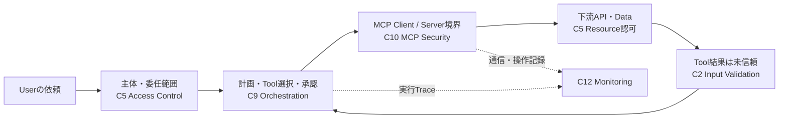
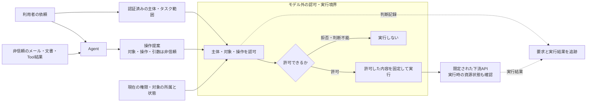

# P1 候補レビュー：Agentの操作提案を実行権限へ直結させない

- 作成日：2026-10-22
- 対象：既存LandscapeのP1のみ
- 判断：2026-10-22のユーザー対話で開発着手を了承。`retain`から`select`へ移行。
- 現在の状態：選定根拠の記録。[Pattern本文（draft）](../domains/agents/secure-tool-execution/README.md)を作成済み。製品の検証結果ではない。
- 候補の正本：[Landscape P1](pattern-landscape.md#p1-deterministically-authorized-tool-execution)
- 作業進捗と再開地点：[Engineering計画](../plan.md)

## 判断してほしい範囲

最初のPatternとして、**認証済みの起点主体に代わってAgentが提案した一つの操作を、
信頼できる権限・対象情報で認可してから実行する境界**を扱う。
注文照会・返金を説明例、クラウド運用を再利用性の比較例とする。返金アプリや汎用Agent基盤は作らない。
主配置は`engineering/domains/agents/secure-tool-execution/`とする。

人のレビューは候補の範囲と開発着手について行う。Patternの技術レビュー完了、
`reviewed`・`recommended`への昇格、実製品への配備承認とは別である。

## 読み手と成果物の方針

開発者が設計・実装時に参照し、「どこで何を判断し、何を信頼してはいけないか」を
読み取れるガイドを作る。今回の目的はRepository内のテスト一式を通すことではない。
Mermaidによる構成図、失敗しやすい設計との比較、要点を示す短いサンプル、実装時の確認事項を中心にする。
正常系・悪用ケースは読者が自分の実装を確かめる観点として残し、実行可能な試験基盤は作らない。

### 人が理解するための説明順と比較軸

本文は次の順序で読めるようにする。調査・推論の作業順と、読者へ提示する順序を混同しない。

1. **場面と問題:** 誰が何をしたいか、何が起きると困るかを短い業務例で示す。
2. **全体像:** Mermaidで主体・情報の流れ・信頼境界・今回扱う場所を示す。
3. **具体的な失敗:** 同じ登場人物・対象を使い、危険な操作がどこを通るかを追う。
4. **設計の要点:** どこで何を判断・強制すれば、その失敗を止められるかを説明する。
5. **実装の手掛かり:** 技術・製品・OSSと短い処理例を図の役割へ結び付ける。
6. **実装時の確認:** 正常利用・悪用時の少数の確認例、開発者への依頼例、重要な限界を示す。

図・表・例・サンプルの比較軸は「誰が／何に／どの操作を／どこで判断・実行するか」で揃える。
同じ対象の名称を途中で変えず、略語は必要な場所で説明する。
読者が細部を後からAI等で深掘りできるよう、参照先と深掘りの論点を残す。
細かなAPIオプションやまれな例外は本文から分けるが、設計を誤らせる前提・制約は本文に残す。

### 具体的な技術・製品・OSSの示し方

抽象語だけで終わらせず、可能な限り実際に選択できる技術・製品・OSSを示す。
候補名の羅列ではなく、次の形で図と結び付ける。製品の機能は本文作成時に公式資料で確認する。

| 図の役割 | 説明すること |
|---|---|
| 認証済み主体 | 認証・Identity連携の具体的な技術と、検証済み主体を取り出す場所 |
| 認可判断 | アプリ内の認可処理や外部Policy engineの具体例、判断に渡す情報 |
| 操作の強制・実行 | Tool gatewayやアプリの実行処理の具体例、許可判断を実際に強制する場所 |
| 対象の所属・状態 | DB・業務API等の具体例、対象情報の正本と実行時の状態確認 |
| 記録 | ログ・Traceの具体的な技術、認可判断と実行結果の対応 |

主な構成例を一つ通して説明し、設計判断が変わる少数の代替だけを添える。
各技術について、担当できる役割、アプリ側に残る処理、採用条件、公式参照先を短く示す。
製品を導入すれば認可・隔離が成立するという説明や、特定製品の必須化はしない。
今回のサンプルは設計の要点を示すものであり、製品を接続した実動デモの作成は含めない。

## 見取り図からPatternへ

[Familyの見取り図](../../controls/family-assurance-map.md)は、システムの各場所で
「何を保証するか」を示す入口である。Patternは同じデータの流れを使いながら、
一つの失敗経路について「なぜ失敗するか、どこにどの仕組みを置くか、実装で何に注意するか」を掘り下げる。
見取り図の一つの箱が一つのPatternになるわけではなく、一つのPatternが複数の箱を跨ぐこともある。

以下は見取り図の第3図を参照用に再掲したもの。Familyの位置づけを理解するための図であり、
P1のMappingや適合範囲ではない。Familyの説明の正本はリンク先に置く。

P1の図は、ここから操作提案・認可・実行の関係に焦点を当てる。
MCPは利用可能な接続方法の一つであり、P1の必須条件ではない。

この図の強制点を迂回する経路を作らず、Agentには下流APIを直接操作する広い資格情報や
認可Policyの変更権限を与えない。図の箱が別のプロセス・サービスでなければならないという意味ではなく、
実際の権限・通信・管理境界で迂回できない構成が必要である。

## 調査根拠と限界

既存の[ATLAS調査](mitre-atlas-pattern-discovery-2026-08.md)を起点とし、
[公式の固定データ](https://github.com/mitre-atlas/atlas-data/blob/41d4f5ca4112f0e492ffaa3ebff07dc80a75afa5/dist/v6/ATLAS-2026.08.yaml)
と研究者の一次報告を2026-10-22に再確認した。ATLASはrolling sourceであり、今回は
collection `2026.08`、format `6.0.0`、revision `41d4f5ca4112f0e492ffaa3ebff07dc80a75afa5`を使用する。
ローカルの調査用データのSHA-256は既存記録の
`a8d32f676854cc57721c217ec5b39f07db518076dee4a6c1335df0a7bc8271a2`と一致した。
最新版への更新調査ではなく、Source Registryの版・確認日も変更しない。

| 観察 | 一次報告と公開日 | 攻撃者能力・経路・観測された結果 | 読み取れないこと |
|---|---|---|---|
| O1：顧客対応Agent | [Zenity](https://labs.zenity.io/post/a-copilot-studio-story-2-when-aijacking-leads-to-full-data-exfiltration-bc4a)、2025-07-07。ATLAS `AML.CS0037`、`Exercise` | 研究者が再現したAgentへ攻撃メールを送り、知識・CRM情報の取得とメール送信を誘導した。 | 実顧客環境での被害、現行製品全般の脆弱性、提案する認可設計の実証ではない。 |
| O2：デスクトップ操作Agent | [HiddenLayer](https://www.hiddenlayer.com/research/indirect-prompt-injection-of-claude-computer-use)、2024-10-24。ATLAS `AML.CS0046`、`Exercise` | 攻撃者が用意したPDFの指示を、利用者の依頼で開いたAgentが処理し、シェルを通じた破壊操作に至った研究実証。 | 現行版の再現性、あらゆるコマンドの安全な認可方法、ホスト隔離の有効性は示さない。 |

一次報告は取得時点のWeb本文であり固定Revisionを提供していない。ATLASの固定記録と照合し、
後日の本文変更まで不変だとは主張しない。各実証を本作業では再実行していない。
二つの独立した研究チーム・システム類型が、外部入力から権限付き操作へ移る境界の問題を示す。
これはP1の反復性を支持するが、二事例の被害すべてをP1だけで防げる証拠ではない。

**補足の相違:** 既存P1に挙げられた`AML.CS0045`は、固定ATLAS記録では実行前の利用者確認に言及する。
[Backslashの一次記事](https://www.backslash.security/blog/simulating-a-vulnerable-mcp-server-for-context-poisoning)
（2025-06-24、2026-10-22参照）には通知なしの流出という記述もある。
この確認の有無を本レビューで確定せず、O1・O2を主な比較根拠とする。出典間の差を黙って統合しない。

## 問題の再構成と適用条件

共通する経路は、攻撃者が扱えるメール・文書等から、モデルの操作提案を経て、
アプリケーションやサービスの権限が行使されることである。
「モデルが提案した」「既知のToolである」「サービスのCredentialで成功する」は、
起点主体がその操作を許可されていることの証明にならない。

P1では、モデル外で操作範囲を定義できるシステムを対象とする。自由文の目的をモデル自身が
解釈して許可範囲を拡張する設計は対象に含めない。タスク開始時に信頼された処理が
許容する操作・対象を確定し、実行時には現在の権限・資源状態とも照合する。

### 説明用の二つの業務例（Repositoryによる構成例）

| 観点 | 注文照会・返金 | クラウド運用 |
|---|---|---|
| 起点主体 | 認証済みの顧客サポート担当者 | 認証済みの運用担当者 |
| 資産・副作用 | 顧客の注文情報、返金残額、返金処理 | サービス状態、可用性、再起動操作 |
| 非信頼入力 | 顧客メール、添付文書、モデルが生成する引数 | アラート本文、ログ、モデルが生成する引数 |
| 制限されたTool | 注文の照会、特定注文への返金 | サービス状態の取得、特定サービスの再起動 |
| 対象情報の正本 | サーバー側の注文所属・金額・既返金状態 | サーバー側のアカウント・環境・サービス所属 |
| 悪用例 | 他顧客の注文、担当権限外の返金、金額差し替え | 検証環境の依頼を本番操作へ変更、削除APIの要求 |
| 共通する拒否結果 | 未認可注文の情報を返さず、返金の副作用を起こさない | 未認可環境の情報を返さず、再起動・削除を起こさない |

この二例は事例の追試ではなく、O1・O2から導いた設計問題の再利用性を調べるもの。
任意シェルや任意URLへのHTTP呼出しを許したまま、引数の文字列検査だけで同じ保証が得られるとはしない。
特にO2のような広いシェルは、狭い操作APIへの置換または別途の実行環境隔離が必要になる。

## 実装で守る条件と確認の観点

以下は読者の設計・実装レビューに使う観点であり、このRepositoryでの実行済みテストではない。

| ID | 常に守る条件 | 強制する場所・信頼する情報 | 正常利用と悪用時に確認したいこと |
|---|---|---|---|
| I1 | モデルは起点主体・所属・付与された権限を上書きできない | 検証済みIdentityを保持するサーバー。操作提案とは別経路の主体情報 | 正しい主体で許可対象を取得できる。主体・顧客IDを提案へ混ぜても越境した情報や副作用が発生しない。 |
| I2 | 実行する操作は、主体・タスク・Tool・資源Policyのすべてで許可される | Tool実行前の強制点。サーバーの資源所属と現在の権限・業務状態 | 許可された照会／操作は成功。未知Tool、担当外資源、金額超過、失効後の要求は拒否。 |
| I3 | 許可した対象・操作・引数と、実際に実行する内容が一致する | 実行側で確定した操作値と資源状態の検証。共有可変のモデル提案を再利用しない | 許可した操作だけが到達する。判断後の引数差し替え・対象変更・状態変化で未認可の副作用を起こさない。競合防止は資源側の原子的検証が必要。 |
| I4 | 権限や対象が確定できないとき、広いサービス権限で代行しない | 認可・資源解決・実行Adapter。明示的な拒否と障害処理 | 正常な依存先では成功。認可Timeout、未知Policy、主体欠落時は拒否し、副作用なし。 |
| I5 | Agentからの操作は、認可を強制する経路を迂回できない | 下流の認証・認可、Credential配置、ネットワーク・管理境界 | Broker経由の許可操作は成功。Agentの実行Identityからの直接API呼出しやPolicy変更は拒否。実配備での証拠が必要。 |

判断・実行の記録には要求ID、主体参照、対象参照、操作、Policy版、許可／拒否理由、実行結果を残す。
秘密や顧客文書の本文は残さない。ログの存在だけで強制点が有効だったとは判断しない。

## 隣接問題と範囲を広げない理由

| 問題 | 今回の扱い |
|---|---|
| 人による承認 | 必要な操作で承認が認可に追加されること、承認した操作と実行の一致までを示す。承認UI・職務分離・承認疲れの包括設計は含めない。 |
| 再試行・二重返金 | 下流の冪等性と結果照会を前提・運用上の限界に明記。P1の単一操作認可だけで二重実行防止を保証しない。 |
| Credential発行・多段委任 | P3・P14との境界。Agentに広い資格情報を渡さない前提は必要だが、OAuth／MCP仕様や発行基盤を実装しない。 |
| 任意コード・ホスト侵害 | P13・P17との境界。認可された引数でも危険なInterpreterに渡せば安全とは言えない。 |
| 認可の管理面 | P20との境界。AgentがPolicyを書き換えられないことを前提・配備確認に含めるが、管理基盤全体のPatternを同時開発しない。 |
| 長いタスクの目的・累積上限 | P15との境界。個々の操作が許可されても総量・組合せの危険は残る。 |
| 検索・会話の内容制御 | P2・P4等との境界。今回の学習をそのままP1の要件へ移さない。 |

認可された操作でも、業務判断の誤りや機微情報の不適切な組合せは残る。
モデルによる意図の理解が正しいことや、Prompt Injectionの完全防止を主張しない。

## サンプルで示す要点と実装時のガイド

本文の主役は構成図と設計上の判断である。短い疑似コードまたは処理の対比で、次の要点を示す。

1. 認証済みの主体・タスク範囲と、モデルが生成した操作提案を別々に受け取る。
2. Tool・引数を検査し、対象の所属・現在の権限・業務状態を信頼できる側で確認する。
3. 判断不能なら止め、許可できた内容を固定して限定された操作へ渡す。
4. 実行時の状態変化に対応し、判断と実行結果を追跡できるようにする。

「モデルの提案を共有サービス権限でそのまま実行する」失敗例との対比を置き、
各処理が何を守るのかを説明する。完成した認可ライブラリやコピーするだけで安全になる実装として提示しない。
サンプルに省略した認証、Policy管理、DB競合制御、冪等性などは、読者が自分の環境で設計すべき点として明示する。
Pythonや特定フレームワークの採用は前提にしない。模擬サービス・実行可能テスト一式・CIは今回作らない。

I1〜I5は、読者が自身の実装で正常利用・越境・失効・障害・迂回を点検する観点として使う。
詳細な試験基盤の代わりに、「何を試し、何が起きなければよいか」を少数の具体例で示す。
例えば、他顧客の注文を指定した際に、拒否メッセージだけでなく注文情報や返金の副作用が出ないことを見る。
資格情報やネットワークの分離は図だけでは成立せず、配備環境で確認する必要があると説明する。

資料の完成時には図・説明・サンプルの整合性、リンク、危険な省略や過大な保証がないかを確認する。
この文書品質の確認と、読者の実製品に対する安全性検証は区別する。

### 開発者に依頼する具体例

> 「今回のAgentの実行Identityと、実際にAPIを呼ぶIdentityを見せてください。
> 他顧客の注文を指定した要求が拒否され、下流に返金が作られていない記録を確認したいです。」

十分な証拠は、対象版・Policy・認可結果・下流状態が対応すること。
「モデルが断りました」だけなら、モデルを通さず同じ操作提案を入力しても止まるか確認する。

> 「Agentの実行環境からBrokerを通さず同じAPIへ接続した場合と、Policyを書き換えようとした場合の結果を見せてください。」

十分な証拠は実際のRuntime Identity、アクセス制限、拒否記録、変更されていない下流状態。
構成図だけなら、配備環境での負の試験が未確認と記録する。

## 候補昇格の確認

| Gate | 本レビュー時点の判断 |
|---|---|
| 反復性 | O1・O2の独立した研究実証により支持。実被害・現行版の再現性とは区別。 |
| まとまった境界 | モデルの操作提案から認可・実行までに限定。上表で独立した問題を分離。 |
| 不変条件・強制点・反証 | I1〜I5を実装時の確認観点として整理。実行可能テストの作成は今回の対象外。 |
| 主配置と再利用 | agentsを主配置とし、返金とクラウド運用で同じ判断構造を比較。 |
| 人による候補範囲レビュー | 2026-10-22の対話で「OK. その方針ですすめよう！」と了承。Negative testチェックシートの追加も反映。本文の技術レビューとは区別。 |

この範囲を引き継いで、[本文・構成図・技術例](../domains/agents/secure-tool-execution/README.md)と
[Negative testチェックシート](../domains/agents/secure-tool-execution/negative-tests.md)を作成した。Framework Mappingは行っていない。
技術レビュー担当者と長期Ownerは未割当であり、`recommended`の条件を満たしたとは扱わない。
