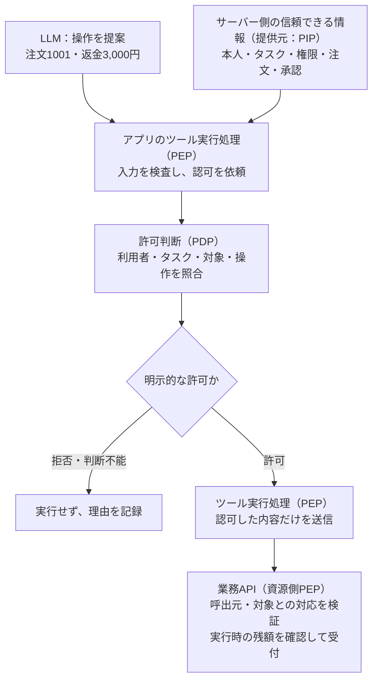

# 実装の要点：ツール実行前に何を・どこでチェックするか

[Pattern本文](README.md)で**制限付き実行が必要と判断した場合**の「担当者Aが注文1001へ3,000円の返金を依頼する」を、
自分のアプリのどこへ組み込むかを説明する。
**ツール呼び出しを受け取る処理に認可を置き、許可した内容だけを業務APIへ渡す。**

Agent・ツール・業務APIの関係を先に確認したい場合は、[本文の全体像](README.md#1-全体像モデルの提案をアプリが実際の操作へつなぐ)から読む。
読む順序は、組み込み位置の図 → 許可／拒否の一往復 → 短い処理例 → 確認事項。
情報の取得元・照合内容・強制する場所は、[本文のチェック表](README.md#5-何をもとに何をどこでチェックするか)を参照。
後段に、認可判断をOPAで実装する場合の例を置く。アプリ内の認可関数でも同じ境界を作れる。
ここで示すのは設計の要点であり、完成したサービスや実行検証済みコードではない。

## 先に、照会と提案で足りる場合の実装を確認する

主例では、既存の注文照会APIに本人・注文・照会タスクの認可を適用し、その結果から返金案を表示する。
ツール登録と資格情報を照会専用にし、返金ツール・汎用HTTPによる迂回経路を公開しない。
提案を表示しても返金APIは呼ばず、担当者が既存画面で確認して実行する。APIの通常の認可・業務状態確認は残す。
[チェックシートの構成別確認](negative-tests.md#構成を選んで確認する)で、この分離を確かめる。

以降は、実行をAgent経路へ追加するときの要点である。OPAも独立サービス化も必須ではない。

## 1. 自分のアプリのどこに入れるか

LLMが返したツール名と引数を受け取り、実際の関数やAPIを呼ぶ処理を探す。
この**ツール実行処理（handler／dispatcher）**が、許可されていない要求を止める場所になる。
Pattern本文では、この処理を持つバックエンドを「実行サービス」と呼ぶ。



認可判断（PDP）は可否を返し、ツール実行処理（PEP）はその結果に従って止める。
ルールを作成・管理する役割がPAPであり、Agentに変更させない。
これらは役割の名前で、役割ごとに別サービスを建てるという意味ではない。

**業務APIの資格情報と直接の実行経路をAgentに渡さない。**
同じアプリ内に置く場合も、モデルは構造化された提案だけを返す前提とする。
モデルが任意コードを実行できる環境へ同じ資格情報を置く構成は、この境界を迂回できる。

## 2. 3,000円なら進み、4,000円なら止まる

担当者Aは会社Aの注文1001を担当する。通常の返金権限は5,000円、今回のタスクで一回に依頼できる上限は3,000円、
注文の返金可能残額は8,000円。注文1001への3,000円の返金依頼は人が承認済みとする。
主体・タスク・承認は有効期限内で、返金可能な注文という前提で比較する。

ここで確認するのは一回の要求金額であり、タスク全体の累積額ではない。
3,000円を二回依頼することや同じ承認の再利用を止めるには、累積額や承認の使用状況を別途管理する。

| LLMが提案した内容 | アプリが信頼する情報との照合 | 結果 |
|---|---|---|
| 注文1001へ3,000円 | 担当・タスク・金額上限・承認がすべて一致 | 許可。業務APIが実行時の条件も確認して返金依頼を一件受付 |
| 注文1001へ4,000円 | 今回のタスク上限3,000円を超え、承認金額とも不一致 | 拒否。業務APIを呼ばない |
| 注文9001へ3,000円 | 別会社の注文で、担当・タスクの範囲外 | 拒否。注文内容もAgentへ返さない |
| 注文1001へ3,000円、承認情報を取得できない | 実行してよいと判断する根拠が揃わない | 判断不能として停止。業務APIを呼ばない |

金額だけで決めるのではなく、**誰が・どのタスクで・どの注文に・何をしてよいか**をまとめて確認する。
この例の承認は金額まで一致させるため、2,000円へ変更した場合も再承認が必要になる。
返金依頼の受付と外部決済の完了は別の処理である。

## 3. ツール実行処理に入れる短い例

モデルが送る提案は三項目だけにする。本人・所属・承認はサーバーが別に取得する。

```json
{"action": "refund.request", "order_id": "1001", "amount_jpy": 3000}
```

次は言語非依存の疑似コード。`認可を判定`で照合するのは、上のチェック表にある権限・タスク・承認の条件である。
その前後で、アプリが信頼できる情報を集め、許可した命令だけを実行へ渡す。

```text
refund.request のツール呼び出しを受けたら：
  命令 = 提案を検査し、操作・注文・金額を変更不能な値としてコピー
  主体・タスク = 検証済みセッションと、サーバーに保存した実行ジョブから取得
  注文・権限・承認 = サーバー側の管理元から現在値を取得
  認可入力 = 命令と上の情報を、項目を指定して組み立てる

  判断 = 認可を判定(認可入力)           ← 権限・タスク・承認を照合
  判断が明示的な許可でなければ：
    拒否理由を記録して終了             ← 業務APIは呼ばない

  返金依頼APIを呼ぶ(命令, 信頼済み実行コンテキスト)
    # 固定の接続先へ、実行サービス専用の資格情報で送る
    # 業務APIは呼出元・主体／タスクと操作の対応を検証する
    # 同じトランザクション内で現在の注文状態・残額を確認し、受付を記録する
  判断と受付結果を要求IDで対応付けて記録
```

検査・情報取得・認可のどこで失敗しても、API呼び出しへ進めない。
`信頼済み実行コンテキスト`は、サーバーが主体・タスク・承認と今回の命令を結び付けた情報を指す。
業務APIへどう伝えるかは既存の認証・認可方式に合わせて決める。[補足A](#補足aサービス間で認可した内容を引き継ぐ一案)に一案を示す。

| アプリが実装する部分 | この例で守ること |
|---|---|
| 提案の検査 | 登録した操作と引数だけを受け付け、必須項目・型・長さ・範囲を確認。未知・重複JSONキーを拒否。金額は正の整数円とし、文字列・booleanを数値へ変換しない |
| 本人・タスク・承認の取得（PIP） | 検証済みセッションとサーバーのジョブの対応から取得。モデルの`user_id`・タスクID・`approved`で差し替えない |
| 注文・権限の取得（PIP） | 所属・担当・返金可否・上限・残額を管理元から取得。認可前に注文内容をAgentへ返さない |
| 認可入力の構築 | モデル提案とサーバー情報を汎用的にマージしない。双方の必須項目・型を確認し、取得失敗や失効では止める |
| 許可した操作の実行（PEP） | 判定後も同じ命令を使う。元のモデル提案を読み直さず、接続先・メソッド・ヘッダーをモデルに選ばせない |

注文の残額は認可後にも変わるため、業務API側の確認と更新を一つのトランザクションにする。
別基盤の権限・承認には失効の反映期限と確認方式を決め、古い許可を無期限に使わない。
この例は`refund.request`用であり、`order.lookup`には開示前に適用する別の認可ルールが必要になる。

## 4. 自分の実装で何を確認するか

まず、第2節の3,000円の正常系が通ることを確認し、同じ環境で条件を変える。
[Negative testチェックシート](negative-tests.md)には試す操作・期待結果・証拠・結果欄がある。
以下は要点との対応であり、実行済みの試験結果ではない。

| 確認すること | 対応するチェック |
|---|---|
| 本人・タスク・承認をモデルが偽装できない | N1 主体偽装、N5 承認流用、N10 情報欠落 |
| 別会社の注文やタスク上限を超える提案を止める | N2 越境、N3 上限、N4 引数逸脱 |
| 許可した値だけを渡し、実行時の残額も確認する | N6 差し替え、N7 状態競合 |
| 失効・認可障害でAPIを呼ばない | N8 失効、N9 認可障害 |
| Agentが直接APIを呼んだり、ルールを書き換えたりできない | N11 直接実行、N12 認可ルール変更 |

> 開発者への依頼例：「LLMのツール呼び出しを受け取ってから、返金APIを呼ぶまでの処理を見せてください。
> どこで担当者と注文を照合し、4,000円ならどの行で止まりますか。
> 本人・承認の取得元と、認可した注文・金額がそのままAPIへ渡ることも確認したいです。」

> 運用担当者への依頼例：「拒否された要求IDについて、判断記録と返金台帳を突き合わせてください。
> Agentの返答だけでなく、返金依頼が受け付けられていないことを確認したいです。」

## 5. 任意の実装例：判定部分にOPAを使う場合

OPA（Open Policy Agent）は、入力された情報をルールに照らして判断を返すポリシーエンジンである。
この例では認可関数の役割を担う。セッションや注文を自動で取得したり、返金APIを実行したりするものではない。

### 採用するかを決める

以下は本PJの設計上の選択目安であり、製品の採用必須条件ではない。

| 状況 | 実装の選択肢 | 引き受けること |
|---|---|---|
| 一つのアプリで少数のルールを扱う | アプリ内の認可関数 | ルールの変更・レビュー・判断記録をアプリで管理する |
| 複数のアプリでルールを共有し、アプリと分けて更新したい | OPAなどのポリシーエンジン | ポリシーの配布・版管理、評価の障害・遅延、入力情報の鮮度を管理する |

OPAにはポリシー配布と判断ログの仕組みがあるが、入力情報の取得と拒否の強制はアプリの責務として残る。
[公式のツール呼び出し解説](https://www.openpolicyagent.org/docs/agent-tool-calling)でも、
実行プログラムをPEP、OPAをPDPとして、実行前に照会する構成が示されている。

### 第3節の「認可を判定」を実装する

```text
実行サービス → OPA
  固定の POST /v1/data/foundry/refund/allow
  本文：{"input": 認可入力}

OPA → 実行サービス
  {"result": true}  → この入力に対応する命令だけを実行へ渡す
  それ以外・障害    → 実行しない
```

成功と扱うのは、HTTP 200かつJSONオブジェクトで、`result`がbooleanの`true`の場合だけ。
`false`・欠落・`null`・文字列の`"true"`・数値の`1`、タイムアウト、解析失敗、応答サイズ超過では止める。
HTTP 200だけでは許可と判定しない。[Data API仕様](https://www.openpolicyagent.org/docs/rest-api)

接続先と評価パスは配備設定で固定し、実行サービスが認証したOPAへ問い合わせる。
Agentから渡された`{"result": true}`は採用しない。評価APIの利用権限とポリシー更新権限も分ける。
OPAの応答は署名付きの実行許可証ではなく、この問い合わせに対する判断である。
[OPA APIの保護](https://www.openpolicyagent.org/docs/security)

<details>
<summary>同じ返金例の入力JSONとRegoルールを見る</summary>

### 入力とルールの詳細

以下は**実行サービスが組み立てる**リクエスト本文。`proposal`以外の値をAgentから受け取るAPIにはしない。
識別子と時刻は架空の説明値。実装ではサーバーが得た現在値に置き換える。

```json
{
  "input": {
    "proposal": {
      "action": "refund.request", "order_id": "1001", "amount_jpy": 3000
    },
    "subject": {
      "id": "staff-a", "tenant_id": "company-a", "active": true,
      "actions": ["order.lookup", "refund.request"], "refund_limit_jpy": 5000
    },
    "task": {
      "id": "task-1001", "subject_id": "staff-a", "order_id": "1001",
      "active": true, "actions": ["order.lookup", "refund.request"],
      "max_amount_jpy": 3000, "expires_at_epoch_s": 1800000300
    },
    "order": {
      "id": "1001", "tenant_id": "company-a", "assignee_id": "staff-a",
      "refundable": true, "remaining_jpy": 8000
    },
    "approval": {
      "id": "approval-1001", "subject_id": "staff-a", "task_id": "task-1001",
      "action": "refund.request", "order_id": "1001", "amount_jpy": 3000,
      "active": true, "expires_at_epoch_s": 1800000300
    },
    "now_epoch_s": 1800000000
  }
}
```

サーバー由来の情報も、必須項目と型を検証してからOPAへ渡す。
IDは空でない文字列、権限は操作名の配列、金額・期限は整数、状態はbooleanとする。
型不正をRegoの大小比較だけで検出しようとしない。

### 認可ルール：許可条件がすべて揃ったときだけ進める

OPA 1.x / Rego v1の記法で示す。`default allow := false`を起点に、
同じ`allow`本体内の条件をすべて満たした場合だけ許可する。
これは本PJの業務例に対するルールであり、OPAの組み込み返金ポリシーではない。

```rego
package foundry.refund

import rego.v1

default allow := false

allow if {
    p := input.proposal
    s := input.subject
    t := input.task
    o := input.order
    a := input.approval

    # 誰が、どのタスクで、どの注文を扱うか
    s.active == true
    t.active == true
    t.subject_id == s.id
    input.now_epoch_s < t.expires_at_epoch_s
    p.action == "refund.request"
    p.action in s.actions
    p.action in t.actions
    p.order_id == t.order_id
    p.order_id == o.id
    o.tenant_id == s.tenant_id
    o.assignee_id == s.id

    # 利用者・タスク・注文がそれぞれ許す金額か
    o.refundable == true
    is_number(p.amount_jpy)
    p.amount_jpy == floor(p.amount_jpy)
    p.amount_jpy > 0
    p.amount_jpy <= s.refund_limit_jpy
    p.amount_jpy <= t.max_amount_jpy
    p.amount_jpy <= o.remaining_jpy

    # 承認した操作と、今回実行する操作が一致するか
    a.active == true
    a.subject_id == s.id
    a.task_id == t.id
    a.action == p.action
    a.order_id == p.order_id
    a.amount_jpy == p.amount_jpy
    input.now_epoch_s < a.expires_at_epoch_s
}
```

担当者の通常上限が5,000円でも、タスク上限が3,000円なら4,000円は拒否する。
承認した3,000円を2,000円に変えた場合も、この例では承認内容の不一致として再承認を求める。
承認範囲を金額上限として扱う業務では、承認画面とルールの両方でその意味を明示する。

このルールは、入力の出所、業務APIの呼出元、実行時点の残額まで保証しない。
第3節の入力構築と実行境界を合わせて実装する。

</details>

### 公開されている実装・連携例

| 一次資料 | 何が具体化されているか | この資料で確認できる範囲 |
|---|---|---|
| [OPA公式：Agent Tool Calling](https://www.openpolicyagent.org/docs/agent-tool-calling) | ツール名・引数を実行前に評価するRegoとREST API呼び出し | 公式の解説サンプル。公式例は拒否理由の集合を返すが、本例は明示的なbooleanの許可を要求する |
| [Solo.io：Enterprise AgentgatewayのOPA演習](https://github.com/solo-io/fe-enterprise-agentgateway-workshop/blob/main/labs/security/opa-authorization.md) | 外部認可サービス内のOPAエンジンでLLM／MCPルートを保護する設定 | 商用製品向けの演習。今回の注文・金額・承認の業務ルールを実装した例ではない |
| [OPA公式：OPA–Envoy plugin](https://github.com/open-policy-agent/opa-envoy-plugin) | Envoyの外部認可APIとOPAをつなぐOSS実装 | AI専用ではないHTTPリクエストの認可連携 |

これらは構成を具体化する参考になる。今回の返金Agentと同じ構成の本番導入実績を示すものではない。

## 補足A：サービス間で認可した内容を引き継ぐ一案

**ここからは、実行サービスと業務APIが別サービスの場合の設計例。専用ストアの新設はPatternの必須条件ではない。**
必要なのは、業務APIが信頼できる形で主体・タスク・承認と実行内容の対応を確認できること。
既存の認証・認可方式でこの対応を渡せるなら、それを使う。
要求IDで保存済み命令を参照する方式を選ぶ場合は、次のように構成できる。

```text
実行サービス：認可した命令と主体・タスク・承認を、サーバー生成の要求IDに結び付けて保存
  → 専用資格情報で固定の返金依頼APIへ、要求ID・注文・金額を送る
業務API：呼出元を認証し、信頼するストアから要求IDの記録を取得
  → 記録の有効性と、主体・タスク・承認・受信した注文・金額の対応を検証
  → 実行時の条件を確認して返金依頼を受付
```

要求ID自体を認証情報にはしない。mTLS等で許可された実行サービスを確認し、
記録なし・期限切れ・値の不一致・異なる呼出元では拒否する。
キューを挟む場合も、受信側が保存済み命令を取得し、遅延中の失効や状態変化を再確認する。

## 補足B：API接続と結果不明時の扱い

接続先は配備設定の`https://orders.example.invalid/v1/refund-requests`などに固定する。
HTTPクライアントは証明書検証、接続・読取りタイムアウト、応答サイズ制限を有効にし、
リダイレクトを自動追従しない。資格情報は実行サービスにだけ注入する。

受付後に通信が途切れた場合は結果不明として要求IDで照会し、無条件に再送しない。
要求IDがあるだけでは二重受付を防げない。再送を許すなら業務APIで重複検出を実装する。

## 参照と確認範囲

2026-10-22にRego v1とData APIの公式資料を確認し、2026-10-23に公開連携例を追加した。
参照先は更新型の公式文書・mainブランチであり、特定製品版の結合動作を保証するものではない。
返金の業務ルールと組み込み例は本PJの設計解釈で、OPAの組み込み返金ポリシーではない。
OPA 1.x / Rego v1を想定するが、Regoのコンパイル・実行、API接続、配備分離、競合制御の実行検証は未実施。

- [OPA Policy Language](https://www.openpolicyagent.org/docs/policy-language)：ルールと構造化入力。
- [OPA default](https://www.openpolicyagent.org/docs/policy-reference/keywords/default)：既定の拒否。
- [OPA v1への移行](https://www.openpolicyagent.org/docs/v0-upgrade)：Rego v1の言語要件。

認証・通信には既存の認証基盤・TLS実装を使い、秘密値や証明書をサンプルに埋め込まない。
