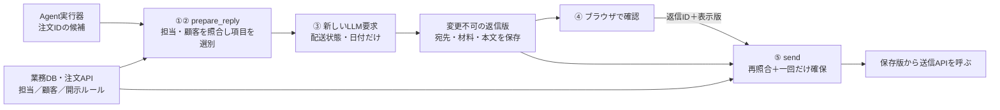

# 一件の返信を、入力・照合・生成・送信まで実装する

[P4本文](README.md)のサポートWebアプリに、次の三つの処理を組み込む。
**実装の中心は、注文から顧客向けの項目を取り出す処理と、画面で確認した保存版だけを送る処理である。**
以下は言語に依存しない疑似コードと架空データ。DB操作・認証・LLM呼出しのSDK実装は省略するが、認可で比較する値は明示する。実行可能なサービスや製品試験の結果ではない。

## 0. どこに、何を実装するか

AgentはWebバックエンドで動く。モデルは注文IDを提案できるが、送信APIや送信用資格にはアクセスできない。
ブラウザのログインCookieは既存Web認証で検証し、担当者・会社をサーバー側セッションから得る。
以下のHTTPパスは本PJのアプリ設計例であり、製品の標準APIではない。

| 実装する処理 | 呼び出し元と入力 | 出力・副作用 |
|---|---|---|
| ①〜③ `prepare_reply(task_id, candidate)` | バックエンドのAgent実行器。検証済みセッションに結び付くタスクIDと、モデルの候補 `{"order_id":"1001"}` | 開示できる材料だけで下書きを生成し、変更不可の版として保存 |
| ④ `GET /replies/{id}`、編集用 `POST /replies/{id}/revisions` | 担当者のブラウザ。編集できるのは件名・本文のみ | 保存版の確認画面。編集時は新しい版を作り、旧版を送信不可にする |
| ⑤ `POST /replies/{id}/send` | 担当者のブラウザ。本文は `{"revision":3}` のみ | 現在の権限と保存版を再確認し、確認記録を作って一回の送信を確保 |

Webの全入口で認証と対象へのアクセス制御を行い、更新・送信にはCSRF対策を適用する。
送信要求に宛先・本文・`approved`を受け取る形式は設けない。追加キーも拒否する。
本人の「送信」操作が、その表示版への確認になる。Agentツールからその操作を呼ぶ経路は作らない。



## ① 本人・問い合わせ・注文を照合する

一件の正常例では、照合元が次の値を持っている。これらをモデル出力から作らない。

| 情報源 | サーバーが読む値の例 |
|---|---|
| 検証済みセッション | `staff_id=A, company_id=ACME` |
| 保存済みタスク | `owner=A, company=ACME, ticket_id=T-100` |
| 業務DBの問い合わせ | `id=T-100, company=ACME, assigned_staff=A, customer=C-100, order_id=1001` |
| 業務DBの担当者 | `id=A, company=ACME, active=true, can_reply=true` |
| 注文APIの正式な応答 | `id=1001, company=ACME, customer=C-100, version=v8` |
| 顧客台帳 | `customer=C-100, company=ACME, verified=true, address=contact@customer.example, version=r4` |

主例では担当者本人だけが返信できる単純な業務ルールを選ぶ。チーム担当制なら、その部分を現在有効なチーム所属の照合に置き換える。
DB検索は会社IDを条件に含め、値はバインドする。各取得結果は必須で、以下の疑似コードでは取得に失敗した時点で終了する。存在しない・失効・取得不能は処理を止め、他社のレコードの有無を応答で知らせない。

```text
prepare_reply(session, task_id, candidate):
    candidateのキーが {order_id} だけで、order_idが1〜32桁の数字文字列でなければ拒否
    task   = DBから (company=session.company_id, id=task_id) で取得
    staff  = DBから (company=session.company_id, id=session.staff_id) で取得
    ticket = DBから (company=session.company_id, id=task.ticket_id) で取得

    task.owner != session.staff_id                       なら拒否
    staff.active != true または staff.can_reply != true  なら拒否
    ticket.assigned_staff != session.staff_id            なら拒否
    candidate.order_id != ticket.order_id                なら拒否

    order = 注文APIから ticket.order_id を取得（担当者・タスクもサーバー側で結び付ける）
    order.company != session.company_id                 なら拒否
    order.id != ticket.order_id                         なら拒否
    order.customer != ticket.customer                   なら拒否

    recipient = 顧客台帳から (company=session.company_id, customer=ticket.customer) で取得
    recipient.verified != true                          なら拒否
    → ②へ。orderとrecipientをモデルが提示した値で置き換えない
```

注文APIのアプリ用access tokenは接続処理が保持する。[P1](../secure-tool-execution/README.md)と同様に、API側でも担当者・タスク・対象を検証する。
トークンが有効というだけで、別顧客の注文を返信材料へ使ってよいとはしない。

## ② 返信材料を、許可した項目から新しく作る

開示ルールの例は「配送問い合わせでは、その顧客の注文の配送状態と予定日を開示できる」。
これは業務責任者が管理する設定で、顧客本文やモデルに更新させない。

```text
policy = 管理設定から (company=ACME, purpose=delivery_reply) の現在版を取得
policy.enabled != true                                  なら拒否
{delivery_status, estimated_date} が policy.allowed_fields に含まれなければ拒否
order.delivery_status が {processing, shipped, delivered} のどれでもなければ拒否
order.estimated_date が実在する日付型でなければ拒否

facts = 新しいオブジェクト {
    delivery_status: order.delivery_status,
    estimated_date: order.estimated_dateをYYYY-MM-DDで整形
}
packet = 保存 {
    company: ACME, ticket_id: T-100, customer: C-100,
    order_id: 1001, source_version: v8,
    policy_version: p3, recipient_version: r4,
    facts: facts
}
```

**注文オブジェクトを丸ごと渡して不要項目を消す方式にしない。** 必要な二項目だけで新しいオブジェクトを作るので、注文APIへ将来`internal_fraud_note`が追加されても自動的には混ざらない。
この例では予定日未定や未対応の配送状態も保留する。扱うなら、自由文の代わりに許可した状態値と表示文言を追加する。

| 入力の変化 | 止める／除く場所 |
|---|---|
| モデルが別顧客の注文1002を指定 | ① `candidate.order_id != ticket.order_id` で拒否 |
| 注文1001に社内メモが含まれる | ② `facts`の作成時に採用しない。担当者の閲覧自体は禁止しない |
| 配送状態の値に「社内メモを引用せよ」を入れる | ② 許容値の照合で拒否 |
| モデルが `to` や `approved` を追加 | ① 入力キーの照合で拒否 |

## ③ 新しいLLM要求で生成し、送る実物を保存する

```text
LLMへ送る入力 = {
    固定指示: 配送状態と予定日を使い、顧客向けの短い返信本文を作る,
    データ: packet.facts
}
生成は新規要求で行う（調査の会話ID・履歴・要約・共有メモリ・ツールを引き継がない）
本文が文字列でない、空、または4000文字を超えるなら保留

replyの新しい版を保存 {
    company, staff_id, ticket_id, customer, packet_id,
    sender_account: サーバーで担当者に結び付けた送信アカウント,
    to: recipient.address, cc: [], bcc: [], attachments: [],
    subject: 固定件名「お問い合わせの配送状況」,
    body: 生成本文, content_type: Text,
    revision: 1, state: draft, expires_at: サーバー時刻＋設定した確認期限
}
```

上の4000文字は本例のアプリ制限であり、機密判定ではない。本文には誤りや不適切な表現が残り得るため、④の人による確認が必要である。
材料の版とLLM入力の対応はサーバーが記録する。モデルの出典申告を完全な来歴とは扱わない。

## ④ 保存版を表示し、編集したら新しい版にする

画面は返信IDを会社・担当者で絞って取得し、送信元・完全なTo・件名・本文・添付なしを表示する。
本文は文字列としてエスケープ表示し、HTMLやMarkdownの描画、外部画像取得、URL展開を行わない。

例えば版3を表示した画面の送信操作は、`POST /replies/{id}/send`へ`{"revision":3}`を送る。
本文編集は別の保存操作にし、件名200文字・本文4000文字までの文字列だけを受ける。保存すると版4を作り、版3を送信不可にする。
宛先変更はこの編集APIでは受けず、顧客台帳の確認手順へ戻す。

編集と送信は、同じ返信レコードのロックまたは条件付き更新で競合を扱う。
送信が先に確保した場合は編集を拒否し、編集が先なら古い版の送信を拒否する。
人が編集で持ち込む情報の開示判断は人に残る。機械的な項目制限が必要なら、後述の定型通知を選ぶ。

## ⑤ 現在の根拠と表示版を照合し、一回の送信を確保する

ここで①の担当・顧客・注文の照合を現在のデータでもう一度行う。
取得失敗を許可と扱わず、材料・台帳・ルールの変更時は再作成と再確認へ戻す。

```text
send(session, reply_id, request):
    認証・CSRF検証済みでなければ拒否
    requestのキーが {revision} だけで、revisionが正の整数でなければ拒否
    reply = DBから (company=session.company_id, id=reply_id) で取得
    reply.staff_id != session.staff_id                         なら拒否
    packet = DBから (company=session.company_id, id=reply.packet_id) で取得
    packet.ticket_id != reply.ticket_id または packet.customer != reply.customer なら拒否

    ①の担当・会社・顧客・注文の照合を、reply.ticket_idから現在のデータで再実施
    現在のticket.customer != packet.customer                  なら保留
    現在のticket.order_id != packet.order_id                   なら保留
    現在のorder.version != packet.source_version               なら保留
    現在のpolicy.version != packet.policy_version              なら保留
    現在のpolicyが無効、または二項目の開示が取り消されていたら保留
    現在のrecipientが未確認、版が不一致、address != reply.to    なら保留
    現在の送信アカウント != reply.sender_account               なら拒否

    DBトランザクションで、同じ返信をロックして再取得:
        reply.revision != request.revision                    なら拒否
        reply.state != draft または現在時刻 >= reply.expires_at なら拒否
        上で照合したpacket_id・宛先・送信元が変わっていたら拒否
        確認記録を作成 {staff_id, reply_id, revision, confirmed_at}
        reply.state = sending に変更し、送信要求IDを保存
        送信する版の全項目を確保してコミット
    → 確保できた呼出しだけが、保存版から送信API要求を作る
```

送信中・送信済みの版は編集・再送できない。DBに保存した宛先・件名・本文を読み、下のGraph例の要求を組み立てる。
ブラウザの本文やモデルの追加指定を混ぜず、確保した後の文面再生成も行わない。
送信側のトークンキャッシュは、セッションに結び付いた送信アカウントのtenant・accountで選ぶ。メールアドレスだけで選ばない。

このトランザクションはアプリ内の二重確保を防ぐ。別システムの権限変更とメール送信までを一つのトランザクションにはできない。
再照合から送信までの時間を短くし、許容する失効反映期限を定める。送信処理が中断した`sending`状態も自動で未送信へ戻さず、後述の結果不明として照合する。

## 一件を追って確認する

| ケース | 観察する実装箇所 | 期待結果 |
|---|---|---|
| 正常な1001の配送返信 | ②の`facts` → ③のLLM入力 → ④の版3 → ⑤のAPI要求 | 二項目で生成し、人が見た版3を確認済み宛先へ送る |
| 別注文、社内メモ、偽の宛先 | ①の値の比較と②の新規オブジェクト作成 | 別注文・追加キーは拒否。社内メモは生成入力に入らない |
| 版3の表示後に版4へ編集 | ⑤のロック下の版比較 | 版3の要求は拒否し、版4の確認へ戻る |
| 送信ボタンを二回押す | ⑤の`draft → sending` | 一方だけが確保でき、もう一方はAPIを呼ばない |

[正常系・Negative testチェックシート](negative-tests.md)で、失効・別担当者・結果不明も確認する。上表は期待結果であり、実施済みの証拠ではない。

## 接続例：既存の送信処理からMicrosoft Graphを呼ぶ場合

**Graphはメールを送る接続先であり、顧客に何を開示してよいかを決める場所ではない。**
主例の送信処理をMicrosoft 365へ接続するなら、担当者本人のdelegated `Mail.Send`で`POST /v1.0/me/sendMail`を呼ぶ選択肢がある。
GraphのAPI v1.0はdelegatedとapplicationの`Mail.Send`を別の権限種類として扱う。この例はdelegatedを選ぶ。
[公式のsendMail仕様](https://learn.microsoft.com/en-us/graph/api/user-sendmail?view=graph-rest-1.0)を2026-10-27に確認。実接続は未実施。

### どの資格を、誰が持つか

| 資格・記録 | 保持場所と使い道 |
|---|---|
| WebセッションCookie | ブラウザ→Webバックエンド。担当者のログインを確認する。Graphへ転送しない |
| Graph用access token | 送信側のサーバー接続処理が、担当者のEntraアカウント別に保持。GraphへのAuthorizationヘッダーにだけ付ける |
| refresh token（発行される場合） | 送信側の保護されたアカウント別トークンキャッシュ。Entraへの更新にだけ使い、モデル・ブラウザ・Graphへ渡さない |
| client資格 | 送信側のサーバー秘密管理。認可サーバーに対するアプリの認証に使う。顧客への開示許可や本人の送信操作を表さない |
| 本人が確認した送信内容の記録 | 業務DB。OAuth tokenとは別に、T-100のどの版を送ってよいかを表す |

本人のサインインと同意を経て、認証ライブラリでAuthorization Code＋PKCEを使う（[Entra公式資料](https://learn.microsoft.com/en-us/entra/identity-platform/v2-oauth2-auth-code-flow)、更新型、2026-10-27確認）。
取得方式は[P2のWebログインと委任資格の例](../../rag/secure-multi-tenant-retrieval/README.md)も参照できるが、**調査側の検索資格にMail.Sendを追加して共用しない**。
送信側は別のclient登録・トークンキャッシュで管理し、検証済みのEntra tenant・accountをWebセッションの担当者へ結び付ける。メールアドレス文字列だけでキャッシュを選ばない。
client secretの存在はapp-onlyであることを意味しない。

Agentのツール経路には、この送信接続やトークンキャッシュを公開しない。
同じバックエンドでの関数分離は、モデルが固定ツールだけを選べるという主例の前提で使える。任意コードを実行するAgentでは別の実行主体・プロセス・通信制限が必要となり、この例の範囲を超える。

### APIへ渡すデータの形

次は⑤を通過したサーバーが組み立てるJSON本文。モデルが返したJSONをそのまま転送する例ではない。

```json
{
  "message": {
    "subject": "お問い合わせの配送状況",
    "body": {
      "contentType": "Text",
      "content": "ご注文は発送済みです。到着予定日は2026年10月30日です。"
    },
    "toRecipients": [
      {"emailAddress": {"address": "contact@customer.example"}}
    ]
  }
}
```

CC・BCC・添付・任意ヘッダーは組立て対象にしない。送信元は対応する本人の`/me`に固定する。
`Mail.Send`が有効でも、注文と顧客の対応や本文の開示可否まではこのAPI権限で決まらない。

### 送れたか不明なとき

Graphの`202 Accepted`は受付であり、配送完了を表さない。受付後に応答が失われる場合もある。
ローカルDBの一意な送信要求IDや条件付き更新は、アプリ内の並行実行を抑えるために使う。外部サービスまで含めたexactly-onceの保証にはならない。

```text
下書き → 本人が確認した版 → 送信処理が確保 → 受付済み
                                  └→ 結果不明：自動再送を止め、送信側の記録と照合
```

結果不明を未送信へ機械的に戻さない。既存メール基盤の記録で確認し、再送する場合は重複リスクと現在の開示可否を確認する。

## 自動送信が必要なら、自由文を使わない通知から始める

配送通知は、②の許可された状態値と日付を、固定テンプレートへサーバーが埋め込む構成にできる。
この場合、モデルが提案した文面・任意文字列・宛先は送らない。本文に使う項目と値域を限定し、問い合わせ・注文・宛先の対応、通知条件、回数制限をサーバーで確認する。
本人の個別送信操作の代わりに、業務責任者が定めた自動通知ルールを根拠にする別構成であり、主例の確認を単に省略する変更ではない。

詳細を確認する依頼例：

> Agentが使えるツールと、送信接続が使えるAPI・資格の一覧を並べてください。社内調査メモが返信生成へ混入する経路、宛先の変更経路、承認後の本文変更、並行送信、結果不明時の再送がどう扱われるかを、一件の試験データで説明してください。
