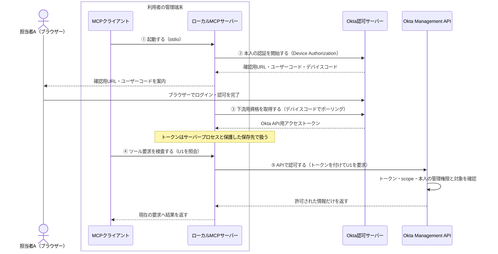
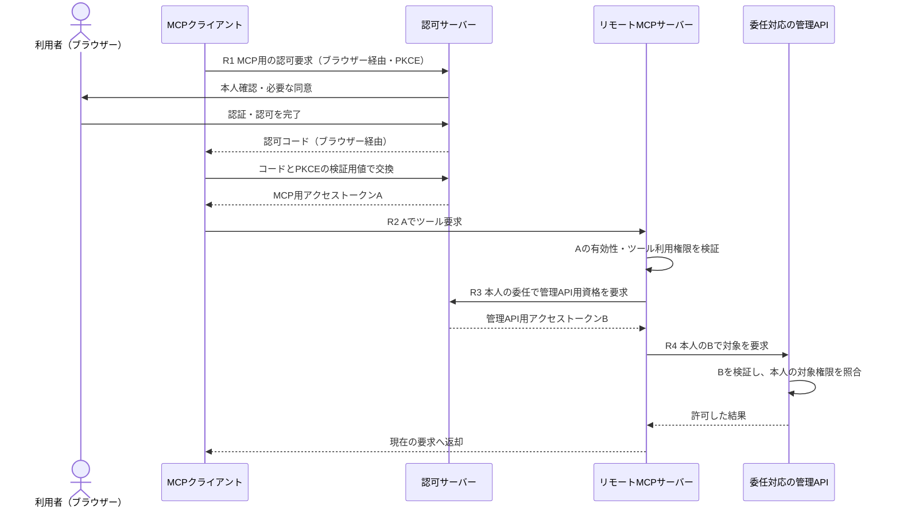

# MCPの接続構成と、下流APIを呼ぶ主体を選ぶ

**本人の端末から本人の権限でAPIを呼べるなら、共有MCPサービスや多段の委任が必要かを先に考える。構成を選んでから、資格情報の保持と認可を設計する。**

本Patternは、MCPサーバーが下流APIへアクセスするときに、誰の権限をどこへ預けるかを決めるガイドである。
主例は[Okta MCP Server](https://github.com/okta/okta-mcp-server)のようなローカル起動＋利用者の直接認証。
リモート提供とサービスアプリの資格を使う構成は、必要になる条件とともに分けて説明する。
状態は`draft`。構成の採用判断と[確認用チェックシート](negative-tests.md)を提供し、製品接続・実行試験の合格は主張しない。

## 1. 場面：担当者が自分の端末からOktaの利用者情報を確認する

担当者AがデスクトップのAgentへ、管理対象の利用者U1の情報を確認するよう頼む。
端末上のMCPクライアントがローカルのMCPサーバーを呼び、サーバーがOkta Management APIへ問い合わせる。
ここでは読取りだけを扱い、Aに許可されていない管理対象U2は開示しない。
U1・U2は確認用の呼び名で、実際の許可範囲は採用先の管理ロール・対象リソース設定に従う。

前提は、管理された端末・OSアカウント、信頼して起動するMCPプログラム、登録済みのOktaアプリと認可先である。
モデル出力・文書・ツール引数は認可の根拠にしない。Oktaや端末OSそのものの侵害、任意SaaSへの接続、削除・更新操作の承認設計は対象外とする。

### まず構成を選ぶ

| 構成 | 選ぶ場面 | 減らせる複雑さ | 残る責任・費用 |
|---|---|---|---|
| **ローカルstdio＋本人の認証（主例）** | 本人が管理端末で対話的に利用し、端末からAPIへ接続できる | MCPの公開HTTP入口、共有サーバーでの利用者別資格管理、入口から下流へのトークン交換を省ける | 端末への配布・更新、プロセスと保存資格の保護、端末紛失時の失効 |
| **サービスアプリの資格** | 利用者不在の定型処理など、アプリ自体の権限で動かす必要がある | 利用者の対話ログインを省ける | 鍵の保護・更新とアプリ権限の限定。会話している本人の権限には自動で制限されない |
| **リモートHTTP＋本人への対応付け** | 接続先が社内網に限定される、配布や連携を中央管理する、複数クライアントへ提供する | 端末ごとの実装配布や接続設定を集約できる | 公開入口の認可、利用者・組織ごとの資格と応答の分離、可用性、監査、失効対応 |

**実行場所・通信方式・権限の主体は別の軸である。** サービスアプリ方式はローカルにもリモートにも置ける。
ローカルでもHTTPを公開すれば入口の保護が必要で、Dockerで動かすだけでリモートサービスになるわけでもない。
端末が多数なら配布・更新の負担が中央サービスより大きくなる場合もある。最小構成の選択は、ここでの用途に対する本PJの設計判断である。

## 2. ローカル構成：MCPサーバーが下流用トークンを直接取得する

Oktaの主例にはDevice Authorization Grantを使う。利用者はブラウザーでログインし、MCPサーバーがOkta API用アクセストークンを取得する。
**MCPサーバーはMCPの通信相手であると同時に、Oktaに対してはOAuthクライアントである。**
MCPクライアントからサーバーへのstdio通信には、後述するリモート構成のトークンAは登場しない。



①〜③は有効な資格がない場合の準備で、毎回ログインする意味ではない。
デバイスコードはトークン取得用、ユーザーコードはブラウザーでの確認用で、どちらもアクセストークンではない。
確認URL・認証操作は信頼するUIから案内し、パスワード・アクセストークン・refresh tokenをモデルの会話へ入力しない。
Device Authorizationのポーリング間隔・期限・拒否応答は認可サーバーの指示に従う。[OktaのDevice Authorization説明](https://developer.okta.com/docs/guides/device-authorization-grant/main/)

### 何をもとに、何を、どこで確認するか

| 段階・強制する場所 | 信頼する情報 | 確認・失敗時の動き |
|---|---|---|
| ① 起動する：端末・MCPクライアント | 管理した実行ファイル・起動設定・OSアカウント | 許可した版を専用の利用者コンテキストで起動。モデルにコマンド・環境変数・保存先を差し替えさせない |
| ② 本人の認証を開始する：MCPの認証処理 | 管理されたOkta組織URL・client ID・必要scope | 予定した組織・アプリへ認可要求。利用者がアカウントと対象を確認できるようにし、失敗ならAPIを呼ばない |
| ③ 下流用資格を取得する：MCPの資格管理 | 正規の認可処理で得た資格と、そのアカウント・組織・アプリとの対応 | 同じ本人の資格だけを利用・更新。対応不明、期限切れで更新不能、アカウント切替時は再認証へ。共通管理者資格で埋め合わせない |
| ④ ツール要求を検査する：MCPのツール境界 | 管理した読取りツール・引数定義・実際に許可された操作 | 対象IDの形式と操作を確認。任意URL、別の組織や資格、更新操作を引数で選ばせない |
| ⑤ APIで認可する：Okta Management API | APIが検証する資格と、Okta側の管理ロール・対象権限 | 本人に許可された対象だけ開示。scopeがあることと対象への権限を混同せず、APIの拒否を尊重する |

MCPへOktaの権限表を複製することは求めない。API側の対象認可を利用する。
MCPのツール境界とAPIが強制箇所（PEP）、APIの権限判定がPDP、ロール・対象情報がPIP、その管理箇所がPAPに相当する。別の認可製品は必須ではない。

### Oktaでの設定と実装の要点

[公式README](https://github.com/okta/okta-mcp-server#readme)のローカル起動・Device Authorizationを具体例にする。次は本PJが確認を求める設定方針で、上流実装を検証済みとする記述ではない。

| 項目 | 読取り用途で確認すること |
|---|---|
| アプリと発行元 | Device Authorizationを使うNativeアプリを設定する。Okta管理APIのscopeにはorg authorization serverを使い、custom authorization serverの例をそのまま転用しない |
| 操作と対象 | `OKTA_SCOPES`には必要な読取りscope（例：`okta.users.read`）を設定し、アプリ側にも許可する。本人の管理ロール・対象リソース範囲も確認する。設定文字列だけでAPIの許可が増えるわけではない |
| 資格の保持 | MCPサーバーがアクセストークンを扱い、発行される場合はrefresh tokenも保護する。モデル・通常ログ・共有設定ファイルへ保存しない |
| 認証方式 | 対話型を使う環境にサービス用の秘密鍵設定を混在させない。実際に選ばれた方式・主体を確認する |

### 一件の照会を実装する：設定・資格・要求を結び付ける

以下は本PJの説明用の疑似コードで、Okta MCP Serverの関数名や保存形式を再現したものではない。
`user.read`はこの例で定義する読取りツール名、`target_id`はU1に対応する実際の資源IDである。
起動・認証は準備処理、ツール受付は要求ごとの処理として分ける。

| 値 | 取得元 | モデルに変更させないもの |
|---|---|---|
| 組織URL・client ID・読取りscope | 管理した起動プロファイル | 認可先、API接続先、認証方式 |
| 資格と所属先 | 正規の認証処理と保護した資格管理 | 組織・アプリ・認証済みアカウントとの対応 |
| 現在のプロファイル世代 | ローカルの認証管理処理 | アカウント切替前の要求を判別する番号 |
| 対象ID | モデルのツール引数 | 候補として受理。実際の対象権限はAPIが判定 |

OSアカウントだけではOktaのログイン本人は決まらない。認証処理で確認できたアカウントとの対応を保存し、ツール引数のメールアドレスや未検証のtoken内容から本人を推定しない。
採用する認証実装でこの対応を確定・維持できない場合は、保存資格の自動再利用を行わず、本人確認を伴う認証手順へ戻す。

```text
起動・認証：
  profile = 管理したローカル設定を読む
  profile.auth_mode != 利用者の直接認証 なら、この主例の起動を拒否
  org_url・client_id・scopeが管理設定と一致しなければ停止
  その設定でDevice Authorizationを開始し、信頼するUIで本人が認証
  拒否・期限切れ・取得失敗なら、資格なしの状態で終了
  正規の認証結果と結び付いたaccountを資格管理に記録
  credential_record = {
      profile_id, generation, org_url, client_id, account,
      granted_scopes, expires_at, 保護した資格への参照
  }
```

認証後のアカウント情報の取得・検証方法は採用する認証実装に従う。上の記録をモデル出力や手入力の`account`だけで作らない。
`generation`は本例のアプリ内の世代番号で、OAuth tokenやMCPセッションIDではない。

```text
user.read の要求を受けたら：
  tool_name != user.read                              なら拒否
  引数のキーが {target_id} だけでなければ拒否
  target_idが空、ID形式・長さに違反していたら拒否
  current = 資格管理から現在のプロファイルと世代を取得
  record = currentに対応する資格記録を取得
  recordがない                                       なら再認証へ
  (record.profile_id, record.generation, record.org_url,
   record.client_id, record.account)
    != currentの対応する値                            なら拒否
  必要な読取りscopeがrecord.granted_scopesに無ければ    拒否
  期限切れなら同じ対応先で更新し、失敗なら再認証へ

  要求ID・current.generation・target_idを変更不能な値として保持
  固定の組織APIの利用者照会ルートへ、target_idをパスの一要素として符号化
  接続処理だけがrecordの資格をAuthorizationへ付けて送信
  APIが本人のロール・対象権限を判定
  拒否・認証失敗・通信障害なら結果を返さず終了
  応答の形式・サイズを検査し、返された資源IDがtarget_idと一致するか確認
  返却直前に現在のgenerationを再取得
  要求開始時と異なれば応答を破棄
  許可した応答項目だけを、元の要求IDの呼出元へ返す
```

対象IDの形式検査は認可ではない。U2が正しい形式でも、本人が扱えなければAPI側で拒否されなければならない。
MCP側で管理ロールを推測して許可を広げず、APIの拒否を管理者資格で再試行しない。
接続先URL・追加ヘッダー・資格参照をツール引数に設けないので、対象IDをURLとして解釈する経路も作らない。

**アカウントを切り替える操作は信頼するUIで行う。** 資格管理のロック下で世代を更新し、旧プロファイルでの新規要求を止め、進行中の旧要求の結果は返さない。
送信開始と切替を同じローカル状態管理で調整する。すでにAPIへ届いた要求を取り消せる保証はないため、ここでは読取りだけを扱い、少なくとも旧本人の応答を新本人へ混ぜない。
モデルに利用者切替・資格読出しのツールを与えない。

例えばU1の照会は成功、U2の照会はAPIで拒否、`org_url`を追加した要求はツール受付で拒否する。
U1の応答待ち中にアカウントを変えた場合は、世代比較で応答を破棄する。この四つを同じ実装で追えば、資格の保持と対象認可がどこで効くか確認できる。

HTTP通信では証明書を検証し、資格を別宛先へ送るリダイレクトを許さない。
上流READMEのDocker例には`PlaintextKeyring`を指定する例もあるため、**keyringという名前だけで暗号化保存と判断しない**。
実際のバックエンド、ファイル権限、コンテナーのvolume・バックアップを確認する。これは配置例を無条件にコピーしないための採用上の注意である。

## 3. サービスアプリ：ログインを省くと、権限の主体も変わる

Okta MCP Serverには、Client Credentials＋Private Key JWTを使う選択肢もある。
この場合、MCPサーバーが秘密鍵でアプリとして認証し、**そのアプリの権限**でAPIを呼ぶ。
Private Key JWTはクライアント認証の方法、Client Credentialsはgrantの種類であり、本人の委任ではない。[Oktaサービスアプリの説明](https://developer.okta.com/docs/guides/implement-oauth-for-okta-serviceapp/main/)

```text
MCPサーバー → 秘密鍵でアプリ認証 → アプリ用アクセストークン → Okta API
```

利用者不在の定型業務なら、この選択には理由がある。必要なscopeと管理ロール・対象リソースをアプリに割り当て、鍵の更新・失効を運用する。
対話型の利用者Aへこの資格を渡す場合は、A本人の権限を超え得る。サービス権限を使わせる主体・操作・対象を別途強制し、本人認証の代替として黙って切り替えない。
**ローカルに置くことも、OAuthを使うことも、この権限差を解消しない。**

## 4. リモート提供：中央サービスにする理由がある場合

中央で接続先を管理する、端末から到達できないAPIへ接続する、といった要件があればリモート提供を選ぶ。
ローカル用プロセスをHTTPで公開するだけでは、呼出し元と下流資格の対応はできない。

<a id="3-一件の要求を追う入口から注文apiまで"></a>

### 本人の委任を引き継ぐ構成例

次は利用者委任に対応した**管理API**を持つ場合の例で、Okta MCP ServerがこのOBO連携を実装しているという意味ではない。
Entra OBOは自社API間で使える一例であり、下流サービスの対応条件を確認する。リモート提供が常にOBOを必要とするわけではない。



図は認可先・クライアント登録・委任設定済みで、同じ認可基盤を使う例。発見・登録は[MCP認可仕様](https://modelcontextprotocol.io/specification/2025-11-25/basic/authorization)を参照する。

| 資格・識別子 | 取得・保持する側 | 受け取る側と目的 |
|---|---|---|
| A：MCP用アクセストークン | MCPクライアント | リモートMCPが受信・検証。OBOでは認可サーバーにも提示する |
| B：管理API用アクセストークン | リモートMCPサーバー | 管理APIが受信・検証。モデルやMCPクライアントへ返さない |
| MCPセッションID（使用時） | MCPサーバーが発行しクライアントが保持 | `MCP-Session-Id`で通信を対応付ける。Aの代わりにはならない |

保持は処理中のメモリや必要なキャッシュを含み、永続保存が必須という意味ではない。
各APIは自分向けの資格だけを受理し、MCP向けAを下流資源APIへ転送しない。同じMCPセッション内でもHTTP要求には認可が必要である。

| 増える責任 | 根拠情報と強制箇所 |
|---|---|
| R2：公開入口の認可 | MCP入口で信頼する発行元・鍵・許可アルゴリズム・利用先・有効期間・必要scope等を検証。モデルが指定した利用者や会社を信頼しない |
| R3：本人の下流資格を選ぶ | 検証した要求主体と組織・宛先・scopeに対応する資格を取得する。OBO失敗・同意不足なら停止。共通管理者資格へ切り替えない |
| R4：並行要求と応答の分離 | APIはBの資格と対象権限を判断。MCPは資格・キャッシュ・返却先を要求に結び付ける。別人の有効なBはAPIだけでは取り違えと分からない |

別途ユーザーごとに下流サービスへログインする方式でも、MCPの呼出し元とその下流アカウントの結付けが必要になる。
アプリ用資格を使う場合は第3節の追加認可が必要。API間で主体識別子やscope名が同じとは仮定せず、管理した対応関係を使う。
[Entra OBO](https://learn.microsoft.com/en-us/entra/identity-platform/v2-oauth2-on-behalf-of-flow)や[MSALの資格取得](https://learn.microsoft.com/en-us/entra/msal/python/getting-started/acquiring-tokens)は実装手段であり、この責任分担の代わりではない。

## 5. どの構成でも保つ境界と失敗例

攻撃者はモデル出力・ツール引数・非信頼コンテンツを操作できるものとする。署名鍵や信頼する権限管理元を支配するとは仮定しない。
保護対象は下流APIのデータ、資格情報、実行主体と要求の対応である。

| 不変条件 | 失敗しやすい設計・影響 | 強制する場所 |
|---|---|---|
| **I1：選んだ実行主体の許可範囲を超えない** | 本人のつもりでサービス用資格を使い、権限外の管理対象を開示する | 認証方式の設定、MCPの操作制限、APIの主体・対象認可 |
| **I2：資格を許可した宛先でだけ使う** | モデル指定URLへ送る、別API用トークンを受理する | 接続設定とHTTP送信処理、各APIの資格検証 |
| **I3：要求・主体・資格・返却先の対応を保つ** | アカウント変更後の古い資格、別利用者のキャッシュを使う | ローカルのOS／資格管理境界、リモートの利用者別要求処理 |
| **I4：資格・権限を確認できなければ開示しない** | 障害時に管理者資格や古い成功結果で補う | 資格取得、API認可、結果返却のエラー処理 |

「普段は本人が読めるが、今回は依頼していない対象」を止めるタスク制限は、これらと別の追加設計である。
必要な製品は[P1のツール実行認可](../../agents/secure-tool-execution/README.md)を組み合わせる。

## 6. 確認・運用・残るリスク

[チェックシート](negative-tests.md)を、共通・ローカル・サービスアプリ・リモートに分けた。
採用した構成で許可と拒否を対に確認し、採用しない構成は理由付きで対象外とする。結果はすべて未実施で、モデルの拒否や文書確認を製品試験の合格に置き換えない。

> 開発者への依頼例：「この用途でリモートMCPが必要な理由は何ですか。ローカルで本人が直接認証した場合に省ける責任と、端末側に残る責任を示してください。その後、APIが誰として判断するか、トークンをどこで保持するか、アカウントを切り替えたとき何が変わるかを、一件の照会で見せてください。」

| 運用項目 | 決めておくこと |
|---|---|
| 資格の保存・切替 | 組織・アプリ・アカウント・宛先・scopeの対応を保つ。保存済み資格を使う際も対応を確認し、別OS利用者や別プロファイルへ混ぜない。資格を使えるローカルコードの範囲も限定する |
| 更新・失効 | 端末の紛失、退職、権限変更、認証方式変更時の失効手順と反映期限。APIの権限キャッシュも確認し、有効期限内だから現在も許可とはしない |
| 監査 | 要求ID、内部主体ID、認証方式、宛先、操作、対象参照、許可／拒否理由。トークン・秘密鍵・認証コード・本文を通常ログへ出さず、記録の閲覧と保持も制限する |
| 応答の再利用 | 最小構成では独自の結果キャッシュを置かない。導入時は本人・対象・現在の権限で再認可する。[P2の開示境界](../../rag/secure-multi-tenant-retrieval/README.md)も参照 |
| 異常時 | 主体の取り違え、予期しない送信先、資格漏えいを検知したら連携を停止し、資格失効・保存先／設定確認・影響調査へ進む |

ローカル構成は端末上の悪意あるコードや不正なMCP更新を防がない。リモート構成は中央での資格漏えい時に影響が集中し得る。
どちらも既存APIのBOLAや過大なロールをOAuthだけで解消できず、本人に許された不要な操作・大量取得も別途制限が必要である。
データを取得できても、そのデータを外部モデルへ送ってよいとは限らない。送信先・目的の判断は別の開示境界として設計する。

<a id="8-参照とレビュー情報"></a>

## 7. 参照とレビュー情報

構成の選択基準、不変条件、運用上の要求、確認例は本PJの設計判断である。上流実装がそのすべてを満たすと認定したものではない。
2026-10-25に以下を確認した。Oktaリポジトリは更新される`main`を参照し、特定コミットでの実行検証はしていない。採用時は配布版を固定して再確認する。

| 一次資料 | 参照状態・用途 |
|---|---|
| [Okta MCP README](https://github.com/okta/okta-mcp-server#readme) | rolling main。ローカル起動、Device Authorization／Private Key JWT、Dockerの保存設定例。製品の安全性保証としては扱わない |
| [起動処理](https://github.com/okta/okta-mcp-server/blob/main/src/okta_mcp_server/server.py)・[認証処理](https://github.com/okta/okta-mcp-server/blob/main/src/okta_mcp_server/utils/auth/auth_manager.py) | rolling main。サーバー側での資格取得・保持と方式の選択。コードの部分確認であり全体監査ではない |
| [Okta Device Authorization](https://developer.okta.com/docs/guides/device-authorization-grant/main/) | 更新型製品資料。本人のブラウザー認証とトークン取得 |
| [OAuth for Okta](https://developer.okta.com/docs/guides/implement-oauth-for-okta/main/) | 更新型製品資料。org authorization server、scopeと利用者権限 |
| [Oktaサービスアプリ](https://developer.okta.com/docs/guides/implement-oauth-for-okta-serviceapp/main/) | 更新型製品資料。Client Credentials、Private Key JWT、アプリの管理ロール・リソース範囲 |
| [MCP Authorization](https://modelcontextprotocol.io/specification/2025-11-25/basic/authorization)・[Transports](https://modelcontextprotocol.io/specification/2025-11-25/basic/transports) | 2025-11-25公開仕様版。HTTPとstdioの区別、利用先の検証、セッション管理。最新版という主張ではない |
| [Entra OBO](https://learn.microsoft.com/en-us/entra/identity-platform/v2-oauth2-on-behalf-of-flow)・[MSAL](https://learn.microsoft.com/en-us/entra/msal/python/getting-started/acquiring-tokens) | 更新型製品／SDK資料。リモートの委任対応APIを使う場合の一例。Okta連携の実証ではない |

[LandscapeのP3](../../../docs/pattern-landscape.md#p3-audience-bound-downstream-delegation)に範囲の変更を記録した。
既存の参照を維持するためPattern ID・配置パスは保持する。2026-10-25の方針・書直し指示は開発への承認で、完成した本文への技術レビューは未実施である。

| 日付 | 変更 | 理由 |
|---|---|---|
| 2026-10-23 | HTTP＋OBOの委任を主例に初版作成 | API間の本人の権限を保持 |
| 2026-10-24 | Aの取得とセッションIDとの区別を補足 | 図の前段を明確化 |
| 2026-10-25 | 構成選択を先に置き、ローカル直接認証・サービス主体・リモート委任に再構成 | 不要な権限・資格の共有・運用責任を設計段階で減らす |
| 2026-10-29 | ローカル主例の準備・要求処理を疑似コード化し、資格の対応比較・応答先・アカウント切替を具体化 | 構成説明から実装すべき処理へつなぐ。draftを維持し、製品試験は未実施 |
