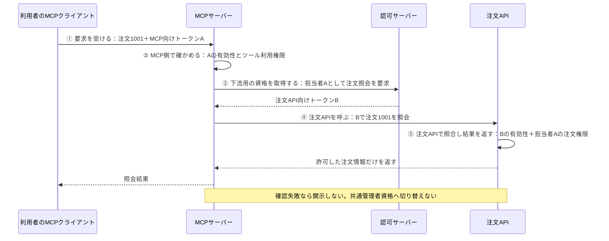

# MCPから下流APIを、利用者本人の権限で呼ぶ

**MCPの入口だけでなく、下流APIにも「誰の依頼か」を引き継ぐ。下流APIが持つ利用者ごとのアクセス制御を、そのまま効かせる。**

下流APIまで本人の権限で呼び、対象データの認可が行われているなら、基本の構成はできている。
MCPに注文の権限管理をもう一組作る必要はない。このガイドでは、その構成を一件の注文照会で追う。
状態は`draft`。製品接続・実行検証は未実施。[確認用チェックシート](negative-tests.md)は採用先で使う。

## 1. 場面：担当者Aが注文1001を照会する

会社Aの担当者AがAgentへ「注文1001を確認して」と頼む。
AgentのMCPクライアントが`get_order`ツールを呼び、MCPサーバーが管理下の注文APIへ問い合わせる。
担当者Aは注文1001を読めるが、会社Bの注文9001と、同じ会社でも担当外の注文1003は読めない。

注文APIには、利用者・所属会社・注文ごとの閲覧権限を確認する既存の処理がある。
モデルが注文IDを9001へ変えても、APIが担当者Aとして判断すれば拒否できる。
**注文IDを変えて他人の注文を読むBOLAへの対策は、ここでもAPI側の対象単位の認可である。P3は、MCPを挟んでもその判断が本人の権限で働くようにする。**

### 対象と前提

- 認証済み利用者による、HTTP型MCPから管理下の注文APIへの読取りを扱う。接続先・認可サーバー・利用可能な操作は管理側が設定する。
- 注文APIは利用者委任を受け付け、本文を返す前に対象の閲覧権限を判断する。共通APIキーしか受け付けないAPIへ、この構成をそのまま適用できるとはしない。
- MCPクライアント／サーバーは資格情報を保持する信頼側の実装で、モデルには渡さない。認可サーバー・API・権限管理元そのものの侵害は前提外とする。
- stdio、利用者のいないバッチ、任意の第三者SaaSへの接続、返金・決済は扱わない。

「普段は読める注文1002も、今回頼まれていないから止める」は追加のタスク制限である。
P3単独ではその拒否を保証しない。必要な製品では、[P1のツール実行認可](../../agents/secure-tool-execution/README.md)を組み合わせる。

## 2. 失敗例：入口だけ本人、奥では管理者

**避ける構成：** `担当者A → OAuthでMCPを呼ぶ → MCPが共通管理者資格で注文APIを呼ぶ`

これではMCPの入口が正しくても、注文APIには管理者の要求に見える。
攻撃者がツール引数を変えたり、外部文書の指示でモデルを誘導したりすると、管理者には読める注文9001が返り得る。
モデルの拒否に頼らず、次の境界を保つ。

| 保護するもの・境界 | 起こり得る失敗 | 保つ性質 |
|---|---|---|
| 注文情報／MCPから注文API | 広い共通資格で呼び、別会社・担当外の注文を開示 | **I1：本人の利用者委任で呼び、APIが対象権限を照合する** |
| トークン／クライアントからMCP、MCPからAPI | 別API用トークンの受理、MCP用トークンの転送、引数で宛先変更 | **I2：各APIは自分向けの資格だけを受理し、資格を許可した宛先でだけ使う** |
| 利用者と要求の対応／並行処理・トークン取得 | 別利用者の有効なトークンを取り違える | **I3：現在の要求と、その本人の下流用資格の対応を保つ** |
| 認可判断／障害から代替経路 | 委任できないとき、管理者資格や古い許可で処理を続ける | **I4：資格・権限を確認できなければ開示せず、権限を広げて再試行しない** |

攻撃者は要求引数・モデル出力を操作できるが、署名済みトークンや管理設定を書き換えられるとは仮定しない。
トークンの取り違えや共通資格への切替は、攻撃を成立させる実装上の失敗として確認する。

## 3. 一件の要求を追う：入口から注文APIまで

次の図は利用者委任の一例。トークンA・Bは説明用の呼び名である。



同じ人でも、**AはMCPで使う資格、Bは注文APIで使う資格**である。利用先を`audience`、許可する操作を`scope`と呼ぶ。
scopeに注文照会が含まれていても、すべての注文を読めるわけではない。最後は注文APIが対象を照合する。
MCP仕様の参照版は、自分向けトークンの検証と、下流API用の別トークンを求めている。[MCP Authorization](https://modelcontextprotocol.io/specification/2025-11-25/basic/authorization#token-audience-binding-and-validation)

### 何をもとに、何を、どこでチェックするか

| 段階・強制する場所 | 根拠情報と信頼する理由 | 確認すること／失敗時 |
|---|---|---|
| ① 要求を受ける：MCPクライアント | 認証フローで得た本人のA。ツール引数とは別に保持 | 要求に本人のAを付ける。モデルが指定した利用者・会社・トークンを採用しない |
| ② MCP側で確かめる：MCP入口 | 設定済みの発行元・検証鍵・MCPの識別子・ツール利用方針 | Aの真正性、発行元、利用先、有効期間、必要な利用者委任scope、許可するクライアント等を確認。注文IDの型・長さとツール名も検査。不成立なら③へ進まない |
| ③ 下流用の資格を取得する：MCPと認可サーバー | ②を通ったAと、管理された委任・接続先・読取りscopeの設定 | 現在の本人としてBを取得。認可サーバーが委任可否を判断する。同意不足・取得失敗なら停止 |
| ④ 注文APIを呼ぶ：MCPのAPIアダプター | ③でその要求に取得したB、設定済みの注文API、検査済み注文ID | 固定した読取り先へBを送る。任意URL・追加scope・別利用者の資格を選ばせない。APIエラーも成功結果として返さない |
| ⑤ 注文APIで照合し結果を返す：注文API | 検証済みBと、API側で管理する利用者・所属・注文権限 | Bの有効性・利用先・必要scope等を確認し、本人が対象注文を読める場合だけ本文を返す。判断不能・権限外なら開示しない |

MCPの入口と注文APIは、拒否を実際に強制する場所（PEP）である。
注文の権限判断（PDP）はAPIの既存ロジックでよく、所属・注文権限の管理データが判断材料（PIP）、そのルールの管理箇所がPAPに当たる。別製品の導入は必須ではない。

## 4. 実装の要点：本人の資格をつなぎ、注文の認可はAPIへ

以下は処理の分担を示す**実行不可の擬似処理**。検証・認可・資格取得を関数一つで実装済みとみなすサンプルではない。

```text
① MCPクライアント
   本人のトークンAを、get_order(order_id=1001)の通信ヘッダーへ付ける
   モデルに渡すのはツール定義と引数だけ

② MCP入口
   認証ミドルウェアでAを検証し、get_orderの必要scopeを照合
   引数はorder_idのみ受理し、形式を検査。不成立ならここで拒否

③ MCPの資格取得処理
   検証した現在のAを使い、設定済みの認可先へ本人の注文API用Bを要求
   読取りscopeは管理設定から指定。失敗なら終了

④ MCPのAPIアダプター
   設定済みHTTPS宛先のGET /orders/{検査済みID}へ、Bを付けて送る
   証明書を検証し、自動リダイレクトは無効。応答を現在の要求へ返す

⑤ 注文API
   認証ミドルウェアでBを検証し、注文照会の利用者委任scopeを照合
   検証済み主体をAPI内の利用者へ対応付ける
   既存の注文認可で、本人の所属・対象注文の閲覧可否を確認
   許可なら注文情報を返す。不成立・判断不能なら本文を返さない
```

認証ミドルウェアでは、信頼する発行元・鍵・許可アルゴリズム・利用先・有効期間を設定し、JWTを読むだけの処理で済ませない。
モデルが指定した`user_id`や`company_id`は認可の根拠にしない。業務上の会社IDは、信頼する利用者管理との対応から決める。
APIの入口を別経路から呼んでも⑤が働くようにする。注文の権限表をMCPへ複製することは求めない。

### 具体例：Microsoft Entra IDのOBOで③を実装する

On-Behalf-Of（OBO）は、中間APIが利用者を引き継いで別のAPIを呼ぶ方式である。
この例では中間APIをMCPサーバー、下流APIを注文APIとして使う。[OBO公式資料](https://learn.microsoft.com/en-us/entra/identity-platform/v2-oauth2-on-behalf-of-flow)

| 準備・実装箇所 | 開発者が用意するもの |
|---|---|
| APIの登録 | MCPと注文APIを別のAPIとして登録し、それぞれの利用先と読取り用の委任scopeを定義する。MCPが注文APIを代理呼出しする許可・必要な同意を設定する |
| ②と⑤：受信側 | 自分のAPI用トークンを検証するミドルウェアとscope検査。例えばASP.NET CoreではMicrosoft.Identity.Webを利用できる。注文の閲覧可否は既存の業務認可で判断する |
| ③：MCP側 | MSALのOBO取得処理へ現在の検証済みAと設定済みscopeを渡す。Pythonなら`acquire_token_on_behalf_of`が該当する。取得成功時のBだけを④で使う |
| 資格情報の管理 | MCP自身が認可サーバーへ認証するための秘密鍵等は秘密管理基盤で保護し、コード・ツール引数・モデル入力に入れない |

MSALは下流用資格の取得を助ける。②・⑤の受信トークン検証や、注文単位の権限判定を代行するわけではない。
[MSALのOBO取得](https://learn.microsoft.com/en-us/entra/msal/python/getting-started/acquiring-tokens#acquire-token-on-behalf-of)、[API側のscope検査](https://learn.microsoft.com/en-us/entra/identity-platform/scenario-protected-web-api-verification-scope-app-roles)を参照する。

MCP自身の資格を使って**認可サーバーへ認証すること**と、**共通管理者として注文を読むこと**は別である。
OBOでは前者に加えて利用者のAを提示し、本人の委任としてBを取得する。Aを認可サーバーへ提示する処理は、Aを注文APIへそのまま転送する処理とは異なる。

<details>
<summary>採用時に確認する識別子と方式の違い</summary>

- EntraのディレクトリIDと業務上の会社IDを同一視しない。検証済みの発行元・テナント・利用者識別子を、API側の管理する利用者と所属へ対応付ける。`sub`等の値がAPI間で必ず同一とも仮定しない。[claims検証](https://learn.microsoft.com/en-us/entra/identity-platform/claims-validation)
- MCP用scopeと注文API用scopeの名前は異なり得る。文字列の単純な共通集合ではなく、各APIの操作と委任設定に沿って確認する。
- OBOは利用者の委任を扱う。app-onlyの要求を同じフローへ載せず、このPatternの利用者用経路では受理しない。同意・追加認証が必要なら正規の手続へ戻し、権限を広げた再試行をしない。
- OBOはこの主例の選択であり、MCPの全実装で必須の方式ではない。別の認可基盤を使う場合も、本人との対応、APIごとの利用先、対象権限の確認を保つ。方式ごとの採用条件は別途確認する。

</details>

## 5. 運用：取り違えと権限変更を見落とさない

| 場面 | 実装・運用で確認すること |
|---|---|
| トークンの再利用 | 現在の要求に結び付いた本人・発行元／テナント・宛先・scopeを保って取得する。SDKの取得・キャッシュ機構を使い、アプリで「最後に得たB」を全員に使い回さない。並行要求も確認する |
| 別人のBを送った場合 | APIには、その別人の正当な要求に見えることがある。APIの署名検証だけでは取り違えを防げないため、③〜④の要求と資格の対応が必要 |
| 権限の変更 | 注文APIは所属・注文権限の管理元を参照する。キャッシュする場合は失効反映期限を定め、期限を過ぎた許可や判断不能時の古い許可を使わない。トークンの有効期限だけで即時失効を保証しない |
| 応答の再利用 | 最小構成ではMCP独自の注文結果キャッシュを置かない。導入する場合は本人・対象・権限変更を考慮して再認可する。[P2のキャッシュを含む開示境界](../../rag/secure-multi-tenant-retrieval/README.md)も参照 |
| 障害 | 同意不足、トークン取得失敗、APIの拒否・タイムアウトを区別して記録する。本文を含む内部エラーや古い成功結果で埋め合わせない |

MCPとAPIの記録を要求IDで追えるようにし、利用者の内部識別子、宛先、操作、対象の参照ID、許可／拒否と理由を必要最小限残す。
要求IDは追跡用で、本人確認の代わりにはしない。トークン、Authorizationヘッダー、秘密鍵、注文本文は通常ログへ出さない。
対象ID等を含む監査記録にも閲覧制限・保持期限を設ける。
主体の取り違えや別宛先への送信を検知したら当該連携を停止し、キャッシュ・接続設定を調べ、漏えいした資格の失効と影響範囲の調査へつなげる。

## 6. 実装を確認する

[正常系・Negative testチェックシート](negative-tests.md)で、担当者Aの注文1001が返り、会社Bの9001と同じ会社の担当外1003が返らないことを対で確かめる。
不正な要求をモデルが拒否しただけでは、②〜⑤の強制を確認したことにならない。
製品試験は未実施。実行する際に環境・版・証拠を記入する。

> 開発者への依頼例：「担当者Aの注文1001の要求を入口から追ってください。MCPと注文APIはそれぞれ誰の資格を検証し、注文の閲覧権限はどこで確認していますか。9001への差替え、別担当者との並行実行、委任に失敗した場合の応答と記録も見せてください。トークン本文は不要です。」

## 7. 限界と隣接する設計

本人に許可された範囲での不要な照会や大量取得は、このPatternだけでは止まらない。
タスク範囲・回数・高影響操作の承認は[P1](../../agents/secure-tool-execution/README.md)等で設計する。
既存APIのBOLA、誤った所属・注文権限、侵害された認可サーバーは、OBOを導入しても解消しない。
MCPサーバー自体が侵害されれば、保持する有効な資格を悪用され得る。実行環境の隔離と資格保護は別途必要である。
取得した注文をどのモデル・外部送信先へ渡してよいかも別の開示判断で、取得の許可だけでは決まらない。

## 8. 参照とレビュー情報

構成・不変条件・確認例は本PJの設計であり、以下の仕様・製品機能を適用したもの。準拠・製品連携成功の主張ではない。
確認日：2026-10-23。SDK依存関係は導入せず、実行可能なサンプルとしての版固定・動作検証も行っていない。

| 一次資料 | 参照状態・用途 |
|---|---|
| [MCP Authorization](https://modelcontextprotocol.io/specification/2025-11-25/basic/authorization) | 公開済みの2025-11-25仕様版。HTTP認可・利用先の検証・下流用の別トークン。最新版という主張ではない |
| [Microsoft Entra OBO](https://learn.microsoft.com/en-us/entra/identity-platform/v2-oauth2-on-behalf-of-flow) | 更新型製品資料。表示更新日2025-01-04。API間の利用者委任と適用条件 |
| [MSAL Python：トークン取得](https://learn.microsoft.com/en-us/entra/msal/python/getting-started/acquiring-tokens) | 更新型SDK資料。表示更新日2025-10-10。OBO取得とapp-only取得の区別。SDK版は未選定 |
| [APIのscope・app role検査](https://learn.microsoft.com/en-us/entra/identity-platform/scenario-protected-web-api-verification-scope-app-roles) | 更新型製品資料。トークン検証と操作権限検査の分担、Microsoft.Identity.Webの利用例 |
| [claims検証](https://learn.microsoft.com/en-us/entra/identity-platform/claims-validation) | 更新型製品資料。利用先・テナント・主体・呼出し元の照合 |

候補の選定経緯は[LandscapeのP3](../../../docs/pattern-landscape.md#p3-audience-bound-downstream-delegation)を参照。
2026-10-23の開発着手への承認は候補範囲への承認で、完成した本文の技術レビューとは区別する。人による本文レビューは未実施。

| 日付 | 変更 | 理由 |
|---|---|---|
| 2026-10-23 | 初版を`draft`で作成 | 本人の下流アクセスと既存APIの認可を主軸にし、タスク単位の制限をP1との組合せへ分離 |
