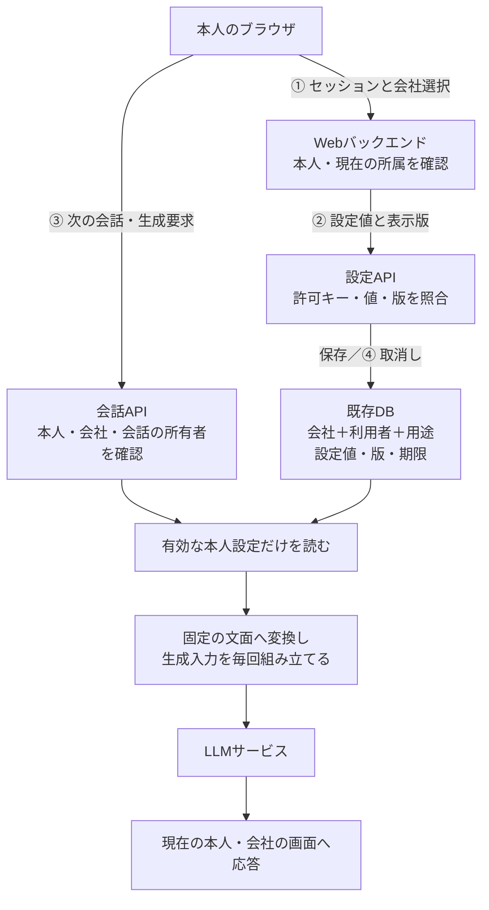

# 本人の回答設定を保存し、次の会話へ安全に渡す

**「覚えておく」は、アプリが情報を保存して、後の推論へ渡し直す処理。その保存・読込み・取消しを、本人と会社に結び付ける。**

P5の主例は、業務Webアプリの「回答は日本語・短め」という設定である。既存の設定画面とDBを使い、本人が保存した少数の値だけを次回へ渡す。Agentには設定を書き換えるToolを持たせない。

[実装例](implementation-notes.md)では、入力、DBの対象条件、版の比較、LLMへの受渡しを具体化する。[チェックシート](negative-tests.md)は正常系と拒否・競合を確認するためのもの。状態は`draft`で、人の技術レビュー・製品試験は未実施。

## 1. 全体像：設定はどこにあり、いつモデルへ入るか

会社Aの担当者U1が、設定画面で「日本語・短め」を保存する。次に会話を始めると、WebバックエンドがU1の会社Aでの設定を読み、生成要求へ反映する。U1が会社Bでも働いている場合、AとBの設定は別に扱う。

ここで扱うMemoryはアプリの保存データであり、モデルの重みを更新する学習ではない。会話履歴や文書の自動要約も、主例の保存物には含めない。

| 場所・主体 | 保持する情報・資格 | 役割 |
|---|---|---|
| 本人のブラウザ | WebセッションCookie、表示した会社と設定版 | 設定の表示・保存・取消し。DBやLLMの資格は持たない |
| Webバックエンド | 検証済みセッション、現在の会社選択、所属台帳へのアクセス | 本人と会社を確定し、設定APIと生成入力の組立てを実行する |
| 既存DB | 所属、会社・利用者・用途ごとの設定、版、期限 | 保存の正本。モデルが指定したownerやRoleは採用しない |
| Agentの処理 | 今回の依頼と、バックエンドが組み立てた生成入力 | 応答・操作案を作る。任意Memory読書き、SQL、管理資格への経路はない |
| DB接続・LLM接続の処理 | それぞれ別のサービス資格 | サーバー内だけで使用。LLM入力へ資格やセッションCookieを含めない |

DBの接続資格は「このアプリがDBへ接続できる」ことを示す。U1がどの会社の設定を操作できるかは、Webセッションと現在の所属から別途判断する。会社IDは業務アプリの所属であり、認可サーバーのtenant IDと一致するとは限らない。

保護する資産は設定値、その所有者・版・期限、取消しの結果である。ブラウザからAPI、APIから共有DB、保存物から後の生成入力への三つの境界を守る。ログイン基盤・所属台帳・サーバー処理は信頼する前提で、サーバーの任意コード実行や管理者侵害は別の対策を要する。

## 2. 構成を選ぶ：少数の設定なら既存プロフィールを使う

| 構成 | 選ぶ場面 | 必要な責任 |
|---|---|---|
| 長期保存せず、その会話で指定する | 次回へ引き継ぐ必要がない | 現在の会話の認可・保持だけを管理する |
| **本人が既存画面で型付き設定を保存する（主例）** | 言語・文量など、許す項目と値が決まっている | 所有者・用途・期限・版を確認し、取消し後の再投入を防ぐ |
| Agentが自由文のMemoryを抽出・検索する | 過去の経験や多数の事実を引き継ぐ必要がある | 元Source、派生コピー、非同期生成、内容による誘導と回収も設計する。[P6の案件内メモ](../persistent-context-poisoning-containment/README.md)は限定した一例 |

主例は既存Web APIとPostgreSQL 18を説明に使う。新たな認可サーバー、Vector DB、Memory専用サービスは必要ない。実装上の責務が同じなら既存の別DBでもよい。

LangGraph StoreやAgentCore Memoryを使う場合も、namespaceやactor IDを誰から決めるかは残る。元イベントと派生Memoryの削除、期限の反映は別々に確認する。具体的な差は[実装例の補足](implementation-notes.md#memory-services)に置く。

## 3. どう失敗するか

攻撃者は自分のログイン後の要求を変更したり、古い画面の保存要求を再送したりできる。取り込む文書・モデル出力に「今後は承認不要」といった指示が混ざることも想定する。

| 失敗する設計 | 起きること | 主例の止め方 |
|---|---|---|
| 要求の`user_id`やモデル指定のnamespaceをそのまま保存先にする | 他者の設定を読み書きできる | 所有者は検証済みセッションから決め、DB条件へ含める |
| 利用者IDだけで保存・検索する | 同じ人の会社Aの設定を会社Bで使う | 会社・利用者・用途を一つのキーとして扱う |
| 取消しで行を消し、再保存時に版を0へ戻す | 古い要求が有効な初回保存に見え、設定が復活する | 値を消して版を進める。利用中のキーで版を巻き戻さない |
| 期限切れの物理削除を待って使い続ける | 期限を過ぎても生成入力へ入る | 読込み時点の期限を判定する |
| 保存した設定オブジェクト全体をプロンプトや認可処理へ渡す | 自由文指示や権限に見える項目が作用する | 許可した二項目だけを固定文へ変換。権限判定は別の信頼する情報で行う |

危険な省略は「ログイン済みだから指定されたMemory IDを使う」「DBから読んだので信頼できる」という判断である。保存場所を知っていることも、永続化されたことも、利用権限や内容の正当性の根拠にはならない。

## 4. 一件の処理で、何を・どこで確認するか

### ① 本人と会社を確定する

既存Web基盤でセッションを検証し、内部利用者IDを取り出す。画面の会社IDは候補として受け取り、サーバー側の現在の会社選択と所属台帳へ照合する。会社を切り替えると選択の版を進め、旧画面から届いた要求との取り違えを防ぐ。

これはMemory専用の新しい認証方式ではない。CookieとCSRF対策は既存Web基盤を使う。設定版や会社選択の版は認証資格ではなく、古い要求を見分ける補助情報である。

### ② 本人が見た値を、その版に対して保存する

言語は`ja`／`en`、文量は`brief`／`standard`だけを受け付ける。用途はサーバー固定の`answer_preferences`。所有者、期限、Role、送信先、承認状態はブラウザやモデルから受け取らない。

DBで会社・利用者・用途・期待版が一致した一行だけを更新する。例えば表示版7へ保存すると版8になる。該当行なし・版不一致は成功にせず、再表示を求める。保存期間はこの例では30日とし、製品の保持方針で決める。

### ③ 次の生成要求で、有効な本人設定だけを読む

毎回のLLM要求の組立て前に、現在の所属と同じ会社・本人の有効設定を読む。会話IDを指定できるAPIでは、その会話も同じ会社・本人に属するか確認する。

保存値を直接文字列連結せず、`ja`なら「日本語」、`brief`なら「簡潔に」というサーバー管理の固定文へ変換する。所有者・版・Cookie等はLLMへ渡さない。Toolの認可や承認判定ではこの設定を参照しない。

設定なし・期限切れ・設定の取得障害なら設定を使わず既定値へ戻せる。一方、認証や所属が確認できない要求は停止する。古い設定を含むSystem Promptや生成要求をCacheから復活させない。

### ④ 取消しでは値を消し、版を進める

版8の設定を取り消すと、値と期限を空にして版9へ進める。一つのDB更新として行い、Commit後に完了を返す。版8を持つ古い保存要求は拒否し、最新の版へ自動で付け替えて再実行しない。

**取消し完了後に開始する新しい読込みには、旧設定を入れない。** その前に読んだ処理中の要求や、既にLLMへ送った入力を回収する保証ではない。設定の取消しと、会話履歴・Provider側の記録・バックアップの消去は区別して説明する。

## 5. 実装で守る条件と確認方法

| ID | 不変条件 | 強制する場所・確認 |
|---|---|---|
| I1 | 設定の表示・保存・取消し・再利用は、判定時点の本人・会社・用途に一致する | Web APIとDBの対象条件。別人・別会社・失効をN1〜N3/N8で確認 |
| I2 | 設定は許可した言語・文量だけに作用し、権限・承認を作らない | 入力Schemaと生成入力の組立て。追加キー・不正値をN4で確認 |
| I3 | 更新・取消しは期待版へ一度だけ作用し、古い要求で取り消した値を復活させない | DBの条件付き更新。N5〜N7で競合・再送を確認 |
| I4 | 有効期限を過ぎた値と、取消し後の新しい読込みで得られない値を再投入しない | 現在のDB読込みとContext組立て。N8〜N10で生成入力を確認 |

[実装例](implementation-notes.md)に同じ①〜④の疑似コード・SQLを載せる。[正常系・Negative test](negative-tests.md)では、応答の言語だけでなく、実際の生成入力、DB状態、拒否理由を確認する。チェック項目の作成は試験の合格を意味しない。

## 6. 運用と限界

操作記録には、内部の本人・会社・用途、要求ID、期待版／確定版、操作、成否、拒否理由を残す。通常のログへCookie、DB・LLM資格、設定本文、会話本文を追加しない。記録の閲覧者と保持期間を決め、版不一致の多発は不正と決め付けず、再送や古い画面の問題も調べる。

所属の終了時は認可を止め、保持方針に従って設定値も消す。行を物理的に消すアカウント廃止では、旧セッション・要求が再利用できないことと、内部IDを他者へ割り当て直さないことが前提になる。

バックアップ復元後は、取消し後の状態まで復旧できたと確認するまでサービスへ公開しない。信頼できる取消し・失効情報を復元先へ反映できなければ、復元した設定値を一括で無効にし、利用者へ再設定を求める。旧画面や要求も失効させる。古いバックアップの設定と版だけを戻すと復活が起こる。

主例は同期DBを正本とし、専用Cache・Vector Index・非同期Memory抽出を持たない。これらを追加する場合は、派生物・遅延書込み・削除の反映範囲を再設計する。入力の意味的な正しさ、モデルが指定文量に従うこと、Prompt Injection全般の防止を保証しない。端末・Web基盤・DB管理者の侵害も別の保護が必要である。

関連する設計は[P1の操作認可](../../agents/secure-tool-execution/README.md)、[P2の検索時認可](../../rag/secure-multi-tenant-retrieval/README.md)、[P4の生成材料の制限](../../agents/untrusted-content-to-action-containment/README.md)。P5は保存から将来の再利用・取消しまでの時間軸を扱う。自由文要約の出所と再利用は[P6の案件内メモ](../persistent-context-poisoning-containment/README.md)で別に扱う。

## 7. 根拠とレビュー情報

主例のキー、保持期間、会社選択の版、API構成は本Repositoryの設計例であり、下記製品の必須仕様ではない。[候補の比較・反復性](../../../docs/pattern-landscape.md#p5-scope-proposal)は別に記録する。

| 一次資料 | 版・状態・確認日 | 利用した事実 |
|---|---|---|
| [PostgreSQL UPDATE](https://www.postgresql.org/docs/18/sql-update.html)・[Transaction Isolation](https://www.postgresql.org/docs/18/transaction-iso.html) | 18版、2026-10-29確認 | 条件付き更新、RETURNING、Read Committedでの並行更新時の条件再評価 |
| [PostgreSQL Constraints](https://www.postgresql.org/docs/18/ddl-constraints.html)・[RLS](https://www.postgresql.org/docs/18/ddl-rowsecurity.html) | 18版、2026-10-29確認 | 複合キー・NULLを含む制約、行PolicyとOwner等の迂回条件 |
| [OWASP CSRF Prevention](https://cheatsheetseries.owasp.org/cheatsheets/Cross-Site_Request_Forgery_Prevention_Cheat_Sheet.html) | 更新型ガイド、2026-10-29確認 | Cookie認証で状態を変更する操作のCSRF対策。既存Frameworkの保護を利用する |
| [LangGraph Memory overview](https://docs.langchain.com/oss/python/concepts/memory) | 更新型概念ガイド、2026-10-29確認 | threadの状態と会話横断のStoreを区別する構成 |
| [AgentCoreイベント削除](https://docs.aws.amazon.com/bedrock-agentcore/latest/devguide/short-term-delete-event.html)・[長期Memory TTL](https://docs.aws.amazon.com/bedrock-agentcore/latest/devguide/long-term-record-ttl.html) | 更新型Developer Guide、2026-10-29確認 | 元イベントの削除と派生Memoryの削除は別。期限切れ後も物理削除まで読取に返り得る |

候補範囲の確認に対する継続指示を受けて作成した`draft`。人による本文の技術レビュー、保守Ownerの引受け、製品試験は未実施。Controls／Frameworksとの正式なMappingは今回作成しない。

| 日付 | 変更 | レビュー状態 |
|---|---|---|
| 2026-10-29 | P5を型付き回答設定に限定し、構成図・実装例・正負の確認方法を作成 | 開発範囲への継続指示に基づく`draft`。製品試験・本文の人による技術レビューは未実施 |
