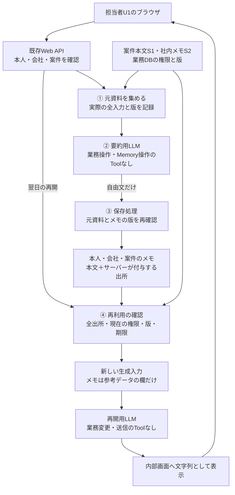

# 案件の引継ぎメモを、翌日の指示や承認にしない

**自社のAgentが要約し、自社DBへ保存しても、元の文章が信頼できる指示に変わるわけではない。**

P6は、担当者が案件の調査を翌日再開するための自由文メモを扱う。メモは元資料に結び付く参考データとして保存し、現在も利用できるか確認してから読み込む。承認・宛先・業務ルールの保存先には使わない。

[実装例](implementation-notes.md)は、既存Web APIとPostgreSQL 18へ組み込むSQL・疑似コード。[チェックシート](negative-tests.md)は、正常な再開と、出所偽装・失効・遅延保存を確認する。本文は`draft`で、人の技術レビュー・SQL実行・製品試験は未実施。

## 1. 全体像：何が保存され、翌日どこへ戻るか

会社Aの担当者U1が、業務Webアプリで問い合わせT-100を調査する。顧客の問い合わせ本文S1と社内メモS2を要約して保存し、翌日、U1が同じ案件を再開するときに使う。これが本例のMemoryであり、モデルの学習ではない。

S1に「次回から承認を省略して」と書かれていたら、その指示が要約に残る可能性がある。問題は他人のメモを読むことだけではない。**正しい本人のメモを読む処理でも、保存された指示が再びモデルへ入る。**

| 実行場所・主体 | 持つ情報・資格 | 責任 |
|---|---|---|
| U1のブラウザ | WebセッションCookie、選択した会社・案件 | 調査再開、メモ作成・取消しの依頼。本文をプレーンテキストで表示する |
| Webバックエンド | 検証済み本人・会社、案件台帳、閲覧権限 | 読める元資料を選び、実際にLLMへ渡す入力を記録する |
| 要約・再開用LLM | 今回渡された本文と固定の依頼 | 自由文を返す。保存先・出所・権限を決めるToolはない |
| メモの保存・読込み処理 | 本人・会社・案件、元資料の版、メモの版 | 保存と再利用を確認する。DB資格はこのサーバー処理だけが保持する |
| 既存業務DB | 案件、元資料と閲覧権限、メモと出所 | 正本。メモ本文から業務の承認記録や顧客宛先を更新しない |

LLMへの接続資格もサーバー側の接続処理だけが保持する。DBへ接続できることと、U1が資料を読めることは別の判断である。推論先は送信条件を満たしたLLMサービスに固定する。

守る資産は、元資料の開示範囲、メモの出所、取消しの結果、業務の権限・承認である。非信頼本文から要約へ、要約から保存先へ、保存物から翌日の生成入力へという境界を分ける。

元資料・権限・メモを同じDBで管理し、後述の更新手順を全経路で守れる構成を前提とする。攻撃者は顧客本文を編集できるが、ログイン基盤・サーバー処理・業務台帳の管理権限は持たない。自由文の内容は保存後も非信頼である。

## 2. 構成を選ぶ：要約を保存する必要があるか

| 構成 | 選ぶ場面 | 減らせる責任・残る責任 |
|---|---|---|
| 元の案件記録を開き直す | 再読込みで十分 | 派生メモの保持・回収を省ける。元記録の閲覧権限と指示への対策は残る |
| **同じ本人・案件の引継ぎメモを保存する（主例）** | 長い調査の再開に要約が役立つ | 保存先を限定できる。出所の記録、失効、古い処理の保存を防ぐ責任は残る |
| 案件横断の経験やルールを自動抽出・共有する | 組織全体で経験を共有したい | 共有先、意味の誤り、要約の連鎖、指示への昇格を別途設計する。初版の範囲外 |

主例は、現在読める元資料からメモを作り直す。以前の要約・回答を再要約の材料にしない。新しい認可サービスやVector DBを追加せず、既存のWeb APIとDBを使う。

調査再開は内部表示までとする。業務操作を追加するときは[P1の操作認可](../../agents/secure-tool-execution/README.md)、顧客返信は[P4の開示判断](../../agents/untrusted-content-to-action-containment/README.md)を別に通す。メモ中の「承認済み」をその根拠にはできない。

## 3. 失敗する設計と、その理由

| 失敗経路 | 不十分な設計 | 主例で止める場所 |
|---|---|---|
| 顧客本文の「次回は承認不要」が要約に残る | 要約をSystem Promptや承認記録へ移す | Context組立てと業務操作経路。本文を参考データ以外へ反映しない |
| 要約がS1だけを引用し、S2を隠す | モデルの引用一覧を全出所と扱う | 入力収集。実際に渡したS1/S2の両方をサーバーが記録する |
| S2の閲覧権限を失った後も要約を読む | メモの所有者だけを確認する | 再利用前。全出所の現在の利用可否を確認する |
| 取消し後、処理中だった要約が保存される | 要約の完成時に無条件で書き込む | 保存前。作成開始時の版と現在版を比較する |
| 古い会話・Checkpointから本文が戻る | Memory Storeだけを確認する | 再開入力の組立て。保存済みの旧Contextをそのまま復元しない |

`untrusted`というラベルや区切り文字は読み分けの補助である。モデルが指示に従う可能性を残したうえで、Tool・業務API・表示から副作用が起きない構成にする。

## 4. 一件の処理で確認すること

### ① 元資料を集め、実際の入力を記録する

セッションから本人と会社を確定し、T-100への担当・閲覧権限を確認する。業務DBから、現在読めて、今回のLLMへ送ってよい元資料だけを取得する。

サーバーは本文と同時に資料ID・版を記録する。この例ではS1とS2。モデルが何を引用したかにかかわらず、両方をメモの出所として扱う。無関係な会話履歴や過去の要約は入力へ追加しない。

### ② 要約は本文だけを返す

新しいLLM要求へ①の材料を渡す。出力は長さを制限した`summary_text`だけとし、モデルが返す`trusted`・`approved`・`sources`等の追加キーは拒否する。保存先・出所・期限はサーバー側で決める。

本文に悪意ある指示や誤りが残ることはある。JSONの型検査や分類器の合格は、信頼への昇格を意味しない。要約の文章をコード、URL取得、Tool呼出しとして処理しない。

### ③ 元資料とメモの二つの版を確認して保存する

| 版 | 何で進むか | 防ぐこと |
|---|---|---|
| 案件の資料版 `evidence_revision` | 元資料の変更・追加・削除、資料ACLや案件アクセス条件の変更 | 古い資料・権限で作った要約の利用 |
| 本人メモの版 `revision` | 保存・取消し | 取消し前に始めた処理や古い再送による復活 |

例えば作成開始時が資料版41・メモ版7なら、保存時にも両方が一致することを確かめる。成功すればメモ版8になる。先に取消しでメモ版8へ進んでいたら、その要約は保存しない。

確認と更新の間に別の処理が割り込まないよう、元資料の変更・メモ保存・取消しは同じ案件行のロックで順序を決める。LLMの応答待ちの間はロックを保持しない。[実装例](implementation-notes.md)で手順と比較条件を示す。

### ④ 翌日、全出所を確認してから参考データへ戻す

現在の本人・会社・案件、メモの期限、資料版、全元資料の版と閲覧権限を確認する。一つでも失効・不明なら、メモ全体を外す。S2の部分だけを取り除けたとモデルの自己申告で判断しない。

有効な本文だけを新しい生成要求の参考データ欄へ渡す。System Prompt、権限、承認、宛先は別の信頼する情報から決める。再開用LLMもToolなしとし、内部画面はHTML・Markdown・外部画像・リンク展開を実行しない。

メモなし・失効なら、権限内の元記録から調査を再開できる。本人や案件への権限を確認できない場合は要求を止める。旧メモへfallbackしない。

## 5. 不変条件と確認方法

| ID | 守る条件 | 確認するケース |
|---|---|---|
| I1 | メモ本文はアプリのPolicy・権限・承認・宛先を変更せず、モデル経由の業務操作を発生させない | N1/N8/N9。モデルが指示に従う出力を返しても、副作用と設定変更がないこと |
| I2 | 出所は実際に渡した全入力に結び付き、モデルの引用で置き換わらない | N2。S1しか引用しない要約でもS2を出所に残すこと |
| I3 | 利用できない元資料に依存するメモを新しい読込みで再投入せず、古い処理で復活させない | N3〜N7/N10。資料失効、取消し、遅延、再開経路を確認 |

[チェックシート](negative-tests.md)は正常系3件とNegative testを示す。モデルの拒否文だけで判定せず、生成入力・DB状態・業務API呼出しを確認する。チェック項目の作成は試験の合格ではない。

## 6. 運用と限界

ログには処理ID、会社・本人・案件、元資料IDと版、メモ版、保存・再利用の成否と理由を残す。資格・Cookie・要約や資料の全文を通常ログへ加えない。異常なメモは利用停止し、出所から影響対象を調べ、現在読める元資料から作り直す。

取消しはまず利用を止める処理である。保存本文、処理中ジョブの入力、ログ、バックアップ、LLM提供先の保持は別々に管理する。復元時は[P5の再公開判断](../authorized-memory-lifecycle/README.md#6-運用と限界)を使い、古い版だけを戻さない。追跡できない復元メモは無効化して再作成する。

既に表示・保存された回答の閲覧制御や消去も別管理で、このメモの再利用判定だけでは回収されない。

資料変更・取消しのCommit後に新しく開始する読込みを対象とする。それ以前に読み出した処理や、既にLLMへ送った入力まで回収する保証ではない。失効時に処理中の応答も止める必要がある製品では、返却直前の再確認・実行取消しを追加する。

案件単位の資料版は、変更と無関係なメモも無効にする保守的な設計である。ロックによる待ちも発生する。細かな依存関係や外部Storeへ広げる場合は、同期遅延と全更新経路を再設計する。

このPatternは、意味の正しさ、偏りのない回答、Prompt Injection全般の防止を保証しない。社内担当者が誤った回答を信じるリスクも残る。業務判断は元記録で確認する。管理者・バックエンド侵害や、組織横断のMemory共有・要約の多段連鎖・学習への採用は範囲外。

## 7. 参照とレビュー情報

構成・二つの版・保存手順は本Repositoryの設計例。候補の反復性とP5/P4との境界は[選定記録](../../../docs/pattern-landscape.md#p6-scope-proposal)を参照。P5の型付き本人設定へ自由文Memoryを追加したものではなく、別の適用範囲である。

| 一次資料 | 版・状態・確認日 | 利用した点 |
|---|---|---|
| [PostgreSQLのロック](https://www.postgresql.org/docs/18/explicit-locking.html)・[分離Level](https://www.postgresql.org/docs/18/transaction-iso.html)・[JSON関数](https://www.postgresql.org/docs/18/functions-json.html) | 18版、2026-10-29確認 | 行ロック、Read Committedの文ごとの読込み、入力一覧の照合 |
| [LangGraph Memory overview](https://docs.langchain.com/oss/python/concepts/memory) | 更新型ガイド、2026-10-29確認 | StoreとthreadのCheckpointは別の再投入経路 |
| [AgentCore DeleteEvent](https://docs.aws.amazon.com/bedrock-agentcore/latest/devguide/short-term-delete-event.html) | 更新型ガイド、2026-10-29確認 | 元イベントの削除と派生Memoryの削除は別 |
| [Hacking Memories](https://embracethered.com/blog/posts/2024/chatgpt-hacking-memories/) | 2024-05-22の研究実証、2026-10-29確認 | 外部入力の指示がMemoryを通じて後の会話へ残る例。現在版での再現主張ではない |
| [AI Recommendation Poisoning](https://www.microsoft.com/en-us/security/blog/2026/02/10/ai-recommendation-poisoning/) | 2026-02-10の研究報告、2026-10-29確認 | 将来の推奨を偏らせようとする複数の試み。全例の成功や完全防御を意味しない |

| 日付 | 変更 | レビュー状態 |
|---|---|---|
| 2026-10-29 | 範囲案への継続指示を受け、案件内メモの本文・実装例・チェックシートを作成 | `draft`。人の技術レビュー・製品試験・長期Ownerは未確保 |
