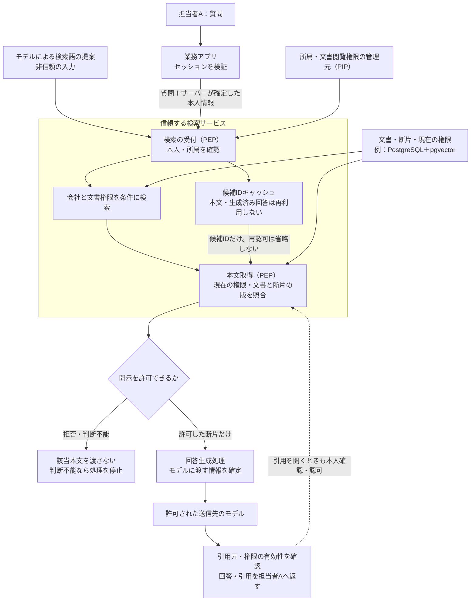

# RAG検索で、利用者に許可された文書だけを渡す

**質問に似ている文書でも、その人が読めるとは限らない。利用者の所属と文書の閲覧権限をサーバーで確認し、許可した断片だけをモデルへ渡す。**

このPatternは、検索サービスが文書を取り出し、RAGの回答材料として渡すまでの設計ガイドである。
従来の文書単位のアクセス制御を、検索結果・文書断片・引用・キャッシュにも適用する。
状態は`draft`。人による本文の技術レビューと製品の実行検証は未実施。

読む順序は、場面 → 全体図 → 失敗例 → 情報源とチェック箇所 → 処理例 → 確認方法。
実装レビューには[正常系・Negative testチェックシート](negative-tests.md)を使う。

具体的な組込み方は[実装ノート：文書ACL・RLS・接続プール](implementation-notes.md)へ。
他の構成を選ぶ際は[アクセス制御方式の比較と多層防御](access-control-options.md)へ。外部認可、OpenSearch DLS、元システムへの委任、Azureの組込み権限連携と制約を整理している。
取り込みでは[新版とACLが揃ってから検索可能にする](implementation-notes.md#更新途中の本文を検索可能にしない)。[文書・質問のEmbedding生成時の送信先](access-control-options.md#embedding生成も本文質問の送信先を確認する)も、回答モデルとは別に確認する。
Control側から全体を捉えるには[Family・Sectionの見取り図：C8.1／C5.2と、C8.3／C5.3](../../../../mappings/aisvs-v1.0-pattern-rag-001.md#familysectionの見取り図)を参照する。

## 1. 場面：会社ごとの文書を検索して、問い合わせに答える

一つのサービスを会社Aと会社Bが利用する。**この例のテナントは会社**を意味する。
両社の文書を共有検索基盤へ格納し、担当者Aが「解約時の返金条件は？」と質問する。
同じ会社でも、人事や管理者向けの文書まで全員が読めるわけではない。

| 登場するもの | この例での意味 |
|---|---|
| 担当者A（`staff-a`） | 会社Aの有効なメンバー。文書A100の閲覧を許可されている |
| 文書A100 | 会社Aのサポート用返金手順。担当者Aは閲覧可 |
| 文書A200 | 会社Aの管理者向け特例。担当者Aは閲覧不可 |
| 文書B100 | 会社Bの返金手順。担当者Aは閲覧不可。質問との類似度はA100より高くてもよい |
| 文書断片（chunk） | 検索用に分割した本文。元文書の会社・ID・版と結び付ける |
| 検索サービス | 本人・所属・文書権限を取得し、検索と本文取得を強制するバックエンド |
| 回答生成処理 | 許可された断片をモデルへ送り、回答と引用を利用者へ返す処理 |

この例では共有公開文書や会社間の共有を扱わず、**会社の一致と文書の閲覧権限の両方**を要求する。
識別子は説明用。ユーザーIDや文書IDが会社をまたいで重複しても、会社IDとの組で照合する。

### 適用範囲と前提

認証基盤、所属・閲覧権限の管理元、検索サービス、文書と断片の対応を管理する取り込み処理を信頼する。
利用者やモデルが送れるのは質問などの検索入力であり、権限情報を書き換える資格情報や任意SQLの実行能力は持たない。
モデルや文書本文に書かれた「会社A」「全員閲覧可」は、権限の根拠にしない。

対象は検索時の認可、断片の受け渡し、キャッシュと失効の扱い。
文書の取り込み全体の完全性、文書汚染、生成内容の正確さ、学習済みモデルからの情報漏えいは別の設計問題とする。
権限は変わるため、確認時点と失効の反映期限も設計の一部にする。即時失効の保証範囲は[第6節](#6-キャッシュと権限変更をどう扱うか)で区別する。

## 2. 全体像：検索条件から、本文を渡す直前まで



認可判断は通常のアプリ内処理でよい。PDPは判断、PEPは結果の強制、PIPは属性の提供、PAPはルールの管理を指す補助用語であり、別製品の導入を意味しない。
検索条件を外した直接の本文取得や、引用リンク経由でも同じ閲覧制限を強制する。
利用者・モデルはDBや検索基盤の資格情報を持たず、認可を通るAPIだけを使う。

## 3. 失敗例：検索結果を先にモデルへ渡してしまう

**危険な設計：説明用。実装の手本にしない。**

```text
担当者Aが返金条件を質問する
  → 全社共通のインデックスから、似ている文書を検索
  → 類似度が高い会社Bの文書B100をモデルへ渡す
  → 「会社Aの情報だけで答えて」とプロンプトで指示
  → 回答や引用にB100の内容が混ざる
```

回答画面で隠しても、B100をモデルへ渡した時点で開示は起きている。
会社IDだけで絞ってもA200が混ざるため、会社内の文書権限も確認する。
質問文による会社IDの偽装、検索フィルターの欠落、古いキャッシュの再利用でも同じ境界が破れる。

攻撃者は自分の質問・検索語・指定IDを操作でき、文書の文章がモデルの検索語に影響する場合もある。
管理DBの権限情報まで直接書き換えられる攻撃は、このPatternの信頼する管理面を侵害する別の条件である。

## 4. 何をもとに、何を、どこでチェックするか

| 確かめること | 根拠となる情報の取得元 | 照合する内容 | 強制する場所・時点 |
|---|---|---|---|
| 誰の、どの会社の要求か | 検証済みセッションと現在の所属管理 | 利用者の有効性、選択した会社への所属。モデルの`user_id`・`tenant_id`を採用しない | 検索APIの受付。複数会社に所属する場合も、画面で選んだ会社への所属をサーバーで確認 |
| その文書を読めるか | 管理元の会社情報と文書閲覧権限（ACL） | 会社の一致に加え、その利用者への有効な閲覧許可があるか | 検索クエリと、候補IDから本文を取得する処理 |
| 断片が正しい文書に属するか | 管理された文書ID・断片ID・版の対応 | 会社・元文書・版の一致、文書が削除／非公開になっていないか | DBの関連付けと本文取得。古い断片や対応不明の断片は渡さない |
| キャッシュを使ってよいか | サーバーが決めた会社・利用者・検索条件と候補ID | 別の利用者の結果を流用していないか、候補文書を現在も読めるか | キャッシュ読取り後も同じ本文取得・認可を通す |
| 今も開示してよいか | 現在の所属・ACL、確認時刻・版、失効の反映期限 | 検索後の取消や変更、待ち時間で古くなった判断 | モデル・外部再ランキングへの送信前と、回答返却前。引用先APIでも再確認 |

検索サービス内部で信頼して扱う候補と、モデルや利用者へ開示してよい本文を区別する。
外部の再ランキングサービスにも、閲覧を許可した断片だけを、許可された送信先として渡す。
本文だけでなく、タイトル・引用・スニペットも文書由来の情報として同じ制限を適用する。

### 常に守る条件

| ID | 不変条件 |
|---|---|
| I1 | 質問・モデル・文書本文は、認証済み本人や所属・文書権限を上書きできない |
| I2 | 開示する各断片は、確認した権限状態で会社と文書単位の閲覧条件を満たし、元文書・版と対応する |
| I3 | 検索、候補キャッシュ、本文取得、引用の各経路で同じ閲覧制限を強制する |
| I4 | 本人・権限・対応関係を確認できないときは開示せず、全社検索や古い許可へ切り替えない |
| I5 | 利用者やモデルは、検索基盤への直接アクセスや権限情報の変更によって認可を迂回できない |
| I6 | 権限の確認時点と失効反映期限を定め、期限を超えた古い許可で新たに開示しない |

## 5. 実装の要点：許可された範囲で検索し、同じ条件で本文を取る

最初の構成例では、文書・断片・所属・ACLをPostgreSQLで管理し、pgvectorで類似度を計算する。
ACLは「誰がどの文書を読めるか」の管理データ。質問やモデル出力から生成しない。
本文を持つ候補キャッシュや生成済み回答の共有キャッシュは、この例では使わない。

検索クエリの条件に加えてDB側でも制限する場合は、[実装ノート](implementation-notes.md)を参照する。
文書と断片の保存形式 → RLSでの強制 → セッション情報の受渡し → 検索後の追加取得、の順で具体例を示す。

```text
検索要求を受けたら：
  質問 = 文字列・長さを検査。モデルからの本人・所属・権限指定は拒否
  本人・会社 = セッションを検証し、現在の有効性と所属を管理元で確認
  候補 = 会社・本人・検索条件を含むキーで候補IDキャッシュを調べる
  キャッシュがなければ：
    会社の一致 AND 文書の閲覧許可 を固定の検索条件にして候補を取得
    候補の文書ID・断片ID・版だけを保存
  現在の所属・ACLと照合し、候補のうち許可された本文だけを取得
    # キャッシュ経由でも、会社・文書・版・公開状態を照合する
    # 情報取得や照合処理が失敗したら、本文を渡さず終了
  開示まで待機した場合は再確認。許可した本文・引用元を確定し、モデルへ送る
  回答返却前に、使った文書すべてへの権限の有効性を確認
    # 途中で失効していたら回答全体を破棄。引用だけ消して回答を返さない
  要求IDと、使用した文書・権限判断・送信先・結果を対応付けて記録
```

該当文書がない場合は「参照できる資料が見つからない」と扱い、会社やACLの条件を外して再検索しない。
回答に付ける引用は、サーバーが許可した文書の一覧から組み立てる。モデル指定の未知のIDやURLをそのまま公開しない。
長い処理・キュー・ストリーミングを使う場合の失効は、次節の契約に合わせる。

<details>
<summary>PostgreSQL＋pgvectorで、照合条件をSQLに置く例</summary>

以下は認可条件を読むための要点サンプルで、スキーマ一式や実行検証済みコードではない。
`memberships`は現在の会社所属、`document_readers`は利用者単位の現在の閲覧許可を管理する例である。
部署やグループから権限を展開する場合は、その変更もこの管理データへ反映する。

```sql
SELECT c.document_id, c.chunk_id, c.document_version, c.body
FROM chunks AS c
JOIN documents AS d
  ON d.tenant_id = c.tenant_id AND d.document_id = c.document_id
 AND d.current_version = c.document_version
WHERE d.tenant_id = $1
  AND d.active = true
  AND EXISTS (
    SELECT 1 FROM memberships AS m
    WHERE m.tenant_id = d.tenant_id AND m.user_id = $2
      AND m.active = true
  )
  AND EXISTS (
    SELECT 1 FROM document_readers AS r
    WHERE r.tenant_id = d.tenant_id AND r.document_id = d.document_id
      AND r.user_id = $2 AND r.active = true
  )
ORDER BY c.embedding <=> $3::vector
LIMIT 5;
```

`$1`はサーバーが確定した会社、`$2`は検証済み本人、`$3`は質問から作る検索ベクトル。
DBドライバーのパラメータとして渡し、文字列連結でSQLを組み立てない。ベクトルの次元・数値・サイズも検査する。
パラメータ化だけで認可になるわけではなく、値の取得元と上の照合条件が必要である。
キャッシュの候補を使う場合も、同じ照合に文書・断片IDと版の絞り込みを加える。IDだけで本文を取り出す別経路を作らない。

文書と断片の会社・ID・版の対応には複合キーや外部キー等を設ける。権限不明・関連付け不明を公開扱いにしない。
検索用DBロールには必要な読取りだけを許可し、ACL更新・取り込み・管理用ロールを分ける。
このSQLは信頼する検索サービスで実行する。Agentへ接続情報や任意SQL実行ツールを渡さない。
資格情報は既存の秘密管理から渡し、サーバー間通信は証明書を検証するTLS等で保護する。秘密値はサンプルへ埋め込まない。

</details>

### 技術が担う役割と、アプリに残る責務

| 技術例 | 担わせること | アプリ・配備側で確認すること |
|---|---|---|
| PostgreSQLの固定クエリ／RLS | 会社と文書権限による行の制限 | 本人情報の渡し方、断片・ACLとの関連付け、実行ロール。RLSを使っても認証やキャッシュ認可は自動では付かない |
| pgvector | 許可条件を伴う類似検索 | 結果が少なくても認可条件を外さない。検索性能と文書の開示許可を別に評価する |
| Azure AI Searchのsecurity filter方式（比較例） | 検索要求に文書の閲覧条件を付ける | 信頼できる本人・所属から条件を作り、欠落させない。フィルター中のID文字列そのものは認証・認可ではない |

PostgreSQLでは、スーパーユーザーや`BYPASSRLS`ロールはRLSを迂回し、所有者も通常は対象外になる。
RLSを追加するなら実際の実行ロールで確認し、`FORCE ROW LEVEL SECURITY`だけで全ロールを制限できると考えない。[公式仕様](https://www.postgresql.org/docs/18/ddl-rowsecurity.html)

pgvectorの近似インデックスでは、走査後のフィルターにより結果が少なくなることがある。
DB内部の走査順序と、未認可本文をモデルへ渡してから隠すことは別である。
検索数を増やす調整でも認可条件は維持する。共有近似インデックスでの会社間の検索品質・速度への影響には、パーティション等の追加設計が必要となる。[v0.8.7のFiltering／Multitenancy](https://github.com/pgvector/pgvector/blob/v0.8.7/README.md#filtering)

## 6. キャッシュと権限変更をどう扱うか

キャッシュは検索を省略するための候補であり、閲覧許可の証明ではない。
この例は会社・利用者・検索条件をキーにし、文書ID・断片ID・版だけを再利用する。
IDも保護対象として検索サービス内で管理し、再利用時は現在の所属と文書権限で本文を取り直す。
権限を失ったA100がキャッシュに残っていても、A100の本文・タイトル・引用をモデルや利用者へ渡さない。

生成済み回答には複数文書の内容が混ざる。回答キャッシュを採用するなら、根拠文書すべてと版・利用者の権限を追跡し、再利用時に確認する別の仕組みが必要になる。
本例では回答キャッシュを無効にし、過去の会話に含まれる検索本文・回答も自動で次のモデル入力へ戻さない。
会話履歴を再利用する設計では、その内容の出所と再開示の可否も確認する。

### 失効の約束を決める

- どの時点の権限で判断したか、取消から何秒以内に反映するかを決める。インデックス・所属同期・権限キャッシュ・キューの遅延も含める。
- ここでのSQLはDB上の権限状態を確認する。外部の権限管理元から同期する構成では、同期遅延や停止を監視し、反映期限を満たせないときは対象の検索・開示を停止する。
- 検索後に待機した要求は、開示前に改めて確認する。モデル送信後に失効を確認したら、未返却の回答は破棄する。すでにモデルや利用者へ送った情報は取り戻せない。

DBの読取りはスナップショットに基づくため、読取り後の取消と開示を自動的に原子化するものではない。
「取消と同時に進行中の開示も必ず停止」が必要なら、要求の取消・送信の制御まで含めた別設計が必要になる。
最初の例は回答をまとめて返す方式とし、ストリーミング中の停止保証は含めない。[PostgreSQL 18の分離レベル](https://www.postgresql.org/docs/18/transaction-iso.html)

## 7. 自分の実装で何を確認するか

[チェックシート](negative-tests.md)の正常系を通してから、一つずつ拒否条件を変える。
モデル経由と検索APIへの直接入力を両方確認し、モデルが答えなかっただけで合格にしない。

> 開発者への依頼例：「担当者Aのセッションから、検索条件を作り、本文をモデルへ送るまでの処理を見せてください。
> 会社と文書権限はどこから取得し、B100とA200はそれぞれどこで除外されますか。キャッシュと引用先でも同じ条件になりますか。」

> 検証担当者への依頼例：「質問によく似たB100を用意して、検索APIへ直接質問してください。
> 回答だけでなく、同じ要求IDでモデル・再ランキングへ送った断片と引用にB100が含まれないことを確認したいです。」

> 運用担当者への依頼例：「A100の閲覧権限を取り消した後、反映期限の前後で同じ質問と古い候補キャッシュを使ってください。
> 取消時刻、同期状態、確認した権限、モデルへの送信記録を対応付けて示してください。」

## 8. 記録・検知・障害対応

要求ID、主体と会社の参照、使用した文書・断片IDと版、権限の確認時刻・版、許可／拒否、キャッシュ経由か、送信先と結果を記録する。
質問全文・文書本文・回答全文・生のセッション／トークンを通常の監査ログへ保存しない。文書ID等の記録にも閲覧権限と保持期間を設定する。
試験でモデルへの送信内容を調べる場合は、ダミー文書と管理下の取得手段を使う。

会社の指定不一致、権限情報の欠落、失効反映期限の超過、検索サービスを通らないアクセスを検知対象にする。
同期障害時は対象範囲の開示を止め、該当キャッシュを無効化する。復旧時は権限と文書版の整合を確認して再開する。
外部応答には権限外文書の存在やタイトルを含めず、内部の監査記録で拒否理由を追えるようにする。

## 9. 限界と追加設計が必要な場面

- 許可された文書自体が悪意ある場合、回答への誘導は残る。ツール実行へ進む場合は[PATTERN-AGENTS-001](../../agents/secure-tool-execution/README.md)の実行認可も適用する。
- 権限管理元・検索サービス・取り込み処理の侵害や誤設定まで、この検索時チェックだけで補えない。
- 過去に正当に開示した文書、回答、モデル入力の回収は保証しない。失効後の新たな開示と区別する。
- 共有基盤の時間・件数・検索品質からの推測や性能干渉、物理分離の要件は別途評価する。
- 認可されても、外部モデルへの送信が契約・データ取扱方針上許可されるとは限らない。送信先の許可を別途確定する。

## 10. 参照と確認範囲

| 一次資料 | 確認した範囲・参照状態 |
|---|---|
| [PostgreSQL Row Security Policies](https://www.postgresql.org/docs/18/ddl-rowsecurity.html) | 18版。行単位の制限、所有者・管理ロールの迂回条件 |
| [PostgreSQL Transaction Isolation](https://www.postgresql.org/docs/18/transaction-iso.html) | 18版。読取り時点と並行した変更の扱い |
| [pgvector README](https://github.com/pgvector/pgvector/blob/v0.8.7/README.md) | v0.8.7タグ。類似検索、フィルター、マルチテナント時の検索品質への影響 |
| [Azure AI Search security filter方式](https://learn.microsoft.com/en-us/azure/search/search-security-trimming-for-azure-search) | 更新型文書、表示更新日2026-08-24。識別子フィルターと本人確認の違い。組込みACL・ラベル連携の状態と制約は[方式比較](access-control-options.md)に分けて記載 |

確認日：2026-10-23。会社A・Bの業務例、キャッシュ方式とSQLの組み立ては本PJの設計解釈であり、上流の完成済みRAG実装の引用ではない。
PostgreSQL 18＋pgvector v0.8.7を説明用の参照版とする。SQL・RLS・キャッシュ・失効の実行検証と製品連携は未実施。
候補選定の根拠と他Patternとの違いは[Landscape P2](../../../docs/pattern-landscape.md#p2-authorization-aware-retrieval-isolation)を参照。

## 11. レビュー状況・変更履歴

2026-10-23にユーザーがテナントを異なる会社とする範囲と開発着手を承認した。
本文の技術レビュー、保守Ownerの引受け、推奨版としての承認は未実施であり、`draft`を維持する。

| 日付 | 変更 | 理由 |
|---|---|---|
| 2026-10-23 | 初稿。会社・文書権限の照合、断片・引用・キャッシュ、失効の説明とチェックシートを作成 | 開発者が根拠情報、照合条件、開示を止める場所を特定できるようにする |
| 2026-10-23 | 文書ACL・RLS・接続プールの実装ノートと確認項目、Control Family・Sectionの案内を追加 | 具体的な組込み方と、既存Controlの中での位置づけを理解しやすくする |
| 2026-10-23 | 認可方式の比較、外部認可サービスと検索の連携図、取り込み・生成段階の補助策の限界を追補 | 提示された多層防御の説明を評価し、製品や方式を一律に必須としない選択材料を示す |
| 2026-10-23 | 方式選択の順序、取り込み途中の公開防止、Embedding送信先の確認を追補 | 更新途中の権限不整合と、回答生成前の外部送信を見落とさないようにする |
