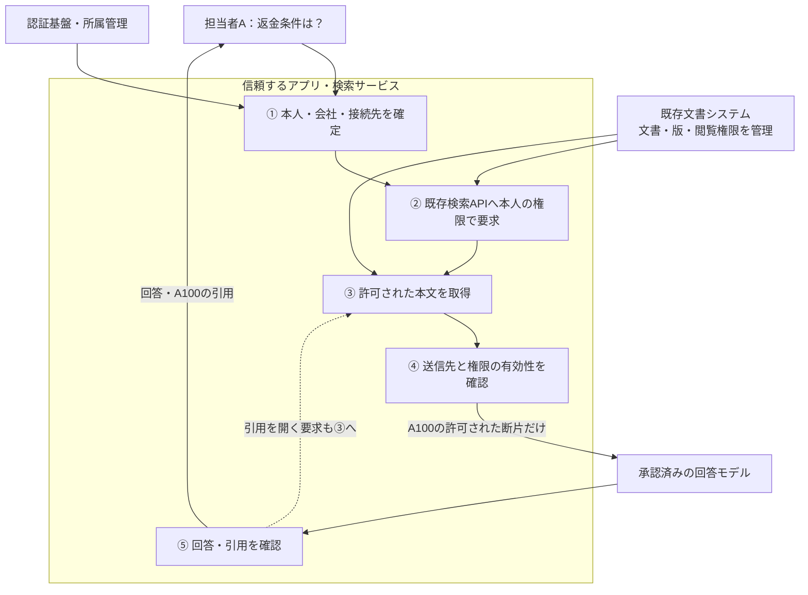

# RAG検索で、利用者に許可された文書だけを渡す

**質問に似ている文書でも、その人が読めるとは限らない。サーバーが本人・会社・文書の閲覧権限を確認し、許可した本文だけで回答を作る。**

担当者Aが質問してから回答を受け取るまでを、一つの例で追う。
まず検索基盤を自作する必要があるかを判断し、既存の認可付き検索を使う例でチェック箇所を把握する。
独自の検索基盤が必要な場合は、[PostgreSQL実装例](implementation-notes.md)へ進む。
状態は`draft`。実行検証は未実施。

## 1. 場面：担当者Aが返金条件を調べる

会社Aと会社Bが同じRAGサービスを利用する。この例の**テナントは会社**を意味する。
会社Aの担当者A（`staff-a`）が「解約時の返金条件は？」と質問する。

| 文書 | 内容と所属 | 担当者Aへの開示 |
|---|---|---|
| A100 | 会社Aのサポート用返金手順 | 許可 |
| A200 | 会社Aの管理者向け特例 | 拒否。同じ会社でも閲覧権限がない |
| B100 | 会社Bの返金手順 | 拒否。会社が違う |

文書を分割した検索用の本文を「断片（chunk）」、誰が文書を読めるかの管理データを「ACL」と呼ぶ。
守る対象は、本文に加え、断片・タイトル・引用・検索結果のキャッシュである。

この例は**会社の一致と文書の閲覧権限の両方**を要求する。会社間共有や公開文書は扱わない。
本人・文書の識別子は、会社IDとの組で区別する。

### 信頼するものと、利用者が変えられるもの

認証基盤、所属・ACLの管理元、検索サービス、文書と断片の対応を管理する取り込み処理を信頼する。
利用者やモデルは質問・検索語・指定IDを変えられるが、管理された権限情報やDBの資格情報は変更できない前提である。
文書に「全員閲覧可」と書かれていても、それをACLにはしない。

対象は、検索から回答までの認可と、その前提となる版・権限の整合である。
取り込み全体の安全性、文書汚染、回答の正確さは[限界と追加設計](#9-限界と追加設計が必要な場面)で区別する。

### 先に、既存の検索を使えるかを判断する

| 構成 | 選ぶ条件 | 減らせる危険・仕組み | 残る責任・運用負担 |
|---|---|---|---|
| 利用者本人の権限で既存検索APIを使う（主例） | 対応文書・検索品質・遅延・失効反映が要件を満たす | 文書・ACLの独自複製、独自Indexと同期処理を作らずに済む | 本人と会社・接続先の結付け、本文取得も同じ権限で行うこと、送信先・キャッシュの制御 |
| 自前の検索領域を会社別に分ける | 独自検索は必要だが、会社をまたぐ検索は不要 | 一つのIndexに会社の文書を混在させずに済む | 接続先と資格情報の分離、会社内の文書ACL、Indexごとの更新・監視 |
| 共有Indexで会社と文書ACLを強制する | 基盤の集約が必要で、共有時の認可と運用を担える | Index群の管理は集約できる | 全経路の条件強制、ACL同期・失効、越境時の影響範囲、共有資源の干渉 |

これは成熟度の段階ではない。まず既存検索で足りるかを判断し、自前で持つなら会社別か共有かを選ぶ。
既存サービス内の会社別領域を使うなどの組合せもある。別Indexという名前だけでは隔離を保証せず、同じ会社のA200への認可はどの構成でも必要になる。

**主例は、会社A用の既存文書検索を担当者A本人の権限で使う構成**とする。
会社と検索先の対応はアプリの管理設定で固定し、本人が会社外へ共有された文書を読める場合でも、本例の「会社内だけ」という検索範囲を別途制限する。
既存APIでこの範囲や失効期限を保証できなければ、主例の適用条件を満たさない。

具体例として、SharePoint／OneDriveにはMicrosoft Graphの利用者委任による検索がある。
公式資料は、サインインした利用者の文脈で文書のアクセス制御を適用すると説明している。
これは認可付き検索の候補であり、本Patternの会社境界や後段のモデル送信まで製品が自動保証する意味ではない。
[Microsoft Graph v1.0 Search概要](https://learn.microsoft.com/en-us/graph/api/resources/search-api-overview?view=graph-rest-1.0)（更新型文書、2026-10-25確認。製品連携は未検証）。

## 2. 失敗例：似ている順に検索し、後から隠す

**危険な設計：説明用。実装の手本にしない。**

```text
担当者Aが質問する
  → 全社の文書から、似ている順に検索する
  → 最も似ているB100をモデルへ渡す
  → 「会社Aの情報だけで答えて」と指示する
```

B100をモデルへ渡した時点で、未認可の本文を開示している。回答画面で隠しても取り消せない。
会社Aだけに絞っても、担当者Aが読めないA200は残る。**会社と文書の両方を、本文を渡す前に照合する**必要がある。

## 3. 質問から回答まで、5か所で確かめる



質問・モデル出力・文書本文は非信頼の入力。図の①〜⑤をサーバー側で実装する。
**必要な情報を確認できなければ処理を止める。** 検索範囲を広げたり、古い許可で代用したりしない。

### ① 本人と会社を確定する

検索APIがセッションを検証し、所属管理を参照して「有効な担当者Aが会社Aを利用している」と確定する。
画面で会社を選べる場合も、その会社への現在の所属を確認する。質問やモデルが指定した`user_id`・`tenant_id`は使わない。
質問の型・長さもここで検査する。

**次へ渡すもの：サーバーが確定した担当者A・会社Aと、検査済みの質問。**

### ② 許可された範囲で検索する

アプリは会社Aに対応する既存検索APIへ、担当者Aの検証済み委任資格で検索を要求する。
検索APIが文書ACLを評価し、アプリが固定した会社Aの検索領域と合わせて「会社Aに属する AND 担当者Aが読める」を強制する。
モデルから受け取るのは検索語だけとし、本人・接続先・資格情報・検索領域はアプリが決める。
検索語を権限条件の式へ文字列連結しない。検索製品の演算子で領域制限を外せないように、管理された対象指定と入力の扱いを分離する。
これでB100は会社条件、A200は文書ACLで除外される。質問との類似度は、この閲覧条件を満たす文書を探すために使う。

既存検索の利用だけなら、アプリが検索ベクトルを作る必要はない。独自検索で外部Embeddingを使う場合は、送信先の許可を確認する。
[Embedding生成時の送信先](access-control-options.md#embedding生成も本文質問の送信先を確認する)には、文書の取り込み時と質問時の確認箇所をまとめている。

結果が不足しても認可条件を外さない。候補キャッシュを使う場合は[第6節](#6-キャッシュと権限変更をどう扱うか)の方式とする。

**次へ渡すもの：許可条件で得た元文書IDと、取得できる場合は版・抜粋。**
検索APIが版を返さない場合は③で現在の本文と版を取得し、その本文から必要な断片を作る。版の対応を確認できない古い検索抜粋はモデルへ渡さない。

### ③ 許可された本文を取得する

本文取得も同じ担当者Aの権限で元システムへ要求する。アプリは会社Aの領域・検索で得た文書ID・版との対応を確認する。
元システムが現在の閲覧権限を強制し、アプリは本文を取得するためだけに広いサービス資格へ切り替えない。
削除・非公開・古い版・対応不明の断片は返さない。検索候補に入ったという事実だけで取得を許可しない。

この例ではA100の現在版の断片だけを取得する。タイトルや前後の段落を追加するときも同じ条件を使う。
既存検索が本文の抜粋を返す場合は②ですでに開示が始まるため、その応答にも認可が必要である。
自前のSQL検索では、②と③を一つの照合付きクエリで実行してよい。
文書の準備側は[新版とACLが揃ってから公開する](implementation-notes.md#更新途中の本文を検索可能にしない)。

**次へ渡すもの：許可を確認したA100の本文・タイトルと、対応するID・版。**

### ④ 許可された送信先で回答を生成する

回答生成処理が、A100の断片を会社のデータ取扱方針上許可されたモデルへ送る。
「担当者Aが読める」と「外部サービスへ送れる」は別の確認である。外部再ランキングを使う場合も同じ扱いにする。

本文取得から送信まで待機した場合は、権限の有効性を再確認する。
権限確認の時点と取消の反映期限は[第6節](#6-キャッシュと権限変更をどう扱うか)で決める。

**次へ渡すもの：生成された回答と、モデルへ渡したすべての文書ID・版。**

### ⑤ 回答と引用を返す

回答返却前に、モデルへ渡したすべての文書への権限が有効か確認する。
途中で失効していたら、未返却の回答全体を破棄する。引用だけ消して回答本文を返してはいけない。

引用はサーバーが許可した文書一覧から組み立て、モデル指定の未知のID・URLは公開しない。
担当者Aが引用を開いたときも、③の本人確認・本文取得を通す。
この例では回答をまとめて返し、生成済み回答や過去の会話を自動で再利用しない。

**担当者Aへ返すもの：A100を材料にした回答と、認可付きの引用。**

## 4. 同じ流れを実装・確認する

主例の要点は、**検索も本文取得も担当者Aとして呼び、アプリが会社の範囲と送信先を固定すること**である。

| 何をもとに | 何をチェックするか | どこで強制するか |
|---|---|---|
| 検証済みセッション・所属と、管理された接続設定 | 担当者A・会社A・委任資格・検索領域が対応するか | アプリが検索・本文取得APIを呼ぶ前 |
| 元システムの文書権限 | A100は読める、A200は読めないか | 既存検索APIと本文取得API。検索の抜粋も対象 |
| 元文書の会社・ID・版と、データ取扱方針 | 会社内の対象か、モデルへ送れるか、返却時にも権限が有効か | アプリの③〜⑤。権限再確認の方法と期限は元システムの契約に合わせる |

既存APIの障害時に管理者検索へ切り替えない。元システムの認可を再利用しても、④・⑤の送信と回答の制御はアプリに残る。
独自の検索が必要な場合に限り、PostgreSQL＋pgvectorによる共有DBの例を読む。専用の認可製品は必須ではない。

| 次に知りたいこと | 読む場所 |
|---|---|
| 独自の共有DBで①〜⑤をどう実装するか | [PostgreSQL実装ノート](implementation-notes.md)。同じ番号で、セッション・RLS・本文取得・回答までを追う |
| 既存の文書管理や別の検索基盤を使いたい | [構成の選び方](access-control-options.md)。権限の管理元・強制箇所・格納先の分離を順に決める |
| 自分の実装で越境や失効を確認したい | [正常系・Negative testチェックシート](negative-tests.md) |

Controlとの関係は、別成果物の[Family・Sectionの見取り図](../../../../mappings/aisvs-v1.0-pattern-rag-001.md#familysectionの見取り図)を参照する。

用語の対応：認可の判断がPDP、開示を止める箇所がPEP、所属やACLの提供元がPIP、ルールを管理する仕組みがPAP。
これらは役割の名前であり、別々の製品を導入する意味ではない。

## 5. 常に守る条件

| ID | 不変条件 |
|---|---|
| I1 | 質問・モデル・文書本文は、認証済み本人や所属・文書権限を上書きできない |
| I2 | 開示する各断片は、確認した権限状態で会社と文書単位の閲覧条件を満たし、元文書・版と対応する |
| I3 | 検索、候補キャッシュ、本文取得、引用の各経路で同じ閲覧制限を強制する |
| I4 | 本人・権限・対応関係を確認できないときは開示せず、全社検索や古い許可へ切り替えない |
| I5 | 利用者やモデルは、検索基盤への直接アクセスや権限情報の変更によって認可を迂回できない |
| I6 | 権限の確認時点と失効反映期限を定め、期限を超えた古い許可で新たに開示しない |

## 6. キャッシュと権限変更をどう扱うか

### 候補を再利用しても、③の認可を通す

主例はアプリ側に候補・回答キャッシュを新設しない。以下は候補キャッシュが必要になった場合の追加条件。元システム内部のキャッシュと失効特性は別途確認する。

候補キャッシュのキーには会社・利用者・検索条件を含め、文書ID・断片ID・版だけを保存する。
IDも検索サービス内で保護し、③で現在の権限による本文取得を行う。別利用者の結果を流用しない。

本例では生成済み回答をキャッシュせず、過去の会話に含まれる本文・回答も自動でモデルへ戻さない。
それらを再利用する構成では、根拠文書すべての版と権限を追跡し、再開示できるか確認する別の仕組みが必要になる。

### 取消をいつまでに反映するか決める

権限の確認時点と、取消から反映までの期限を決める。所属・ACLの同期、認可キャッシュ、キューの遅延も含める。
期限を満たせない場合は対象範囲の検索・開示を停止する。④では待機後の再確認、⑤では回答返却前の確認を行う。

DBの読取り後にも権限は変わり得る。SQLだけで取消と送信を一つの操作にはできない。
取消と同時に進行中の送信も止める必要がある場合や、ストリーミングを使う場合は、要求取消・送信制御まで含めて設計する。
モデルや利用者へすでに送った情報の回収は保証しない。[PostgreSQL 18の分離レベル](https://www.postgresql.org/docs/18/transaction-iso.html)

## 7. 自分の実装で何を確認するか

> 「既存の文書検索を担当者本人の権限で使うだけでは、何が不足しますか。自前Indexが必要なら、会社間で共有する理由と、ACL同期・失効対応の担当を示してください。」

まず担当者AがA100を取得できることを確認し、次にA200・B100がどこで止まるかを見る。
[チェックシート](negative-tests.md)では、本人偽装・別経路・キャッシュ・失効など、変える条件を一つずつ指定している。
モデルが回答を拒否しただけで合格にせず、検索API・本文取得・引用先も直接確認する。

> 「担当者Aのセッションから回答まで、①〜⑤を一度通して見せてください。会社とACLはどこから取得し、A200とB100をどこで除外しますか。モデルへの送信内容と引用先でも確かめたいです。」

> 「A100の権限を取り消し、候補キャッシュを残したまま反映期限後に再要求してください。本文取得・モデル送信・回答返却の各時点で何が止まるかを見せてください。」

## 8. 記録・検知・障害対応

要求ID、主体と会社の参照、使用した文書・断片IDと版、権限の確認時刻・版、許可／拒否、キャッシュ経由か、送信先と結果を記録する。
質問全文・文書本文・回答全文・生のセッション／トークンを通常の監査ログへ保存しない。文書ID等の記録にも閲覧権限と保持期間を設定する。
試験でモデルへの送信内容を調べる場合は、ダミー文書と管理下の取得手段を使う。

会社の指定不一致、権限情報の欠落、失効反映期限の超過、検索サービスを通らないアクセスを検知対象にする。
同期障害時は対象範囲の開示を止め、該当キャッシュを無効化する。復旧時は権限と文書版の整合を確認して再開する。
外部応答には権限外文書の存在やタイトルを含めず、内部の監査記録で拒否理由を追えるようにする。

## 9. 限界と追加設計が必要な場面

- 許可された文書自体が悪意ある場合、回答への誘導は残る。ツール実行へ進む場合は[PATTERN-AGENTS-001](../../agents/secure-tool-execution/README.md)の実行認可も適用する。
- 権限管理元・検索サービス・取り込み処理の侵害や誤設定まで、この検索時チェックだけで補えない。
- 過去に正当に開示した文書、回答、モデル入力の回収は保証しない。失効後の新たな開示と区別する。
- 共有基盤の時間・件数・検索品質からの推測や性能干渉、物理分離の要件は別途評価する。
- 認可されても、外部モデルへの送信が契約・データ取扱方針上許可されるとは限らない。送信先の許可を別途確定する。

## 10. 参照と確認範囲

| 一次資料 | 確認した範囲・参照状態 |
|---|---|
| [PostgreSQL Row Security Policies](https://www.postgresql.org/docs/18/ddl-rowsecurity.html) | 18版。行単位の制限、所有者・管理ロールの迂回条件 |
| [PostgreSQL Transaction Isolation](https://www.postgresql.org/docs/18/transaction-iso.html) | 18版。読取り時点と並行した変更の扱い |
| [pgvector README](https://github.com/pgvector/pgvector/blob/v0.8.7/README.md) | v0.8.7タグ。類似検索、フィルター、マルチテナント時の検索品質への影響 |
| [Azure AI Search security filter方式](https://learn.microsoft.com/en-us/azure/search/search-security-trimming-for-azure-search) | 更新型文書、表示更新日2026-08-24。識別子フィルターと本人確認の違い。組込みACL・ラベル連携の状態と制約は[方式比較](access-control-options.md)に分けて記載 |

確認日：2026-10-23。会社A・Bの業務例、キャッシュ方式とSQLの組み立ては本PJの設計解釈であり、上流の完成済みRAG実装の引用ではない。
PostgreSQL 18＋pgvector v0.8.7を説明用の参照版とする。SQL・RLS・キャッシュ・失効の実行検証と製品連携は未実施。
候補選定の根拠と他Patternとの違いは[Landscape P2](../../../docs/pattern-landscape.md#p2-authorization-aware-retrieval-isolation)を参照。

## 11. レビュー状況・変更履歴

2026-10-23にユーザーがテナントを異なる会社とする範囲と開発着手を承認した。
本文の技術レビュー、保守Ownerの引受け、推奨版としての承認は未実施であり、`draft`を維持する。

| 日付 | 変更 | 理由 |
|---|---|---|
| 2026-10-23 | 初稿。会社・文書権限の照合、断片・引用・キャッシュ、失効の説明とチェックシートを作成 | 開発者が根拠情報、照合条件、開示を止める場所を特定できるようにする |
| 2026-10-23 | 文書ACL・RLS・接続プールの実装ノートと確認項目、Control Family・Sectionの案内を追加 | 具体的な組込み方と、既存Controlの中での位置づけを理解しやすくする |
| 2026-10-23 | 認可方式の比較、外部認可サービスと検索の連携図、取り込み・生成段階の補助策の限界を追補 | 提示された多層防御の説明を評価し、製品や方式を一律に必須としない選択材料を示す |
| 2026-10-23 | 方式選択の順序、取り込み途中の公開防止、Embedding送信先の確認を追補 | 更新途中の権限不整合と、回答生成前の外部送信を見落とさないようにする |
| 2026-10-23 | 本文と実装例を質問から回答までの5段階に再構成し、代替構成と補足の役割を分離 | 一つの利用場面を追ってチェック箇所を理解できるようにする |
| 2026-10-25 | 既存検索の再利用を主例とし、自前Indexの会社別／共有構成を比較。SQL例とチェックを適用構成別に案内 | 文書・ACLの複製と共有境界を追加する前に必要性を判断する |
