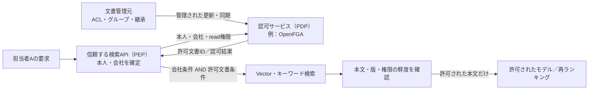

# RAGの構成を選ぶ：権限の管理元・強制箇所・分離

[Pattern本文](README.md)で①〜⑤の流れを把握した後、自分のシステムへ合わせるための選択ガイド。
[PostgreSQL実装例](implementation-notes.md)は、所属・ACL・文書を同じDBで管理し、RLSで強制する構成である。
ここでは、その構成をどこから変える必要があるかを考える。

## 1. 権限の管理元を決める

最初の問いは「担当者AがA100を読めるという判断を、どこから得るか」。

| 自分のシステムの状況 | 管理元・参照方法の候補 | 選んだ後に決めること |
|---|---|---|
| 文書と権限を自分のアプリで管理する | [DBの所属・文書ACL](implementation-notes.md#準備照合に使うデータ) | 文書の版と権限を対応させ、更新を検索・本文取得へ反映する |
| 既存の文書管理システムが権限を持つ | [利用者の代理で元システムへ検索を依頼](#元システムへ利用者の代理で検索を依頼する)、またはACLを検索基盤へ同期 | 委任する本人の範囲、対応データ源、同期の鮮度 |
| グループ・フォルダー継承を複数アプリで共通化したい | [OpenFGA／Auth0 FGA等へ関係データを管理・同期](#認可サービスを検索と組み合わせる) | 元の権限の意味、取消の同期、認可キャッシュ |

本人・所属を確認するIdentity基盤だけでは、任意の文書ストアの閲覧権限までは決まらない。
外部認可サービスを導入する場合も、文書管理元との関係を決める。

## 2. 検索と本文取得で強制する場所を決める

次の問いは「権限の判断を、どの処理が必ず使うか」。管理元が同じでも、強制箇所は選べる。

| 強制箇所 | 具体的な実装例 | 迂回を防ぐための条件 |
|---|---|---|
| アプリが条件を固定し、検索基盤へ渡す | 固定SQL、[Azure AI Searchのsecurity filter](#azure-ai-search文字列フィルターと組込み権限連携を分ける) | 全経路で条件を付け、利用者・モデルから条件を外せないようにする |
| DB・検索エンジンが条件を適用する | PostgreSQL RLS、[OpenSearch DLS](#opensearchdlsで読める文書を制限する)、Azureの組込み権限連携 | 実際に評価される本人・ロールを確認し、管理権限で迂回させない |
| 検索APIが外部の認可結果を適用する | [許可IDで絞る／候補IDを一括認可する](#許可idを先に求める方式とその代案) | 認可結果を検索・本文取得に結び付け、失敗時に範囲を広げない |

検索で許可されても、本文の直接取得・引用・キャッシュに別経路があれば、そこにも強制箇所が必要になる。
RLSが別の検索エンジンにも自動で適用される、と考えない。

## 3. 会社ごとの格納先・資格情報を分けるか決める

最後の問いは「共有基盤の行制限で足りるか、会社別の格納先も必要か」。
会社別のIndex・DB・専用サービスを選ぶ場合は、検証済み所属から接続先を決め、資格情報でも到達先を限定する。
Namespaceの名前だけで分離したとみなさず、会社内の文書ACLも維持する。

例えば、**元システムのACLを同期する → RLSで強制する → 会社別DBへ格納する**という組合せができる。
外部認可や専用基盤への移行を、すべてのRAGの到達点にする必要はない。

検索内部の候補と、本文の開示・物理分離の違い

まず検索対象を会社・文書ACLで絞り、未認可本文を検索APIの結果として外へ返さない構成を基本とする。
回答だけを後から隠しても、すでにモデル等へ渡した情報は取り戻せない。

一方、「検索前の認可」は、共有インデックスの内部探索で他社のVectorへ一切触れないという物理保証とは異なる。
DB・検索エンジン内でのアクセス制御、信頼するサービス内だけで扱う候補ID、本文の開示を分けて設計する。
共有基盤の探索・速度・件数からの推測まで避けたい場合は、別Indexや専用資源を含めた分離が別途必要になる。
pgvectorも共有近似インデックスによるテナント間の検索品質・速度への影響を説明している。[pgvector v0.8.7](https://github.com/pgvector/pgvector/blob/v0.8.7/README.md#multitenancy)

ここまでで構成を決めたら、以下から採用する技術の節だけを読む。

## 認可サービスを検索と組み合わせる

フォルダー継承やグループ、共有相手が複雑なら、権限の判断をOpenFGA等へ集約できる。
ReBAC（関係に基づく認可）は「担当者 → 所属グループ → 閲覧できる文書」の関係を評価する方式。
Entra ID等による本人・所属の確認に加え、文書側のACLと共有・継承ルールが必要である。
Identity基盤へ問い合わせるだけで、任意の文書ストアの閲覧可能IDがすべて得られるわけではない。

認可サービスを呼ぶだけでは強制にならない。検索APIが判断結果を必ず使い、質問・モデル・呼出元が条件を外せないようにする。
同じ文書IDが別会社にも存在する場合は、認可Objectも会社と文書の組で識別する。
認可モデル・関係データの更新資格情報は検索用から分離し、利用者やAgentに変更させない。

### 許可IDを先に求める方式と、その代案

| 組み合わせ | 向く条件 | 設計上の限界 |
|---|---|---|
| 許可IDを列挙してから検索 | 利用者が読める文書集合を扱える大きさで取得できる | 計算時間・返却上限・検索フィルターのサイズを見積もる。空集合は検索しない。エラーを「制限なし」に変換しない |
| 権限の検索用Indexを同期し、開示前にも確認 | 許可文書数が多く、全ID列挙が重い | 同期遅延を監視し、取消を最終確認へ反映する。再確認先自体のキャッシュ・同期状態にも注意 |
| 会社等の既知Scopeで絞った候補IDを取得し、一括認可してから本文を読む | IDだけを信頼する境界内で扱え、検索基盤が本文・タイトルを先に返さない | 件数不足・再検索コスト・IDやScoreの露出を評価。未認可本文をモデルへ渡した後のフィルターでは代替できない |

この組合せは[OpenFGAのSearch With Permissions](https://openfga.dev/docs/interacting/search-with-permissions)を踏まえたRAG向けの設計整理である。
第三案は認可前の候補IDを保護されたサービス内に限定する条件付きの代案であり、本文まで全件取得する構成には使わない。
候補のScore・件数を利用者へ返さず、推測リスクも別に判断する。

公開実装例として、[Auth0のRails＋pgvector＋FGAによるRAG解説](https://auth0.com/blog/secure-ruby-on-rails-application-auth0-fga/)は、許可文書IDで検索を制限する構成を示す。
ベンダーのサンプル解説であり、本PJでの実行結果や本番運用の保証ではない。

**動的な照会でも、元のACL同期と認可キャッシュが古ければ古い許可が返る。**
OpenFGAにはキャッシュを利用する`MINIMIZE_LATENCY`と、キャッシュを回避してDBへ問い合わせる`HIGHER_CONSISTENCY`がある。
後者も、文書管理元からまだ届いていない取消までは補えない。同期・照会・本文送信までを含む失効期限を決める。[Query Consistency](https://openfga.dev/docs/interacting/consistency)

## 検索製品・元システムの機能を使う

### OpenSearch：DLSで読める文書を制限する

Amazon OpenSearch ServiceのFGACは、Index・Document・Field単位のアクセス制御を提供する。
ここでは「行レベル」より、文書レベルの認可を表す**DLS（Document-level security）**が正確である。
Roleに検索条件を設定するので、アプリが各検索要求へ同じ条件を書き足す方式とは強制箇所が異なる。[AWS FGAC](https://docs.aws.amazon.com/opensearch-service/latest/developerguide/fgac.html)

ただし、全利用者を広い共通サービスIdentityで接続すれば、それだけでは担当者Aの権限にならない。
認証済み主体とRoleの対応を設計し、複数Roleの実効権限、検索・ID指定取得の両経路を確認する。
DLSが制限するのは読取りであり、書込み権限は別管理。読取り専用のRoleを使い、ACL属性の更新や管理APIを許可しない。
利用者ID等は`keyword`等による完全一致で扱い、通常の文章解析で別IDが同一視されないようにする。[OpenSearch DLS仕様](https://docs.opensearch.org/latest/security/access-control/document-level-security/)

### Azure AI Search：文字列フィルターと組込み権限連携を分ける

Azure AI Searchのsecurity filter方式なら、管理元から得た閲覧主体をインデックスの属性に保存し、信頼する検索APIが`search.in`等の条件を付ける。
本人確認はアプリの責任であり、フィルターに書いたID自体が認証されるわけではない。
クライアントから検索基盤を直接呼べる構成にせず、会社・ACL条件の欠落を拒否し、権限同期の期限を監視する。[公式のsecurity filter方式](https://learn.microsoft.com/en-us/azure/search/search-security-trimming-for-azure-search)

ベクトル検索の`preFilter`は探索中にフィルターを適用する選択肢である。検索内部の`postFilter`と、未認可本文をモデルへ送った後に回答を隠す処理を混同しない。
方式を選んでも、条件の正しさと全経路への適用は必要である。[Azureのベクトル検索フィルター](https://learn.microsoft.com/en-us/azure/search/vector-search-filters)
これに対して[組込みの文書アクセス制御](https://learn.microsoft.com/en-us/azure/search/search-document-level-access-overview)には、対応データ源からACL等を取り込み、利用者のIdentityと照合する方式がある。
確認時点の同資料では、組込みACL／RBAC scope連携とPurview秘密度ラベル連携は**preview**。アプリが文字列条件を付ける方式とは、対応範囲と成熟度を分けて判断する。

Purview連携は、検索時にEntraトークンとラベルの閲覧権を評価するが、次の条件がある。

- 確認した資料は`2026-08-01-preview` REST API等を前提とする。
- 元文書のラベル変更は次の成功したIndexer実行まで検索Indexへ反映されない。
- 同一Entraテナントが前提で、Guest・Cross-tenant検索には非対応。
- 管理者の特権読取り経路があるため、通常のRAGへその権限を与えない。

対応データ源や設定条件の詳細は[Purview連携の公式仕様](https://learn.microsoft.com/en-us/azure/search/search-indexer-sensitivity-labels)を参照する。

このPatternの「会社A・B」というサービス上のテナントと、Entraのディレクトリテナントは同じとは限らない。
別Entraテナントの顧客を一つの構成へそのまま収容できる、と読み替えない。

### 元システムへ利用者の代理で検索を依頼する

文書がSharePoint／OneDriveにあり、その検索で用途を満たせるなら、自前のVector DBへACLを複製する以外の選択肢もある。
Microsoft Graph Searchの利用者委任による検索は、本人がアクセスできる項目へ結果を制限する。[Microsoft Graph v1.0](https://learn.microsoft.com/en-us/graph/api/resources/search-api-overview?view=graph-rest-1.0)

アプリ単独の広い権限による検索と混同せず、後続の本文取得・再ランキング・キャッシュでも本人の制限を維持する。
元システムの検索機能、遅延、利用制限、権限変更の反映特性が要件を満たすかを確認する。

## 送信・取り込みの補足

### Embedding生成も、本文・質問の送信先を確認する

外部のEmbedding APIを使う場合、回答生成より前にも情報が外へ出る。
検索結果の閲覧認可とは別に、会社のデータ取扱方針とデータ分類を根拠として、次の送信を許可できるか確認する。

| 処理 | APIへ送る情報 | 強制する場所・時点 |
|---|---|---|
| 取り込み時のEmbedding生成 | 元文書の本文・断片 | 取り込みサービスが送信前に、対象会社・データ分類に対する送信先の許可を確認 |
| 検索時のEmbedding生成 | 利用者の質問文。検索語への変換や履歴追加を行うなら、その情報も含む | 検索サービスが送信前に、質問に含まれる情報と送信先の許可を確認 |

接続先は管理された設定から選び、質問・文書・モデルに任意のURLを指定させない。
許可されない場合は送信せず、あらかじめ承認されたローカル処理等がある場合だけ切り替える。障害時も未承認の別サービスへ転送しない。
文書を検索非公開で準備していても、この送信先確認は必要である。

**ベクトル化は匿名化ではない。** 保存したEmbeddingやそのエクスポートも、元文書に応じたアクセス制御の対象にする。[OWASPのEmbedding Privacy](https://cheatsheetseries.owasp.org/cheatsheets/RAG_Security_Cheat_Sheet.html#embedding-privacy)
上の送信前チェックは、その保護原則を取り込み・検索の境界へ適用した本PJの設計判断である。

> 「文書と質問のEmbeddingはどこで作りますか。ダミーの機密文書・質問を使い、未承認の送信先や障害時の切替でも、外へ送られないことを見せてください。」（P8・N20）

### 認可と組み合わせる防御の役割

検索認可が正しくても、閲覧可能な文書に悪意ある指示が含まれることはある。
以下は多層防御の接続点であり、取り込み・Prompt Injection対策全体をこのPatternで実装済みとするものではない。

| 段階 | 実装する責務 | その対策だけでは保証しないこと |
|---|---|---|
| 取り込み | 取得元・取込主体・会社・文書ID・ACL・版の対応を検証。[新版とACLが揃ってから公開する](implementation-notes.md#更新途中の本文を検索可能にしない) | 信頼するConnectorで取れたというだけでは内容は安全にならない |
| 内容の検査・正規化 | 形式ごとに抽出し、隠れた文字や指示、異常な登録・検索分布を検出して隔離・調査する | プレーンテキストにも自然言語の攻撃指示は残る。高密度／外れ値だけで汚染を確定・排除できない |
| 完全性 | 承認済み版のDigestを別権限のManifestで管理し、署名／MAC等で基準値を保護。元文書・抽出結果・断片の版を結び付ける | 攻撃者が本文とHashの両方を変えれば単純比較は通る。Hash一致は内容の安全性や閲覧許可を示さない |
| モデルへの入力 | データと指示を分け、区切り・Spotlighting・検知器を補助として用いる | 「LOW」「CRITICAL」と書いても強制的な認可境界にはならない |
| 出力・下流操作 | 許可済み出典との対応、機密情報、危険なリンク等を確認。外部送信・Tool操作は別途認可 | 出典・類似度・回答辞退は、認可や正確性の証明にはならない |

Digestは同じ表現同士で比較する。元ファイルのHashと抽出済みChunkのHashをそのまま比べず、それぞれの承認済み版との対応を確認する。
不一致は利用停止・隔離・調査へつなげ、正当な更新は別に承認する。[OWASP RAG Security Cheat Sheet](https://cheatsheetseries.owasp.org/cheatsheets/RAG_Security_Cheat_Sheet.html)

Spotlightingは出所を区別しやすくする確率的な緩和策である。ランダムな区切りでも、モデルが指示に従う保証は得られない。
認可と外部送信・操作制限をモデルの外に残す。[Microsoftの多層防御の説明](https://www.microsoft.com/en-us/msrc/blog/2025/07/how-microsoft-defends-against-indirect-prompt-injection-attacks)

出典名やScoreを表示するなら、許可された文書だけを対象にする。
回答辞退の閾値はデータ・検索方式ごとに評価する。類似度は関連性の指標であり、真偽・安全性・利用者の権限とは別の軸である。

## 選んだ構成をレビューする

> 「許可IDが0件、認可サービスがTimeout、ID数が検索APIの上限を超えた場合を見せてください。会社・文書の条件を外して再検索しないことを確認したいです。」（N17）

> 「検索基盤が評価する本人とロールは誰のものですか。担当者Aと管理者で同じサービス資格情報を使うなら、文書権限の違いはどこで強制しますか。」（N18）

> 「元文書のACLやラベルを変更し、同期停止とキャッシュ残存を含めて確認してください。元の取消が判断に反映された時刻を示してください。」（N7〜N9）

## 参照状態・確認範囲

確認日：2026-10-23。本文中のリンクは一次資料。方式の選択条件と補助策の位置づけは本PJの設計判断である。

| 資料 | 参照状態 |
|---|---|
| PostgreSQL／pgvector | 既存例はPostgreSQL 18、pgvector v0.8.7。採用版の変更なし |
| OpenFGAのSearch With Permissions・Query Consistency | 更新型ドキュメント。製品版の固定や性能検証はしていない |
| Auth0のRails RAG解説 | 2026-04-09公開のベンダー実装例。動作・本番適合性を本PJで検証していない |
| Amazon OpenSearch Service FGAC／OpenSearch DLS | 更新型のサービス／OSS資料。両者の採用バージョン・API対応は実環境で確認する |
| Azure AI Search ACL／Purview連携 | 更新型資料、上記組込み機能は確認時点でpreview。Purview資料の更新日2026-09-17、例示APIは2026-08-01-preview |
| Microsoft Graph Search | v1.0の利用者委任による検索を参照。アプリ単独の権限による検索への保証拡張はしない |
| OWASP RAG Security Cheat Sheet | 更新型の補足ガイド。必須規格・AISVSの代替・新たなMappingとして扱わない |
| Microsoft MSRCの多層防御解説 | 2025-07-29公開。確率的対策と決定論的な制限の違いを参照 |

製品導入・API接続・Negative testの実行は未実施。Patternは`draft`を維持する。

| 日付 | 変更 |
|---|---|
| 2026-10-23 | 提示文を一次資料と照合し、認可方式の選択肢・制約・多層防御の役割を整理 |
| 2026-10-23 | 方式選択の順序、取り込み時の公開手順への案内、Embedding生成時の送信先確認を追加 |
| 2026-10-23 | 比較を3つの設計判断に分け、製品別の詳細を後置。会話中の主張の評価表を整理し、再利用する設計上の説明へ集約 |
