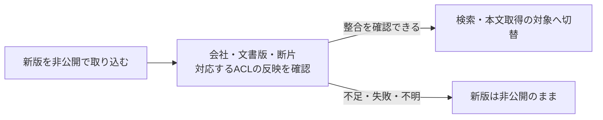
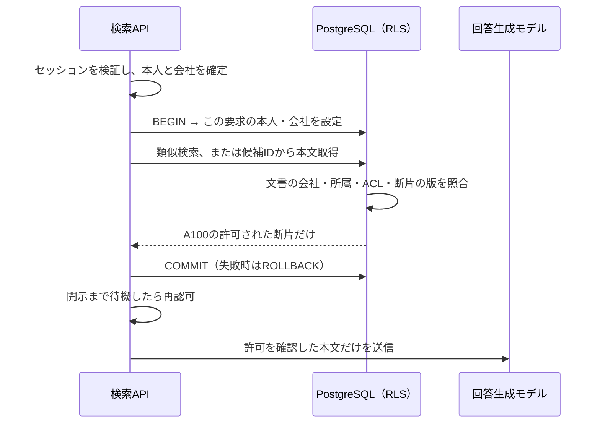

# RAGの検索認可を、DBと検索処理へ組み込む

[Pattern本文](README.md)の会社A・B、担当者A、文書A100・A200・B100をそのまま使う。
**実装する中心は、本人と文書の対応を管理データで照合し、検索・本文取得のどちらでも許可された行だけを返すこと。**
PostgreSQL 18＋pgvector v0.8.7による要点サンプルである。完成したDDLやサービスではなく、SQL・接続プール・製品連携の実行検証は未実施。

## アクセス制御方式を選ぶ

RLSは選択肢の一つ。まず、権限の管理元と、未認可の本文を止める場所を決める。
次の順序で決めると、製品を選ぶ前に必要な責務を整理できる。

1. **権限の管理元**：文書管理システム、自分のDB、外部認可サービスのどれを根拠にし、変更をどう反映するか。
2. **強制する場所**：検索と本文取得の両方で、誰が会社・文書権限を照合して開示を止めるか。
3. **格納先の分離**：会社ごとにIndex・DB・資格情報を分ける必要があるか。

以下は一つだけ選ぶ表ではなく、組み合わせる設計要素の比較である。
たとえば、元システムのACLをDBへ同期し、RLSで強制し、必要に応じて会社別DBに分ける。

| 方式 | 根拠情報と強制箇所 | 技術例・向く場面 | 実装時に残る確認 |
|---|---|---|---|
| アプリが検索条件を固定する | 検証済み本人と管理ACLから条件を作り、検索サービスで強制 | 固定SQL、Azure AI Searchのsecurity filter。管理しやすい権限構造 | 条件欠落・直接API・古いACL・キャッシュの迂回 |
| DB・検索エンジンで強制する | 信頼する本人属性・Roleと、保存した文書属性をエンジンが照合 | PostgreSQL RLS、OpenSearch DLS。複数の読取り経路に同じ制限を適用 | 広い共通サービスIdentity、管理Role、別ストア経由の迂回 |
| 外部認可サービスと検索を組み合わせる | 文書・利用者の関係から許可範囲を計算し、検索APIが結果に束縛 | OpenFGA／Auth0 FGA。グループ・フォルダー継承や複数アプリの権限を共通化 | 同期遅延、認可キャッシュ、ID列挙の量、障害時の停止 |
| 元システムの権限を利用する | 利用者の委任Identityで元システムへ検索を依頼、または検索製品が取り込んだACL／ラベルを評価 | Microsoft Graph Search、Azure AI Searchの組込み権限連携。既存の文書管理を生かす | 対応データ源・API・権限同期・preview制約・特権読取り経路 |
| テナント別に格納先とアクセス権を分ける | 検証済み所属から接続先を選び、資格情報でも到達先を限定 | 会社別Index／DB／専用サービス。会社境界で分離を強めたい場合 | Namespace名だけでは足りない。同じ会社内の文書ACLと運用・共有基盤も確認 |

選択の根拠・公開実装例・製品の制約は[方式の比較と多層防御](access-control-options.md)へ。
以下は、権限と文書を同じDBで管理する場合の具体例を詳しく説明する。

## 1. まず、文書・断片・権限をどう保存するか

Embeddingは類似度計算用の値であり、閲覧権限を表さない。権限は通常の管理テーブルで表す。

| テーブル | 最小限の情報 | 何を判定するか |
|---|---|---|
| `rag.memberships` | `tenant_id, user_id, active` | 本人が現在もその会社に所属するか |
| `rag.document_readers` | `tenant_id, document_id, user_id, active` | 本人がその文書を読めるか |
| `rag.documents` | `tenant_id, document_id, current_version, active, title` | 元文書の会社・現在版・公開状態 |
| `rag.chunks` | `tenant_id, document_id, document_version, chunk_id, body, embedding` | どの会社の、どの文書版を分割した本文か |

担当者Aのデータなら、有効な所属は`(会社A, staff-a)`、有効な閲覧許可は`(会社A, A100, staff-a)`。
A200への許可はなく、B100は会社が違う。そのため、どちらも検索対象にならない。

取り込み処理は、文書管理システムなどの信頼する管理元から会社・文書ID・権限を取得し、断片に元文書と版を結び付ける。
PDF本文やモデルが生成した「閲覧可能ユーザー一覧」をACLとして登録しない。
利用者・文書・断片のキーには会社IDを含め、認可に使うキーは`NOT NULL`とする。断片から元文書への複合外部キーを設け、取得時には現在版とも照合する。
外部キーが証明するのは関連先の存在であり、本文が本当にその文書由来かは取り込み処理の責任である。

部署・グループ権限は、まずこの「誰がどの文書を読めるか」へ展開すると理解しやすい。
実際の権限管理元に継承・明示的な拒否があるなら、その意味も維持して展開し、異動やグループ脱退を反映する。許可だけを集めて元の拒否を失わせない。
この例ではACLを文書に集約するため、権限取消のたびにEmbeddingを再生成する必要はない。

### 更新途中の本文を検索可能にしない

文書A100を「全担当者向けの旧版」から「管理者だけが読める新版」へ変更する場合、本文だけ先に切り替えると、新版を旧ACLで読めてしまう。
取り込みでは、次の公開手順を設ける。「公開」はインターネット公開ではなく、認可付き検索・本文取得の対象にする意味である。



同じDBで管理する本例なら、新版の断片を準備した後、対応するACLと`current_version`を一つのトランザクションで切り替える設計ができる。
検索Indexと権限管理元が別なら、検索APIと本文取得APIが共通して確認する公開状態・版の記録を設け、必要な反映が揃うまで新版を返さない。
これは本PJの設計例であり、既存のSQLサンプルに取り込み処理を実装したものではない。

旧版を残す場合も、最新の閲覧許可と失効期限を守る。新版の取り込み失敗を理由に、取り消された旧ACLへ戻さない。
公開時の確認だけで認可を終えず、検索時・本文取得時にも現在の権限を確認する。

## 2. 検索の条件漏れを、RLSでも止める

[本文の固定SQL](README.md#5-実装の要点許可された範囲で検索し同じ条件で本文を取る)は、検索クエリに会社・所属・文書ACLを置く実装例である。
それに加えて、**Row-Level Security（RLS）は、同じテーブルを読む別のSQLにもDB側で条件を適用する**。
本文取得APIに会社条件を書き忘れた場合にも境界を残せる。[PostgreSQL 18のRLS仕様](https://www.postgresql.org/docs/18/ddl-rowsecurity.html)



ここでの`rag_reader`は検索サービス専用のDBロール。テーブル所有者・スーパーユーザー・`BYPASSRLS`にせず、管理ロールへの切替権限も与えない。
管理用マイグレーションが以下のPolicyを作り、実行ロールには4テーブルの必要な読取りとスキーマの利用だけを許可する。
ACL更新・DDL・スキーマへの作成権限は与えず、既存のロール継承や`PUBLIC`経由の権限も確認する。
所属・ACLテーブルを読めるのは信頼する検索サービスであり、その生データを利用者やモデルへ公開しない。

<details>
<summary>文書の認可を断片にも適用するRLSの例</summary>

ID列は`text`型を想定。既存の4テーブルを使い、他の許可Policyはない構成で示す。

```sql
ALTER TABLE rag.documents ENABLE ROW LEVEL SECURITY;
ALTER TABLE rag.documents FORCE ROW LEVEL SECURITY;
ALTER TABLE rag.chunks ENABLE ROW LEVEL SECURITY;
ALTER TABLE rag.chunks FORCE ROW LEVEL SECURITY;

CREATE POLICY document_read ON rag.documents
FOR SELECT TO rag_reader
USING (
  tenant_id = NULLIF(current_setting('app.tenant_id', true), '')
  AND active = true
  AND EXISTS (
    SELECT 1 FROM rag.memberships AS m
    WHERE m.tenant_id = documents.tenant_id
      AND m.user_id = NULLIF(current_setting('app.user_id', true), '')
      AND m.active = true
  )
  AND EXISTS (
    SELECT 1 FROM rag.document_readers AS r
    WHERE r.tenant_id = documents.tenant_id
      AND r.document_id = documents.document_id
      AND r.user_id = NULLIF(current_setting('app.user_id', true), '')
      AND r.active = true
  )
);

CREATE POLICY chunk_read ON rag.chunks
FOR SELECT TO rag_reader
USING (
  EXISTS (
    -- documentsのRLSが先の文書認可を担う。
    SELECT 1 FROM rag.documents AS d
    WHERE d.tenant_id = chunks.tenant_id
      AND d.document_id = chunks.document_id
      AND d.current_version = chunks.document_version
  )
);
```

文書側にRLSを置くので、タイトルだけを読む経路も同じ許可条件になる。
断片側は、閲覧可能な文書の現在版に結び付く行だけを返す。本人・会社が未設定または空なら許可条件は成立しない。
Policy内の参照先にも実行ロールの読取り権限が必要で、不足時はエラーとして停止する。

RLSの通常の許可Policyを複数追加すると、適用される許可条件は原則ORで結合される。
後から「同じ会社なら可」という別Policyを足すと文書ACLを迂回し得るため、Policy全体をレビューする。
`FORCE ROW LEVEL SECURITY`でもスーパーユーザー・`BYPASSRLS`は対象外である。
ビューや権限昇格関数を経由する場合は、その実行権限も別途確認する。[CREATE POLICY](https://www.postgresql.org/docs/18/sql-createpolicy.html)

</details>

## 3. セッションの本人情報を、接続プールへ安全に渡す

DB接続は複数利用者で再利用される。接続全体に前の人のIDを残すと、次の要求がその人の権限で検索しかねない。
**一つの要求のDB処理を明示的なトランザクションで囲み、その間だけ本人・会社を設定する。**

```sql
BEGIN;

-- 別々のパラメータ付き呼出しとして実行する。
-- $1 / $2は、APIが検証した会社と本人。質問やモデルの指定値ではない。
SELECT set_config('app.tenant_id', $1, true),
       set_config('app.user_id', $2, true);

-- 次の呼出しの$1は、型・次元・サイズを検査した検索ベクトル。
-- RLSが上記の本人と会社に基づき、返してよい行を制限する。
SELECT document_id, chunk_id, document_version, body
FROM rag.chunks
ORDER BY embedding <=> $1::vector
LIMIT 5;

COMMIT;
```

`set_config`の第3引数`true`は、値の有効範囲を現在のトランザクションにする。
自動コミットで設定だけを終わらせず、設定と検索を同一接続・同一トランザクションで実行する。
例外時も必ず`ROLLBACK`し、未終了の接続をプールへ返さない。[設定関数](https://www.postgresql.org/docs/18/functions-admin.html#FUNCTIONS-ADMIN-SET)

トランザクション終了後はセッション側の値に戻るため、接続・ロールの既定値に利用者IDを入れず、要求処理で`SET SESSION`や`set_config(..., false)`を使わない。
毎回両方の値を設定し、設定できなければ検索前に終了する。本人・会社の未設定、正常終了、例外終了の次の要求を同じ接続で確認する。[SET LOCALの寿命](https://www.postgresql.org/docs/18/sql-set.html)

**この設定値は本人証明ではない。** `app.user_id`等はアプリが設定する値なので、任意SQLを実行できる相手は偽装し得る。
この方式が防ぐのは、信頼するサービス内の検索条件漏れである。DB資格情報や任意SQLツールをAgentへ渡さず、SQLは固定し、値をDBドライバーでバインドする。
サービス侵害にも耐える分離が必要なら、DBの接続主体や会社別ストアを分ける設計を追加する。[PostgreSQLのカスタム設定](https://www.postgresql.org/docs/18/runtime-config-custom.html)

資格情報は秘密管理から取得し、例へ埋め込まない。リモートDB接続は証明書・ホスト名を検証するTLSで保護する。
モデルの応答待ちの間までDBトランザクションを保持せず、開示前の権限確認は[本文の失効契約](README.md#6-キャッシュと権限変更をどう扱うか)に従う。

## 4. 検索後に、別の文書を足す経路も確認する

| 処理 | 具体的に維持すること |
|---|---|
| ベクトル検索＋キーワード検索（Hybrid） | 両方の検索経路で同じ本人・会社・文書ACLを強制してから結果を統合する。片方だけのフィルターでは足りない |
| 小さな断片から前後の段落・元文書を追加 | 元のヒットに許可があっても、新しく読む各行の会社・文書・版を確認する。別文書や別ACLの段落を自動で足さない |
| 外部再ランキング | 許可された本文だけを送る。関連度を並べ替えるサービスに認可を任せない |
| 候補IDキャッシュ・引用先API | IDだけで取得せず、同じRLS付き本文取得を使う。キャッシュ内の版と現在版が異なるなら再検索する |

RLSを使う構成でも、別の検索エンジンや本文ストレージを読めばDBのPolicyは引き継がれない。
経路ごとに強制箇所を置く。元文書内でも段落ごとにACLが異なる製品では、この文書単位のモデルを細分化する必要がある。

pgvectorの近似検索では、フィルターにより5件未満になる場合がある。検索品質の調整と認可は分け、件数不足を理由にPolicyを外さない。
実際のRole・Policy・データ量で検索計画と性能を確認する。[pgvector v0.8.7 Filtering](https://github.com/pgvector/pgvector/blob/v0.8.7/README.md#filtering)

### 外部検索エンジンで実装する場合

Azure AI Searchのsecurity filter方式なら、管理元から得た閲覧主体をインデックスの属性に保存し、信頼する検索APIが`search.in`等の条件を付ける。
本人確認はアプリの責任であり、フィルターに書いたID自体が認証されるわけではない。
クライアントから検索基盤を直接呼べる構成にせず、会社・ACL条件の欠落を拒否し、権限同期の期限を監視する。[公式のsecurity filter方式](https://learn.microsoft.com/en-us/azure/search/search-security-trimming-for-azure-search)

ベクトル検索の`preFilter`は探索中にフィルターを適用する選択肢である。検索内部の`postFilter`と、未認可本文をモデルへ送った後に回答を隠す処理を混同しない。
方式を選んでも、条件の正しさと全経路への適用は必要である。[Azureのベクトル検索フィルター](https://learn.microsoft.com/en-us/azure/search/vector-search-filters)

アプリが条件を付ける方式と、製品自身が本人・Roleから条件を強制する方式は別である。
[外部認可サービスとの連携](access-control-options.md#2-認可サービスを検索と組み合わせる)と[OpenSearch DLS・Azureの組込み権限連携の違い](access-control-options.md#3-製品が認可を強制する場合の違い)を参照する。

## 5. 実装レビューでの依頼例

> 「会社Aの担当者で、A200とB100をID指定でも取得できないことを、管理者ではなく実際の検索用DBロールで見せてください。文書と断片の両テーブルで確認したいです。」

> 「同じDB接続を会社A、会社Bの順に使ってください。A側の正常終了と例外終了の両方で、次の要求にIDが残らないこと、本人情報の設定漏れでは文書を返さないことを確認したいです。」

> 「ベクトル検索、キーワード検索、前後の段落取得をそれぞれ見せてください。新しい本文を加える箇所で、どの情報を使って閲覧許可を確認していますか。」

> 「A100の新版を管理者限定に変更し、ACLの反映だけを失敗させてください。新版が旧ACLで検索・直接取得されないことと、復旧後に管理者だけが読めることを確認したいです。」

確認項目は[チェックシートのN4・N10・N14〜N16・N19](negative-tests.md#negative-test)に対応する。該当技術を使わない行は、代わりの強制箇所とともに対象外理由を記録する。

## 参照状態と変更履歴

2026-10-23にリンク先の一次資料を確認。PostgreSQLは18版、pgvectorはv0.8.7タグ、Azureは更新型資料。
本書のSQL例はAzureの組込みACL機能やpreview機能を使用しない。それらは[方式比較](access-control-options.md)で制約を明示して扱う。
テーブル設計、RLSの組合せ、処理例は本PJの設計例であり、上流の完成済みRAG実装の転載ではない。

| 日付 | 変更 |
|---|---|
| 2026-10-23 | 文書ACL・断片の関係、RLS、接続プール、検索後の追加取得を具体化。実行検証は未実施 |
| 2026-10-23 | アクセス制御の選択肢と、一次資料に基づく方式比較・多層防御への案内を追加 |
| 2026-10-23 | 方式を選ぶ順序と、文書・断片・ACLの整合を確認してから新版を公開する手順を追補 |
