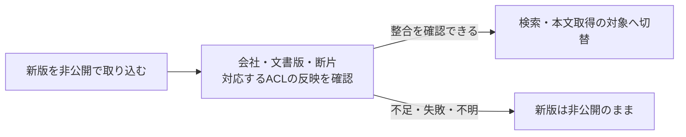

# RAGの検索認可を実装する：PostgreSQLで①〜⑤を追う

[Pattern本文](README.md#3-質問から回答まで5か所で確かめる)の担当者A・会社A・文書A100を、そのままDBとAPIへ落とし込む。
**APIが本人を確定し、DBが会社・文書権限を照合し、アプリが送信と回答を制御する。**

PostgreSQL 18＋pgvector v0.8.7による要点サンプル。DDL一式や完成したサービスではなく、実行検証は未実施。

## 準備：照合に使うデータ

Embeddingは類似度計算用の値であり、閲覧権限を表さない。権限は通常の管理テーブルで表す。

| テーブル | 最小限の情報 | 何を判定するか |
|---|---|---|
| `rag.memberships` | `tenant_id, user_id, active` | 本人が現在もその会社に所属するか |
| `rag.document_readers` | `tenant_id, document_id, user_id, active` | 本人がその文書を読めるか |
| `rag.documents` | `tenant_id, document_id, current_version, active, title` | 元文書の会社・現在版・公開状態 |
| `rag.chunks` | `tenant_id, document_id, document_version, chunk_id, body, embedding` | どの会社の、どの文書版を分割した本文か |

担当者Aのデータなら、有効な所属は`(会社A, staff-a)`、有効な閲覧許可は`(会社A, A100, staff-a)`。
A200への許可はなく、B100は会社が違う。そのため、どちらも検索対象にならない。

取り込み処理は、文書管理システムなどの信頼する管理元から会社・文書ID・権限を取得し、断片に元文書と版を結び付ける。
PDF本文やモデルが生成した「閲覧可能ユーザー一覧」をACLとして登録しない。
利用者・文書・断片のキーには会社IDを含め、認可に使うキーは`NOT NULL`とする。断片から元文書への複合外部キーを設け、取得時には現在版とも照合する。
外部キーが証明するのは関連先の存在であり、本文が本当にその文書由来かは取り込み処理の責任である。

部署・グループ権限は、まずこの「誰がどの文書を読めるか」へ展開すると理解しやすい。
実際の権限管理元に継承・明示的な拒否があるなら、その意味も維持して展開し、異動やグループ脱退を反映する。許可だけを集めて元の拒否を失わせない。
この例ではACLを文書に集約するため、権限取消のたびにEmbeddingを再生成する必要はない。

新版の取り込みは[後半の公開手順](#更新途中の本文を検索可能にしない)で扱う。ここからは文書・断片・ACLが揃った状態で、一件の質問を処理する。

## ① APIで本人・会社を確定する

APIがセッションを検証し、現在の有効性と会社への所属を確認する。
この結果の会社ID・本人IDをDBへ渡す。質問やモデル出力で置き換えない。

この例では、検索サービス専用のDBロール`rag_reader`を使う。
テーブル所有者・スーパーユーザー・`BYPASSRLS`にせず、管理ロールへの切替権限も与えない。
必要な4テーブルの読取りとスキーマ利用だけを許可し、ACL更新・DDL・スキーマへの作成を禁止する。ロール継承と`PUBLIC`経由の権限も確認する。
所属・ACLの生データを読めるのは信頼するサービスであり、利用者やモデルへ公開しない。

**DBへ渡したIDは、DB自身が本人確認した証拠ではない。** 任意SQLを実行できる相手は設定値を偽装し得る。
この方式は信頼するサービス内の条件漏れを防ぐもので、AgentへDB資格情報や任意SQLツールを渡さない。[カスタム設定の仕様](https://www.postgresql.org/docs/18/runtime-config-custom.html)

## ② 会社・ACLを条件に検索する

**RLS（Row-Level Security）は、DBが各SQLへ閲覧条件を適用する仕組み**である。
管理用の処理で文書と断片に設定しておくと、検索や直接取得のSQLが条件を書き忘れても、DBが行を制限する。[PostgreSQL 18のRLS仕様](https://www.postgresql.org/docs/18/ddl-rowsecurity.html)

| 対象 | DBが照合すること | 担当者Aの結果 |
|---|---|---|
| 文書 | 会社の一致、有効な所属、文書への閲覧許可、公開状態 | A100のみ許可。A200・B100は除外 |
| 断片 | 閲覧可能な文書に属し、その現在版に一致すること | A100の現在版の断片のみ許可 |

<details>
<summary>配備時に設定するRLSのSQL</summary>

ID列は`text`型を想定。既存の4テーブルを使い、他の許可Policyはない構成で示す。

```sql
ALTER TABLE rag.documents ENABLE ROW LEVEL SECURITY;
ALTER TABLE rag.documents FORCE ROW LEVEL SECURITY;
ALTER TABLE rag.chunks ENABLE ROW LEVEL SECURITY;
ALTER TABLE rag.chunks FORCE ROW LEVEL SECURITY;

CREATE POLICY document_read ON rag.documents
FOR SELECT TO rag_reader
USING (
  tenant_id = NULLIF(current_setting('app.tenant_id', true), '')
  AND active = true
  AND EXISTS (
    SELECT 1 FROM rag.memberships AS m
    WHERE m.tenant_id = documents.tenant_id
      AND m.user_id = NULLIF(current_setting('app.user_id', true), '')
      AND m.active = true
  )
  AND EXISTS (
    SELECT 1 FROM rag.document_readers AS r
    WHERE r.tenant_id = documents.tenant_id
      AND r.document_id = documents.document_id
      AND r.user_id = NULLIF(current_setting('app.user_id', true), '')
      AND r.active = true
  )
);

CREATE POLICY chunk_read ON rag.chunks
FOR SELECT TO rag_reader
USING (
  EXISTS (
    -- documentsのRLSが先の文書認可を担う。
    SELECT 1 FROM rag.documents AS d
    WHERE d.tenant_id = chunks.tenant_id
      AND d.document_id = chunks.document_id
      AND d.current_version = chunks.document_version
  )
);
```

文書側にRLSを置くので、タイトルだけを読む経路も同じ許可条件になる。
断片側は、閲覧可能な文書の現在版に結び付く行だけを返す。本人・会社が未設定または空なら許可条件は成立しない。
Policy内の参照先にも実行ロールの読取り権限が必要で、不足時はエラーとして停止する。

RLSの通常の許可Policyを複数追加すると、適用される許可条件は原則ORで結合される。
後から「同じ会社なら可」という別Policyを足すと文書ACLを迂回し得るため、Policy全体をレビューする。
`FORCE ROW LEVEL SECURITY`でもスーパーユーザー・`BYPASSRLS`は対象外である。
ビューや権限昇格関数を経由する場合は、その実行権限も別途確認する。[CREATE POLICY](https://www.postgresql.org/docs/18/sql-createpolicy.html)

</details>

実行時は、質問から検索ベクトルを作り、同じ接続・同じトランザクションで本人情報の設定と検索を行う。
外部Embeddingを使うなら、[質問の送信先確認](access-control-options.md#embedding生成も本文質問の送信先を確認する)を先に行う。ベクトルの型・次元・数値・サイズも検査する。
以下のSQLはDBドライバーのパラメータを使い、文字列連結で組み立てない。

```sql
BEGIN;

-- 別々のパラメータ付き呼出しとして実行する。
-- $1 / $2は、APIが検証した会社と本人。質問やモデルの指定値ではない。
SELECT set_config('app.tenant_id', $1, true),
       set_config('app.user_id', $2, true);

-- 次の呼出しの$1は、型・次元・サイズを検査した検索ベクトル。
-- RLSが上記の本人と会社に基づき、返してよい行を制限する。
SELECT document_id, chunk_id, document_version, body
FROM rag.chunks
ORDER BY embedding <=> $1::vector
LIMIT 5;

COMMIT;
```

ここでは②の候補検索と③の本文取得を一つのクエリにまとめている。RLSが許可した断片だけが`body`として返る。

### 接続プールで前の利用者の権限を残さない

`set_config`の第3引数`true`は、値の有効範囲を現在のトランザクションにする。
自動コミットで設定だけを終わらせず、設定と検索を同一接続・同一トランザクションで実行する。
例外時も必ず`ROLLBACK`し、未終了の接続をプールへ返さない。[設定関数](https://www.postgresql.org/docs/18/functions-admin.html#FUNCTIONS-ADMIN-SET)

トランザクション終了後はセッション側の値に戻るため、接続・ロールの既定値に利用者IDを入れず、要求処理で`SET SESSION`や`set_config(..., false)`を使わない。
毎回両方の値を設定し、設定できなければ検索前に終了する。本人・会社の未設定、正常終了、例外終了の次の要求を同じ接続で確認する。[SET LOCALの寿命](https://www.postgresql.org/docs/18/sql-set.html)

資格情報は秘密管理から取得し、例へ埋め込まない。リモートDB接続は証明書・ホスト名を検証するTLSで保護する。
モデルの応答待ちの間までDBトランザクションを保持しない。開示前の再確認は④で行う。

> 「会社Aと会社Bの要求で同じ接続を順番に使ってください。正常終了・例外終了の後に本人情報の設定を省略しても、前の要求の権限で読めないことを見たいです。」（P5・N14）

## ③ 本文を追加取得するときも照合する

検索結果から元文書を開く、前後の段落を足す、キャッシュ内のIDを読む場合も、同じRLS付き本文取得を通す。
IDを知っていることを閲覧許可とみなさない。現在版が変わったら、古い候補から本文を取らず再検索する。

| 処理 | 具体的に維持すること |
|---|---|
| ベクトル検索＋キーワード検索（Hybrid） | 両方の検索経路で同じ本人・会社・文書ACLを強制してから結果を統合する。片方だけのフィルターでは足りない |
| 小さな断片から前後の段落・元文書を追加 | 元のヒットに許可があっても、新しく読む各行の会社・文書・版を確認する。別文書や別ACLの段落を自動で足さない |
| 外部再ランキング | 許可された本文だけを送る。関連度を並べ替えるサービスに認可を任せない |
| 候補IDキャッシュ・引用先API | IDだけで取得せず、同じRLS付き本文取得を使う。キャッシュ内の版と現在版が異なるなら再検索する |

RLSを使う構成でも、別の検索エンジンや本文ストレージを読めばDBのPolicyは引き継がれない。
経路ごとに強制箇所を置く。元文書内でも段落ごとにACLが異なる製品では、この文書単位のモデルを細分化する必要がある。

pgvectorの近似検索では、フィルターにより5件未満になる場合がある。検索品質の調整と認可は分け、件数不足を理由にPolicyを外さない。
実際のRole・Policy・データ量で検索計画と性能を確認する。[pgvector v0.8.7 Filtering](https://github.com/pgvector/pgvector/blob/v0.8.7/README.md#filtering)

> 「実際の検索用DBロールで、A200とB100を検索・ID指定取得してください。別の検索経路や段落追加でも、どこで認可が効くかを見せてください。」（N2〜N4・N10・N16）

## ④ アプリで送信先と権限の有効性を確認する

DBからA100の本文が返った後、アプリがモデルへ送ってよいデータと送信先を確認する。
外部再ランキングにも同じ確認を適用し、DBトランザクションはモデルの応答を待つ前に終了する。
待機・キューを挟んだ要求は[失効の約束](README.md#6-キャッシュと権限変更をどう扱うか)に従って再認可し、判断不能なら送信しない。

## ⑤ 回答・引用を担当者Aへ返す

アプリは、モデルへ渡した文書ID・版を保持しておき、回答返却前にすべての文書の権限が有効かを確認する。
失効していたら回答全体を破棄する。引用は許可した文書一覧から作り、クリック時も①と③を通す。
要求IDと文書・権限判断・送信先・結果を対応付けて記録する。[記録と障害対応](README.md#8-記録検知障害対応)

これで、担当者Aの一件の要求を、セッションからA100の回答・引用まで追える。
[チェックシート](negative-tests.md)で正常系と拒否条件を対にして確認する。下記は取り込み担当や、別の構成を検討するときの補足である。

## 補足：文書を用意するとき

### 更新途中の本文を検索可能にしない

文書A100を「全担当者向けの旧版」から「管理者だけが読める新版」へ変更する場合、本文だけ先に切り替えると、新版を旧ACLで読めてしまう。
取り込みでは、次の公開手順を設ける。「公開」はインターネット公開ではなく、認可付き検索・本文取得の対象にする意味である。



同じDBで管理する本例なら、新版の断片を準備した後、対応するACLと`current_version`を一つのトランザクションで切り替える設計ができる。
検索Indexと権限管理元が別なら、検索APIと本文取得APIが共通して確認する公開状態・版の記録を設け、必要な反映が揃うまで新版を返さない。
これは本PJの設計例であり、既存のSQLサンプルに取り込み処理を実装したものではない。

旧版を残す場合も、最新の閲覧許可と失効期限を守る。新版の取り込み失敗を理由に、取り消された旧ACLへ戻さない。
公開時の確認だけで認可を終えず、検索時・本文取得時にも現在の権限を確認する。

> 「A100の新版を管理者限定に変更し、ACLの反映だけを失敗させてください。新版が旧ACLで検索・直接取得されないことと、復旧後に管理者だけが読めることを確認したいです。」（P7・N19）

## 補足：SQLの条件を明示して読む

RLSへまとめた照合内容を、通常のクエリの`WHERE`として読む場合の参考。
この例の実行経路は上の①〜⑤であり、次のSQLを別の未認可取得経路として追加するものではない。

<details>
<summary>会社・所属・文書ACLをクエリに書く例</summary>

以下は認可条件を読むための要点サンプルで、スキーマ一式や実行検証済みコードではない。
`memberships`は現在の会社所属、`document_readers`は利用者単位の現在の閲覧許可を管理する例である。
部署やグループから権限を展開する場合は、その変更もこの管理データへ反映する。

```sql
SELECT c.document_id, c.chunk_id, c.document_version, c.body
FROM chunks AS c
JOIN documents AS d
  ON d.tenant_id = c.tenant_id AND d.document_id = c.document_id
 AND d.current_version = c.document_version
WHERE d.tenant_id = $1
  AND d.active = true
  AND EXISTS (
    SELECT 1 FROM memberships AS m
    WHERE m.tenant_id = d.tenant_id AND m.user_id = $2
      AND m.active = true
  )
  AND EXISTS (
    SELECT 1 FROM document_readers AS r
    WHERE r.tenant_id = d.tenant_id AND r.document_id = d.document_id
      AND r.user_id = $2 AND r.active = true
  )
ORDER BY c.embedding <=> $3::vector
LIMIT 5;
```

`$1`はサーバーが確定した会社、`$2`は検証済み本人、`$3`は質問から作る検索ベクトル。
DBドライバーのパラメータとして渡し、文字列連結でSQLを組み立てない。ベクトルの次元・数値・サイズも検査する。
パラメータ化だけで認可になるわけではなく、値の取得元と上の照合条件が必要である。
キャッシュの候補を使う場合も、同じ照合に文書・断片IDと版の絞り込みを加える。IDだけで本文を取り出す別経路を作らない。

文書と断片の会社・ID・版の対応には複合キーや外部キー等を設ける。権限不明・関連付け不明を公開扱いにしない。
検索用DBロールには必要な読取りだけを許可し、ACL更新・取り込み・管理用ロールを分ける。
このSQLは信頼する検索サービスで実行する。Agentへ接続情報や任意SQL実行ツールを渡さない。
資格情報は既存の秘密管理から渡し、サーバー間通信は証明書を検証するTLS等で保護する。秘密値はサンプルへ埋め込まない。

</details>

## 別の構成を選ぶ場合

文書管理元へ検索を委任する、外部認可サービスを使う、会社別DBへ分ける場合は[構成の選び方](access-control-options.md)へ。
そこでは「何を根拠に判断するか」「どこで強制するか」「何を分離するか」を分けて比較する。

## 参照状態と変更履歴

2026-10-23に確認した一次資料を参照。PostgreSQLは18版、pgvectorはv0.8.7タグ。
テーブル設計と処理の組合せは本PJの設計例であり、実行検証は未実施。
製品ごとの比較と成熟度は[構成の選び方](access-control-options.md#参照状態確認範囲)で確認できる。

| 日付 | 変更 |
|---|---|
| 2026-10-23 | 文書ACL・断片、RLS、接続プール、検索後の追加取得を具体化 |
| 2026-10-23 | 認可方式の選択肢と、取り込み途中の公開防止を追補 |
| 2026-10-23 | 本文と同じ①〜⑤に並べ替え、配備用SQL・取り込み・方式比較を補足へ分離 |
