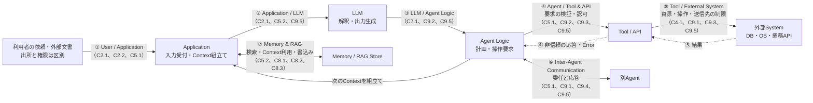

# Agentic Systemの7つの接点から信頼境界を点検する

この文書はユーザ提供メモの編集版である。構成と問題意識を引き継ぎ、対話での技術レビューを反映した。
未編集の原文全文は別保存していない。本文の設計判断・図・検証例はRepositoryの解釈であり、
外部Frameworkの要件、正式なMapping、製品の適合証拠ではない。

**非信頼情報を受け取ること自体より、その情報をどの判断に使い、どの権限を行使できるようにするかを確認する。**

## この整理の使い方

7項目は、具体的なSystemの信頼境界を探すための接点一覧である。
OWASP Top 10 for Agentic Applications 2026が、この7分類を公式に定義したとは確認できていない。
実際の構成では境界が重なる、存在しない、さらに細分化される場合があり、網羅性は主張しない。

図でComponentを分けても、相手の出力を無条件に実行するなら防御は成立しない。同一Process内でも、
認可の判断根拠と非信頼Dataの間に分離が必要になる。ただし同一Processの侵害まで想定する場合、
論理的な分離だけでなく実行権限・隔離の強度も評価する。
各接点で「誰が制御できる情報か」「どの判断・操作へ影響するか」「何を根拠に、どこで強制するか」を記録する。



番号は境界の識別用であり、実行順序ではない。図は単純化した構成例で、Memoryへの書込みもApplication経由とした。
Agentが直接書く構成では、その経路にも⑦の判断を置く。破線は結果の戻りであり、信頼済みを意味しない。
②ではContextのモデル提供先への開示も評価する。④と⑤の強制点を迂回する直接呼出しや共有Queueも点検する。

## 1. ユーザ／アプリケーション境界（C2.1、C2.2、C5.1）

- **役割**：利用者の依頼、メール、公開文書、Webページ、カレンダー等を受け付ける。認証済み利用者の依頼と、その人が持ち込む外部文書の内容は区別する。
- **脅威**：直接・間接のPrompt Injection、入力元の偽装、処理量の増大。認証済み経路でもContentは敵対的になり得る。
- **影響**：文書中の指示を利用者の依頼として扱うと、以後の計画や操作が攻撃者の目的へ誘導される。
- **強制点と対策**：受付処理で本人・Tenant・依頼の範囲を確定し、取得Contentには出所と用途を保持する。長さ・形式・処理量を制限し、外部Dataから権限や承認状態を生成させない。
- **限界**：検査用の正規化、Contentスキャン、キーワード検出は補助策である。検査後に実際に利用するPayloadとのずれを点検し、意味のある本文を不用意に改変しない。検出漏れを前提に、後段でも操作を制限する。

## 2. アプリケーション／LLM境界（C2.1、C5.2、C9.5）

- **役割**：System指示、利用者の依頼、取得Dataをモデルへ渡し、解釈・生成を依頼する。
- **脅威**：Data中の指示による目標誘導、秘密情報のContextへの混入、モデル提供先への過剰な開示。
- **影響**：不正な回答・操作候補の生成や情報流出。指示に従わなくなることは、保存済みSystem Promptのファイル自体が改ざんされたこととは異なる。
- **強制点と対策**：Context組立て処理で必要な情報だけを選び、秘密のCredentialを除外し、送信先の利用・保存条件と開示可能範囲を確認する。指示とDataを区別して渡し、操作の認可はモデル外で行う。
- **限界**：Role、Delimiter、ロールプレイ抑制指示は、資源へのアクセス制御ではない。モデルが指示の優先順位を常に守ることを安全性の前提にしない。

## 3. LLM／エージェントロジック境界（C7.1、C9.2、C9.5）

- **役割**：モデルが生成した計画・構造化出力・Tool呼出し候補をApplicationで扱う。
- **脅威**：説得力のある出力の盲信、正しい形式に収まった不正な引数、計画変更による承認の迂回。
- **影響**：誤った対象・宛先・操作が実行候補として採用される。
- **強制点と対策**：受渡し時にSchema・値域・許可操作を検証する。実行側は信頼された本人・Task・Policyを根拠に、具体的な対象と引数を独立に認可する。計画変更で対象や影響が変われば必要な承認も取り直す。
- **限界**：Schema適合は値の正当性や権限を保証しない。内部Chain-of-Thoughtを取得・判定する前提にはせず、観測可能な操作要求、認可判断、実行結果を検証する。出力された理由説明も認可の根拠にはしない。

## 4. エージェント／ツール・API境界（C5.1、C9.2、C9.3、C9.5）

- **役割**：Agentの操作要求を、MCP Server、業務API等へ渡す。
- **脅威**：Tool悪用、過大権限、偽Toolや定義変更、利用者の権限を超える代理実行。
- **影響**：正規Credentialを使った不正操作、秘密の漏えい、別Tenantへのアクセス。Credentialの窃取や権限昇格がなくても成立する。
- **強制点と対策**：実行ComponentでToolの実体・許可版を確認し、利用者・Task・対象資源・操作・引数を認可する。Credentialは接続処理に保持し、用途・Audience・寿命・権限を限定する。高影響操作では、実際の対象・引数・内容に結び付いた有効な承認を実行直前に確認する。
- **限界**：専用ID、Tool名の許可リスト、短命Tokenだけでは細粒度の認可にならない。Toolの導入・更新確認と、呼出しごとの認可は別である。認証済みToolの応答も①〜③へ戻る非信頼Dataとして扱う。

## 5. ツール／外部システム境界（C4.1、C9.1、C9.3、C9.5）

- **役割**：ToolがDB、Cloud資源、Filesystem、OS、外部送信先へ作用する。
- **脅威**：任意Command実行、過剰な読み書き、不正な宛先への送信、認可Gatewayを迂回した直接アクセス。
- **影響**：破壊、変更、秘密の読取り・流出、可用性や費用への損害。
- **強制点と対策**：任意Shellより限定された業務APIを選ぶ。Tool実装と下流資源側で、型付き引数・Parameterization・対象資源・送信先・実行量を制限する。隔離はCredential、Mount、Network、実行権限まで含めて設計する。
- **限界**：コンテナ化だけでは十分なSandboxとは限らず、読取り専用でも流出する。監査・異常通信検知は予防制御の代替ではない。下流へ渡したJobはAgent停止後にも続き得るため、取消・停止の意味を確認する。

## 6. エージェント間通信境界（C5.1、C9.1、C9.4、C9.5）

- **役割**：Task、委任された権限、結果を別Agentへ受け渡す。
- **脅威**：なりすまし、Replay、正規Agentからの権限外委任、応答による操作誘導、再帰的な障害伝播。
- **影響**：受信側の広い権限を使った代理実行、誤情報や過剰な作業の拡散。
- **強制点と対策**：通信の認証・完全性・必要な機密性を確保する。受信側で委任元・委任先・Task・Scope・有効期限を検証し、権限を増幅させない。状態変更要求のReplayを制御し、再委任・再試行・全体予算・停止を制限する。
- **限界**：署名や暗号化は、送信者の判断の正しさを保証しない。認証済みAgentでも侵害・誤動作を想定する。応答は本人からの新しい承認として扱わない。

## 7. 記憶・RAGデータベース境界（C5.2、C8.1、C8.2、C8.3）

- **役割**：文書、Vector Index、長期Memoryを保存・検索し、後のContextで利用する。
- **脅威**：汚染Dataの書込み、要約による出所の消失、他Tenantの検索結果混入、失効した情報の再利用。
- **影響**：誤った内容や命令が後のSessionへ持ち越され、繰り返し操作を誘導する。
- **強制点と対策**：保存処理で書込み権限と出所を確認し、保存・利用状態への昇格・検索時の開示認可を分ける。Tenant・利用者・目的を検索とContext組立て時にも検証する。派生要約やCacheへ出所・制約を引き継ぎ、汚染発覚時は関連Stateを利用停止し、修正・削除・復旧を行う。
- **限界**：ウイルススキャンは意味的な誘導を網羅しない。署名は出所・完全性、暗号化は機密性等を支えるが、内容の安全性とは別である。TTLは残存期間を短くするだけで、失効済みDataの即時排除や派生物の除去を保証しない。

## 境界を跨ぐ攻撃と設計判断

例として、Agentが資料を検索し、担当者に代わって外部へ要約を送る構成を考える。

```text
攻撃者が編集できる文書を検索Toolで正規に取得
  → 文書内の送信指示が、次のContextで操作の根拠になる
  → モデルが許可済み送信Toolへの要求を生成
  → 送信処理が宛先・開示内容を確認しない
  → 正規Credentialで機密情報を流出させる
```

検索と認証が正常でも、権限の使い方を誤れば失敗する。⑦から②・③・④・⑤へ進む場合もあり、
①を必ず経由するわけではない。文書を受信しただけで境界が破られたとは言わず、
非信頼Dataを操作根拠として扱った場所と、拒否すべき操作を通した場所を特定する。

最初に、送信まで自動化する必要があるかを判断する。調査・下書きだけで足りれば、Agentの送信能力と
送信用Credentialへの経路を除く。人が送る場合も、下書きを信じて機密を送る危険は残る。
送信先の業務上の根拠と、渡してよい情報を独立に確認する。
自動送信が必要なら、許可された宛先と開示項目に限定した処理を選び、自由文の完全な安全判定を前提にしない。

このRepositoryでは、提供メモの3原則を次のように具体化する。OWASPの公式な三原則という帰属はしない。

1. **入力の出所と利用範囲を保つ**：検査を通っても、外部Dataを本人の依頼やPolicyへ昇格させない。
2. **出力を利用先で検証・認可する**：形式だけでなく、操作・対象・宛先・内容を確認し、開示や副作用の前に強制する。
3. **不要な能力を除き、残る能力を制限・観測する**：権限、実行量、承認、停止・復旧を設計する。

## 7接点だけでは見落としやすいもの

- **人への表示と承認**：Agentが直接実行しなくても、人を説得して危険な操作を承認させ得る。モデルの説明だけでなく、実際の宛先・対象・内容・影響を安全な画面で示し、承認後の変更には再確認を求める。
- **設定・Skill・Tool定義の更新**：導入時の審査後も能力が変わり得る。変更権限、出所、差分、適用版を管理し、実効権限を再評価する。
- **停止・失効・復旧**：親Agentを止めるだけでなく、子Agent、下流Job、資格、汚染Memoryと派生物を扱う。停止後に残る副作用と復旧条件を定める。
- **観測情報の保護**：操作・認可・委任・拒否・実行結果を相関できる記録を残す一方、秘密や不要な全文をLogに複製しない。

## 正常系・Negative Testの確認例

許可された試験環境と模擬Dataを使い、対象版・Policy・経路を固定する。以下は検証計画であり、製品試験は未実施。
モデルが偶然拒否した結果だけで合格にしない。必要に応じ、同じ実行境界へ不正な操作要求を直接投入する。

| ケース | 操作・条件 | 期待結果 | 確認する証拠 | 結果 |
|---|---|---|---|---|
| 許可された処理 | 正規の依頼と委任範囲で、承認済みの内容を許可宛先へ送る | 必要な承認・認可を経て送信できる | 本人・Task・Policy版・承認対象・実送信結果 | 未実施 |
| Schema適合の不正要求 | 正しい形式で、依頼に含まれない宛先への送信を要求 | 実行側で拒否し、送信しない | 拒否理由と送信先側の受信記録、別経路の副作用 | 未実施 |
| 署名済み汚染Memory | 正規署名のMemoryに外部送信を促す内容を保存し、後続Sessionで利用 | 署名を操作許可にせず不正送信を阻止。汚染判明後は元Dataと派生要約の利用を止める | 認可判断、出所・派生関係、利用停止後の検索・Context | 未実施 |
| 認証済みAgentの権限外委任 | 正規のAgentが委任範囲外の削除を別Agentへ要求 | 受信側で拒否し、下流削除しない | 委任Scope、拒否、対象資源の状態 | 未実施 |
| 承認後の差替え | 承認した宛先・本文を実行前に変更する | 変更前の承認で実行せず、再承認を要求 | 承認対象と実要求の比較、未送信の確認 | 未実施 |

## 出典・確認範囲と編集記録

確認日：2026-10-27。一次資料は補助的な技術参照であり、そのコード例やMappingを自動採用していない。

| 一次資料・状態 | 確認箇所と本書での扱い |
|---|---|
| [OWASP Top 10 for Agentic Applications 2026 紹介](https://genai.owasp.org/resource/owasp-top-10-for-agentic-applications-for-2026/)・[本文](https://genai.owasp.org/download/52117/?tmstv=1765059207) | 公開日は2025-12-09、本文はVersion 2026。Repository登録状態はstableなRisk taxonomy。本文の「Agentic Top 10 At A Glance」、ASI01、ASI06、ASI07、ASI09を参照。ASI09はHuman-Agent Trust Exploitationであり、モデル出力の盲信全般とは区別する。この7分類・三原則の公式定義は確認できていない。 |
| [LLM Prompt Injection Prevention Cheat Sheet](https://cheatsheetseries.owasp.org/cheatsheets/LLM_Prompt_Injection_Prevention_Cheat_Sheet.html) | 版を固定していない更新型Web資料。Input Validation and Sanitization、Structured Prompts with Clear Separation、Secure Implementation Pipelineを参照。検出・Promptの限界と、利用先での強制を考える補助資料。 |
| [AI Agent Security Cheat Sheet](https://cheatsheetseries.owasp.org/cheatsheets/AI_Agent_Security_Cheat_Sheet.html) | 版を固定していない更新型Web資料。Tool Authorization Middleware、High-Impact Action Integrity Controlsを参照。実行側での認可と操作に結び付く承認の補助資料。 |

Frameworkの採用状態は[Source Registry](../registry.yaml)を参照する。本書は版の更新採用ではない。
「7接点の評価」「強制点の整理」「攻撃経路と検証例」は対話に基づくRepositoryの技術判断であり、上流の引用ではない。

| 編集日 | 主な補正 |
|---|---|
| 2026-10-27 | 公式分類という未確認の帰属を外し、7接点の図を追加。認可と形式検証、認証・完全性と内容の安全性を分離。固定的な攻撃順序と権限奪取の前提を修正し、人への出力・変更・停止・復旧・検証例を追加。会話用の末尾質問を削除。 |

## Repositoryでの利用先

- [Capability FlowのInsight](../../docs/insights/web-security-to-agent-capability-flow.md)：非信頼情報から権限行使への経路をレビューする方法。
- [信頼昇格のInsight](../../docs/insights/trust-is-granted-at-promotion.md)：保存、判断材料への採用、利用時の認可を区別する。
- [Engineering共通設計原則](../../engineering/docs/security-principles.md)：能力の除去と、残る境界での検証・強制を設計する。
- [C9 Family概要](../../controls/control-records/c09-orchestration-and-agentic-security/README.md)・[C9学習ガイド](../../controls/learning/c09-orchestration-and-agentic-security/README.md)：行動・承認・隔離・委任の保証を組み合わせて読む。
